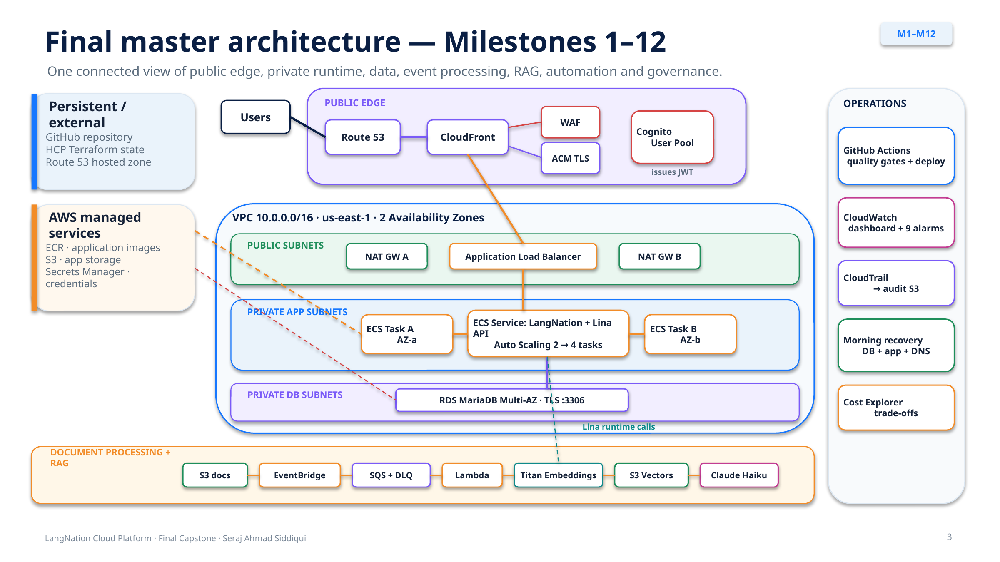

# LangNation Cloud Platform
## Final AWS Cloud Computing with AI Capstone — Milestones M01–M12

### 🌐 Explore the Live Interactive Architecture

[**▶ Open the final M01–M12 Interactive Architecture**](https://sheikhseraj.github.io/langnation-cloud-platform/interactive/langnation-architecture-m01-m12.html)

*Explore animated AWS service connections, individual milestones, and end-to-end workflows, including CI/CD, Lina RAG, security, and morning recovery.*

**Project:** LangNation Cloud Platform — Secure, Highly Available, Containerized Learning Platform with AI/RAG on AWS  
**Author:** Seraj Ahmad Siddiqui  
**Course:** AWS Cloud Computing with AI Bootcamp  
**Environment:** Development (`dev`) — educational AWS sandbox, cleaned periodically  
**AWS Region:** `us-east-1`  
**Infrastructure as Code:** Terraform  
**Remote State / Authoritative Plan & Apply:** HCP Terraform (`cloudforge-capstone` / `langnation-capstone-dev`)  
**Application Delivery:** GitHub Actions, OIDC, ECR and ECS Fargate  
**Implementation Status:** ✅ Milestones M01–M12 completed and validated in the training environment

---

## 1. Project Overview

LangNation Cloud Platform is my AWS capstone project. I designed and implemented a reproducible cloud platform for a real educational use case: a LangNation web application backed by a private database and an AI-assisted learning feature, **Lina**.

The goal was not simply to create AWS resources. I wanted to understand and demonstrate how networking, containers, databases, identity, security, automation, event processing, retrieval-augmented generation (RAG), monitoring, and disaster recovery work together as one platform.

**Main design goals:**

- **Security:** Keep the application and database in private subnets; enforce HTTPS and WAF protection at the public edge.
- **Availability:** Deploy across two Availability Zones and let ECS recover failed tasks automatically.
- **Automation:** Provision infrastructure reproducibly and deploy application images with quality gates.
- **AI learning:** Ingest German-learning content, generate embeddings, retrieve relevant passages, and return grounded Lina answers.
- **Recovery:** Recreate disposable sandbox infrastructure, restore the database and application, and repair persistent DNS without manual recreation of each AWS component.
- **Evidence:** Test the infrastructure and document actual results rather than relying only on successful deployment messages.

---

## 2. Final Platform Architecture



**[Open the final architecture image directly](docs/architecture/master/final-platform-m01-m12.png)** · [Architecture documentation](docs/architecture/README.md)

The final application request path is:

```text
Student / Browser
       │ HTTPS
       ▼
Route 53 — persistent personal AWS account
       │ DNS
       ▼
CloudFront + ACM certificate + AWS WAF
       │ HTTP :80 to restricted origin
       ▼
Application Load Balancer (public subnets)
       │ target group :3000
       ▼
ECS Fargate — private application subnets, 2 AZs
       ├── Amazon RDS MariaDB (private DB subnets; TLS)
       ├── Amazon S3 (private document storage)
       ├── Amazon Cognito (access-token verification)
       └── Lina / Bedrock RAG (question answering)
```

CloudFront is the public HTTPS entry point. The ALB accepts inbound traffic only from the AWS-managed CloudFront origin-facing prefix list. ECS tasks do not have public IP addresses, and the MariaDB instance is not publicly accessible. CloudFront connects to the ALB on HTTP port 80; **this design does not claim HTTPS on the CloudFront-to-ALB hop**.

### 2.1 Networking and Compute

| Component | Final configuration |
|---|---|
| VPC | `10.0.0.0/16`, in `us-east-1` |
| Availability Zones | `us-east-1a`, `us-east-1b` |
| Public subnets | `10.0.1.0/24`, `10.0.2.0/24` |
| Private app subnets | `10.0.11.0/24`, `10.0.12.0/24` |
| Private DB subnets | `10.0.21.0/24`, `10.0.22.0/24` |
| Outbound routing | Two NAT Gateways, one in each AZ |
| Application | Dockerized Node.js app on ECS Fargate |
| ECS baseline | 2 tasks; Auto Scaling min 2, max 4; CPU target 50% |
| Health | ALB target group `/health` on port 3000 |
| Database | RDS MariaDB 11.8.9, Multi-AZ, encrypted, 7-day backups |
| Storage | Private S3, versioned, SSE-S3/AES256, HTTPS-only |

### 2.2 Event-Driven Processing and Lina RAG

Document ingestion:

```text
S3 object created
   → EventBridge rule
   → SQS main queue
   → Lambda document processor (Python 3.12)
   → Bedrock Titan Text Embeddings V2 (1024 dimensions)
   → Amazon S3 Vectors index
```

Processing failures are retried through SQS and can move to a dead-letter queue (DLQ). Knowledge chunks use approximately 200 words with a 40-word overlap.

Lina question answering:

```text
POST /api/lina/ask
   → Embed user question with Titan
   → Search S3 Vectors for relevant LangNation passages
   → Add retrieved context to a grounded prompt
   → Claude Haiku 4.5
   → Return answer with grounded/source information
```

In M09, the application was integrated with a **sanitized MariaDB dataset of 58 validated tables**. The database connection uses verified TLS.

---

## 3. Live Interactive Architecture

**[▶ Open the final M01–M12 Interactive Architecture](https://sheikhseraj.github.io/langnation-cloud-platform/interactive/langnation-architecture-m01-m12.html)**

[Interactive HTML source](docs/interactive/langnation-architecture-m01-m12.html) · [Instructions and features](docs/interactive/README.md)

The walkthrough contains a live, animated overview of the platform, individual milestone views, and focused request, authentication, CI/CD, event, RAG, monitoring, quality, resilience, cost and recovery flows. Use **Pause / Play** to control the moving connections; the automatic milestone tour is a separate mode.

---

## 4. Implementation Milestones

| Milestone | Topic | Status |
|---|---|---|
| [M01](docs/milestones/M01-foundation-networking.md) | Foundation & Networking | ✅ Complete |
| [M02](docs/milestones/M02-docker-ecr-ecs-fargate.md) | Docker, ECR & ECS Fargate | ✅ Complete |
| [M03](docs/milestones/M03-alb-multiaz-autoscaling.md) | ALB, Multi-AZ & Auto Scaling | ✅ Complete |
| [M04](docs/milestones/M04-automated-deployment.md) | GitHub Actions & Automated Deployment | ✅ Complete |
| [M05](docs/milestones/M05-database-storage.md) | Database & Storage | ✅ Complete |
| [M06](docs/milestones/M06-edge-dns-security-authentication.md) | Edge, DNS, Security & Cognito | ✅ Complete |
| [M07](docs/milestones/M07-serverless-event-driven-processing.md) | Serverless Event Processing | ✅ Complete |
| [M08](docs/milestones/M08-rag-knowledge-pipeline.md) | RAG Knowledge Ingestion | ✅ Complete |
| [M09](docs/milestones/M09-application-integration-rag-runtime.md) | Real Application, MariaDB Restore & Lina | ✅ Complete |
| [M10](docs/milestones/M10-security-monitoring-governance.md) | Monitoring, Security & Governance | ✅ Complete |
| [M11](docs/milestones/M11-cicd-quality-gates-release-hardening.md) | CI/CD Quality Gates & Release Hardening | ✅ Complete |
| [M12](docs/milestones/M12-resilience-cost-final-validation.md) | Resilience, Cost & Final Validation | ✅ Complete |

Each milestone document includes the objective, architecture decisions, services and resources used, implementation details, validation, troubleshooting and lessons learned.

---

## 5. Infrastructure and Deployment Automation

### 5.1 Ownership Model

```text
Terraform + HCP Terraform
    → Infrastructure configuration, authoritative state, plan and apply

GitHub Actions
    → Application image builds, release validation and ECS deployment

ECS Application Auto Scaling
    → Runtime task-count adjustments

OP01 Morning Recovery
    → Recreate infrastructure, database, application and DNS after cleanup
```

GitHub Actions assumes temporary AWS permissions via OIDC rather than storing long-lived AWS access keys.

### 5.2 Release Quality Gates (M11)

Before deployment, the reusable quality-gates workflow validates application dependencies and checks, Terraform formatting/configuration, Docker container startup and `/health`, and Trivy's CRITICAL vulnerability threshold. A vulnerable base image was identified and replaced with a Node 24 Alpine image without relaxing the security gate.

### 5.3 Automated Morning Recovery (OP01)

The education sandbox **must be activated manually**. After an active AWS session is available, OP01 can:

1. Start an authoritative HCP Terraform infrastructure rebuild.
2. Run a one-off ECS Fargate database-restoration task and verify 58 sanitized tables.
3. Rebuild/deploy the application image and verify ECS service health.
4. Discover the newly created CloudFront domain.
5. Assume a restricted role in the persistent personal AWS account and update the Route 53 record.
6. Wait for DNS synchronization and verify public HTTPS `/health`.

Primary scheduled run: **07:37 Europe/Berlin**. Fallback: **08:17 Europe/Berlin** (skips if already healthy).

[Read the OP01 runbook](docs/operations/OP01-automated-morning-sandbox-recovery.md).

---

## 6. Validation and Evidence

| Validation | Observed result |
|---|---|
| Public app health | HTTPS `/health` returned HTTP 200 |
| Edge security | Controlled WAF input was blocked (403); direct ALB bypass blocked |
| Cognito | Protected API returned 401 without JWT, 200 with valid token |
| ECS scaling | Controlled scale-out from 2 to 4 tasks |
| Document processing | EventBridge/SQS/Lambda path verified, including retries and DLQ |
| Semantic retrieval | Titan embedding and S3 Vectors query verified |
| Application & database | Verified TLS connection; sanitized 58-table restore |
| Lina | Grounded answer with source metadata |
| Monitoring | Nine CloudWatch alarms; DLQ alarm ALARM → OK |
| Audit | Multi-Region CloudTrail delivered management-event logs to S3 |
| CI/CD | All mandatory M11 quality gates passed |
| Self-healing (M12) | ECS restored 2/2/0 in approximately 44 seconds after stopping one task; public HTTP 200 continued |

### 6.1 Cost Observation

AWS Cost Explorer for **1–23 October 2026** recorded approximately **USD 23.78 of usage before tax** and **USD 28.07 including the reported tax**. NAT Gateway hourly charges were a substantial cost driver. Lower-cost alternatives were assessed for noncritical development, while the final capstone retained two NAT Gateways and Multi-AZ database availability.

**Evidence is specific to controlled testing in an educational sandbox** and does not represent measured production uptime, comprehensive penetration testing or a formal performance SLA.

[Evidence index](docs/evidence/README.md) · [M12 validation](docs/evidence/M12-validation-evidence.md) · [M12 cost analysis](docs/evidence/M12-cost-analysis-evidence.md)

---

## 7. Repository Structure

```text
.
├── .github/workflows/          # Deploy, recovery, quality gates
├── application/                # Node.js/Express services
├── demo-website/               # Sanitized LangNation demonstration app
├── lambda/                     # Document processor
├── knowledge/                  # Example learning content
├── terraform/
│   ├── environments/dev/
│   └── modules/               # Reusable AWS modules
└── docs/
    ├── README.md
    ├── architecture/          # Master, milestone and workflow diagrams
    ├── milestones/            # M01–M12 documentation
    ├── evidence/              # Validation notes and screenshots
    ├── operations/            # OP01 runbook
    ├── interactive/           # Live HTML architecture
    ├── guides/                # Study and tools guides
    ├── presentation/          # Final slides
    └── report/                # Final thesis-style report
```

The local `Research/` directory contains development notes and working drafts and is excluded from Git. It should not be published with the submission.

**Image path note:** Milestone image folders use lowercase `m01`–`m06` and uppercase `M07`–`M12` in the current repository. Milestone links must match that case exactly on GitHub.

---

## 8. Final Submission Documents

| Document | Files |
|---|---|
| Thesis-style capstone report | [PDF](docs/report/LangNation_Cloud_Platform_Final_Capstone_Report.pdf) · [Word](docs/report/LangNation_Cloud_Platform_Final_Capstone_Report.docx) |
| Final M01–M12 presentation | [PDF](docs/presentation/LangNation_Final_Capstone_M1-M12.pdf) · [PowerPoint](docs/presentation/LangNation_Final_Capstone_M1-M12.pptx) |
| AWS Tools Guide (M01–M12) | [Word](docs/guides/LangNation_AWS_Tools_Guide_M1-M12.docx) |
| Project Study Guide (M01–M12) | [Word](docs/guides/LangNation_Cloud_Project_Study_Guide_M1-M12.docx) |
| Full documentation index | [docs/README.md](docs/README.md) |

The presentation, guides and report may receive further editorial revisions; the infrastructure and validation facts here represent the final documented M01–M12 implementation.

---

## 9. Lessons Learned and Conclusion

The most important lesson was that infrastructure is not finished merely because it deploys successfully. It must be **secured, recoverable, observable and validated**. The regular sandbox cleanup made Infrastructure as Code and operational recovery necessary design decisions; adding event-driven RAG, quality gates and a controlled self-healing test made those choices measurable.

The resulting LangNation Cloud Platform demonstrates an integrated AWS system that can be recreated from code and explained milestone by milestone.

**Author:** Seraj Ahmad Siddiqui  
**Project:** AWS Cloud Computing with AI — Final Capstone
