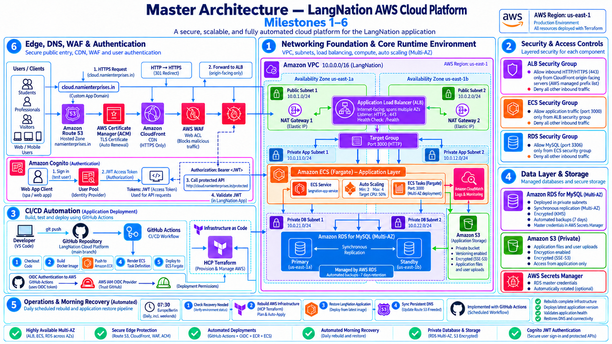

# LangNation Cloud Platform — Project Documentation

This folder contains the architecture, milestone documentation, operational notes, validation evidence and presentation material for the LangNation Cloud Platform AWS capstone.

The project was built step by step during the **AWS Cloud Computing with AI Bootcamp**. Milestones 1–6 are currently implemented and documented.

---

## Current Platform



The current platform includes:

- Multi-AZ VPC networking
- private ECS Fargate workloads
- Application Load Balancer
- ECS Service Auto Scaling
- GitHub Actions CI/CD with AWS OIDC
- Amazon RDS for MySQL
- private Amazon S3 storage
- Route 53 persistent DNS
- CloudFront + ACM
- AWS WAF
- CloudFront-only ALB access
- Amazon Cognito authentication
- JWT-protected application endpoints
- automated sandbox recovery and DNS synchronization

---

## Milestones

| Milestone | Topic | Status |
|---|---|---|
| [M01](milestones/M01-foundation-networking.md) | Foundation & Networking | ✅ Complete |
| [M02](milestones/M02-docker-ecr-ecs-fargate.md) | Docker, Amazon ECR & ECS Fargate | ✅ Complete |
| [M03](milestones/M03-alb-multiaz-autoscaling.md) | ALB, Multi-AZ & Auto Scaling | ✅ Complete |
| [M04](milestones/M04-automated-deployment.md) | Automated Deployment | ✅ Complete |
| [M05](milestones/M05-database-storage.md) | Database & Storage | ✅ Complete |
| [M06](milestones/M06-edge-dns-security-authentication.md) | Edge, DNS, Security & Authentication | ✅ Complete |

---

## Architecture

### Master Architecture

The cumulative architecture through Milestone 6 is stored in:

```text
architecture/master/
```

### Milestone Architecture

Each milestone contains:

```text
architecture/milestones/mXX/
├── design-sketch.png
├── milestone-architecture.png
├── design-sketch-platform.png
└── platform-after-mXX.png
```

The design sketches show my own architecture-learning process in Excalidraw, while the polished diagrams provide cleaner documentation views.

Milestone 1 does not require a separate cumulative platform image because its milestone architecture is already the complete platform at that stage.

### Special Flows

```text
architecture/flows/
```

This folder contains focused diagrams for:

- CI/CD architecture
- CI/CD deployment flow
- automated morning sandbox recovery

---

## Interactive Architecture

The interactive architecture for Milestones 1–6 is available here:

[Open interactive architecture file](interactive/langnation-architecture-m01-m06.html)

It includes milestone-specific views and end-to-end platform flows.

> When viewed directly in a GitHub repository, HTML is shown as a file rather than executed as a live application. It can be opened locally in a browser, and it can later be published through GitHub Pages.

---

## Operations

Operational automation is documented separately from the milestone implementation notes.

- [OP01 — Automated Morning Sandbox Recovery](operations/OP01-automated-morning-sandbox-recovery.md)

The recovery workflow rebuilds the disposable AWS sandbox, restores the application deployment and synchronizes the recreated CloudFront endpoint with persistent Route 53 DNS.

---

## Evidence

Validation and evidence material is stored under:

```text
evidence/
```

Current documentation includes:

- [Milestone 6 validation evidence checklist](evidence/M06-validation-evidence-checklist.md)

Milestone documents also contain their own implementation and validation sections.

---

## Presentation

The current capstone progress presentation is stored in:

```text
presentation/
```

It covers Milestones 1–6 and summarizes the architecture, validation, engineering decisions and troubleshooting completed so far.

---

## Architecture Principle

A major design constraint of this project is that the AWS training sandbox is regularly cleaned.

The platform therefore separates durable configuration from disposable runtime infrastructure:

```text
Git repository
+ Terraform configuration
+ HCP Terraform state
+ persistent Route 53 DNS
        ↓
recreate disposable AWS infrastructure
        ↓
GitHub Actions restores application deployment
```

This led to one of the main design principles of the project:

> **Persistent DNS + disposable infrastructure**

---

## Next Implementation Phases

The following phases are planned but are not presented as completed functionality:

```text
Milestone 7  — Serverless & Event-Driven Architecture
Milestone 8  — RAG Knowledge Pipeline
Milestone 9  — Lina AI Tutor / RAG Runtime
Milestone 10 — Security, Monitoring, CI/CD Quality Gates,
               Resilience & Final Architecture
```

The documentation will be extended as each milestone is implemented and validated.
