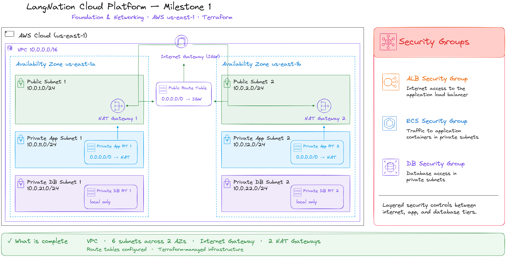
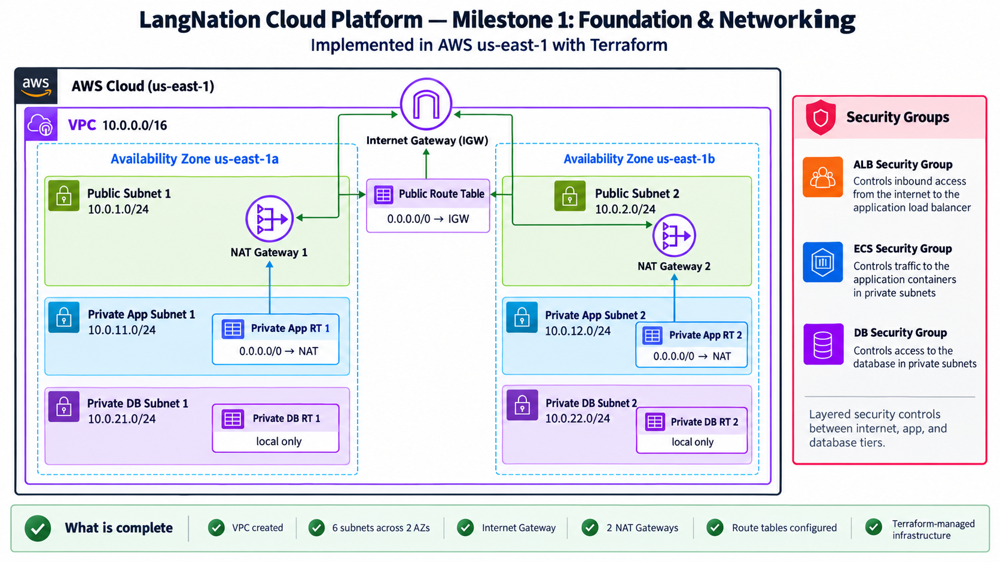

# LangNation Cloud Platform
## Milestone 1 — Foundation & Networking

**Project:** LangNation Cloud Platform — Secure, Highly Available, Containerized Learning Platform with AI/RAG on AWS
**Course:** AWS Cloud Computing with AI Bootcamp
**Environment:** Development (`dev`)
**AWS Region:** `us-east-1`
**Infrastructure as Code:** Terraform
**Remote State / Authoritative Plan & Apply:** HCP Terraform
**Status:** ✅ Complete

---

## 1. Objective

Milestone 1 established the network foundation for the LangNation Cloud Platform.

The goal was to build a reproducible, multi-AZ AWS network that could support later milestones without exposing application or database workloads directly to the internet.

The milestone introduced:

- one custom VPC
- two Availability Zones
- two public subnets
- two private application subnets
- two isolated private database subnets
- one Internet Gateway
- two NAT Gateways with Elastic IPs
- separate public, private-app and private-DB routing
- layered security groups for ALB, ECS and database communication
- reusable Terraform modules
- HCP Terraform remote state and authoritative plan/apply
- reproducibility after nightly sandbox cleanup

---

## 2. Architecture Design

### My Excalidraw Design Sketch

Before implementation, I recreated the network in Excalidraw to understand the relationship between the VPC, Availability Zones, subnet tiers, route tables, NAT Gateways and security groups.



### Final Milestone Architecture

The final documentation view shows the same design in a cleaner presentation format.



---

## 3. Network Design

### VPC

```text
VPC CIDR: 10.0.0.0/16
Region:   us-east-1
```

The `/16` VPC gives enough address space for multiple subnet tiers while keeping the addressing plan easy to understand.

### Subnet plan

| Tier | us-east-1a | us-east-1b |
|---|---:|---:|
| Public | `10.0.1.0/24` | `10.0.2.0/24` |
| Private App | `10.0.11.0/24` | `10.0.12.0/24` |
| Private DB | `10.0.21.0/24` | `10.0.22.0/24` |

The addressing pattern is intentionally readable:

- `10.0.1.x` / `10.0.2.x` → public tier
- `10.0.11.x` / `10.0.12.x` → private application tier
- `10.0.21.x` / `10.0.22.x` → private database tier

### Routing

```text
Internet
   |
Internet Gateway
   |
Public Route Table
0.0.0.0/0 -> IGW
   |
   +---------------------------+
   |                           |
Public Subnet 1           Public Subnet 2
10.0.1.0/24              10.0.2.0/24
   |                           |
NAT Gateway 1            NAT Gateway 2
   |                           |
Private App RT 1          Private App RT 2
0.0.0.0/0 -> NAT 1       0.0.0.0/0 -> NAT 2
   |                           |
Private App Subnet 1      Private App Subnet 2
10.0.11.0/24             10.0.12.0/24

Private DB Subnet 1       Private DB Subnet 2
10.0.21.0/24             10.0.22.0/24
   |                           |
Private DB RT 1           Private DB RT 2
local only                local only
```

Key design decisions:

- public subnets use the Internet Gateway
- each private application subnet uses the NAT Gateway in the same AZ
- private database route tables have no `0.0.0.0/0` route
- database subnets therefore have no direct internet path

---

## 4. Security Model

The milestone introduced three security-group layers:

```text
ALB Security Group
        |
        | application traffic
        v
ECS Security Group
        |
        | MySQL 3306
        v
Database Security Group
```

At this stage, the purpose was to establish security-group referencing between layers instead of opening internal services broadly by IP range.

The important controls were:

- ECS is not directly exposed to the internet
- ECS accepts application traffic only from the ALB security group
- the database accepts MySQL traffic only from the ECS security group
- private database subnets have no internet route

> **Current-state note:** Milestone 6 later hardened the public path further. The ALB now accepts HTTP port 80 only from the AWS-managed CloudFront origin-facing prefix list. Viewer HTTPS terminates at CloudFront, and direct public access to the ALB is blocked.

---

## 5. Terraform Structure

The milestone separated networking and security responsibilities into reusable modules.

```text
terraform/
├── environments/
│   └── dev/
│       ├── data.tf
│       ├── main.tf
│       ├── outputs.tf
│       ├── provider.tf
│       ├── terraform.tfvars.example
│       ├── variables.tf
│       └── versions.tf
│
└── modules/
    ├── networking/
    │   ├── main.tf
    │   ├── variables.tf
    │   └── outputs.tf
    │
    └── security/
        ├── main.tf
        ├── variables.tf
        └── outputs.tf
```

### Networking module responsibilities

The networking module creates and manages:

- VPC
- public subnets
- private application subnets
- private database subnets
- Internet Gateway
- Elastic IPs
- NAT Gateways
- public route table
- private application route tables
- private database route tables
- route-table associations

### Security module responsibilities

The security module creates:

- ALB security group
- ECS security group
- database security group
- security-group rules between the application layers

The modules communicate through Terraform outputs rather than hardcoded AWS resource IDs.

---

## 6. Terraform Workflow

The agreed workflow for this project is:

```text
Local workstation
   |
   | terraform init
   | terraform fmt -recursive
   | terraform validate
   v
Git / GitHub
   |
   v
HCP Terraform
   |
   | authoritative plan
   | reviewed apply
   | remote state
   v
AWS
```

Local Terraform is used mainly for syntax, formatting and configuration validation.

HCP Terraform is the authoritative source for:

- remote state
- plans
- applies
- run history
- rebuilds after sandbox cleanup

### Versions used during this milestone

```text
Local Terraform: 1.16.2
AWS provider:     hashicorp/aws 6.67.0
```

### Core validation commands

```powershell
terraform init
terraform fmt -recursive
terraform validate
```

Expected validation result:

```text
Success! The configuration is valid.
```

---

## 7. Implementation Summary

The milestone was built incrementally rather than as one large Terraform change.

### Foundation

1. verified AWS CLI, Terraform, Git and Docker
2. configured the AWS provider and default project tags
3. configured HCP Terraform
4. verified AWS authentication
5. created the VPC
6. created six subnets across two Availability Zones
7. attached the Internet Gateway
8. created the public route table and subnet associations

### Private routing

9. created two Elastic IPs
10. created one NAT Gateway per Availability Zone
11. created private application route tables
12. routed each private application subnet through its same-AZ NAT Gateway
13. created isolated private database route tables
14. associated each DB subnet with its local-only route table

### Security

15. created the reusable security module
16. created ALB, ECS and database security groups
17. restricted ECS ingress to the ALB security group
18. restricted database ingress to the ECS security group
19. exposed security-group IDs as module outputs

---

## 8. Validation

The deployed environment was checked in both Terraform and AWS.

### Verified resources

- [x] VPC CIDR is `10.0.0.0/16`
- [x] six subnets exist
- [x] subnets span two Availability Zones
- [x] Internet Gateway is attached
- [x] public route table contains `0.0.0.0/0 -> IGW`
- [x] both public subnets use the public route table
- [x] two NAT Gateways exist
- [x] each NAT Gateway is in a public subnet
- [x] private app subnet 1 routes through NAT Gateway 1
- [x] private app subnet 2 routes through NAT Gateway 2
- [x] private DB route tables have no internet route
- [x] layered security-group configuration validates
- [x] HCP Terraform successfully planned and applied the infrastructure

### Nightly sandbox rebuild validation

The training sandbox removes resources overnight. HCP Terraform retained the desired state and later detected the missing infrastructure.

A rebuild plan showed:

```text
11 to add
0 to change
0 to destroy
```

The networking foundation was recreated successfully from code.

This became an important design principle for the project:

> **The environment is disposable; the infrastructure definition is not.**

---

## 9. Problems and Lessons

### Problem: Terraform variable block structure

A missing closing brace caused Terraform to report:

```text
Unsupported block type
```

**Fix:** corrected the configuration and ran `terraform validate`.

### Problem: New module was not installed

After adding a module, Terraform validation reported that the module was not installed.

**Fix:**

```powershell
terraform init
```

This reinforced that `terraform init` should be rerun when module sources or backend configuration change.

### Problem: Local plan tried to recreate cloud-managed resources

A local `terraform plan` showed resources as new even though they already existed.

**Cause:** the local working directory was not using the authoritative HCP Terraform remote state.

**Decision:** use local Terraform for `init`, `fmt` and `validate`, and use HCP Terraform for the authoritative `plan`, `apply` and state.

### Problem: AWS sandbox removes infrastructure nightly

Instead of treating the nightly cleanup only as a limitation, I used it to validate reproducibility.

The same Terraform configuration could recreate the network foundation without rebuilding resources manually in the AWS Console.

---

## 10. Design Decisions

### Why two Availability Zones?

The architecture avoids placing the complete application path in one AZ. Later milestones can distribute ECS tasks, load balancing and database resources across both zones.

### Why two NAT Gateways?

Each private application subnet has same-AZ outbound access.

This costs more than using one shared NAT Gateway, but reduces dependency on a single AZ and demonstrates a production-style multi-AZ pattern.

### Why isolated database route tables?

The database tier does not require direct internet access.

Removing the default internet route reduces the network exposure of the data layer.

### Why security-group references?

Using security-group-to-security-group rules expresses application relationships directly:

```text
ALB -> ECS -> Database
```

This is safer and easier to maintain than allowing broad CIDR ranges for internal application traffic.

---

## 11. What I Learned

This milestone gave me practical experience with:

- VPC CIDR planning
- public vs private subnet behavior
- Internet Gateway routing
- NAT Gateway egress
- same-AZ routing decisions
- isolated database networks
- stateful security groups
- security-group references
- Terraform modules
- Terraform variables and outputs
- `count` and `count.index`
- splat expressions
- HCP Terraform remote state
- plan/apply separation
- infrastructure reproducibility
- debugging Terraform configuration errors
- designing around Availability Zone dependencies

One of the most important lessons was that a subnet is not public or private because of its name. Its routing, addressing and attached resources determine its actual network behavior.

---

## 12. Result

Milestone 1 produced a reproducible network foundation with:

```text
Multi-AZ VPC
+
public ingress tier
+
private application tier
+
isolated database tier
+
same-AZ NAT egress
+
layered security groups
+
Terraform-managed infrastructure
+
HCP Terraform remote state
+
rebuild capability
```

This foundation was then used by **Milestone 2 — Docker, Amazon ECR & ECS Fargate**.

---

## Interview / Presentation Summary

> I built the AWS network foundation for the LangNation Cloud Platform with Terraform and HCP Terraform. The environment uses a custom `10.0.0.0/16` VPC across two Availability Zones with six subnets: two public, two private application and two isolated database subnets. Public routing uses an Internet Gateway, while each private application subnet uses a NAT Gateway in the same Availability Zone for outbound access. The database subnets have no direct internet route. I also implemented layered security groups so application traffic follows the ALB-to-ECS-to-database path rather than exposing internal services publicly. Because the AWS training sandbox is cleaned regularly, I also validated that the environment can be rebuilt from Terraform instead of being recreated manually.
