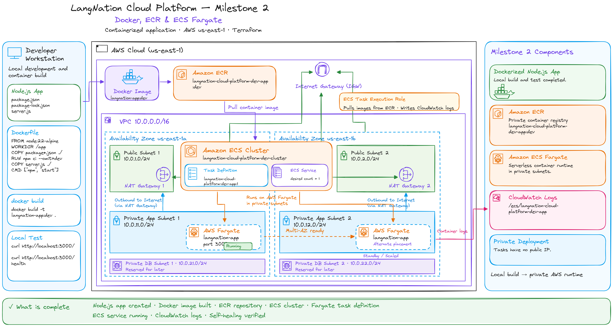
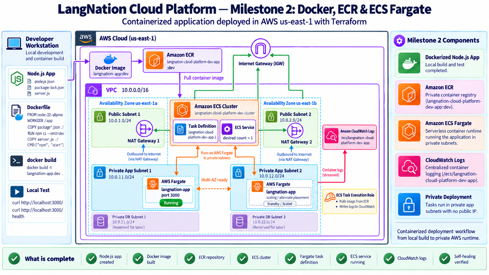
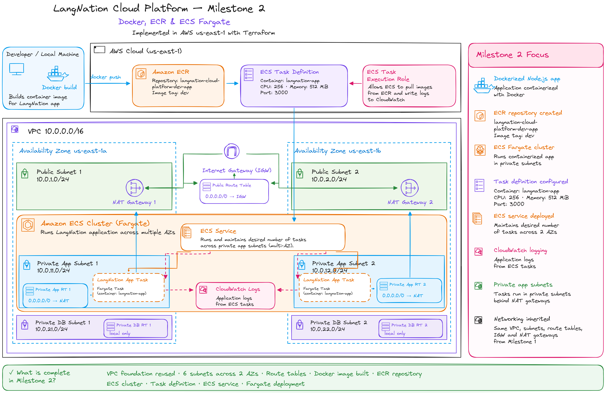
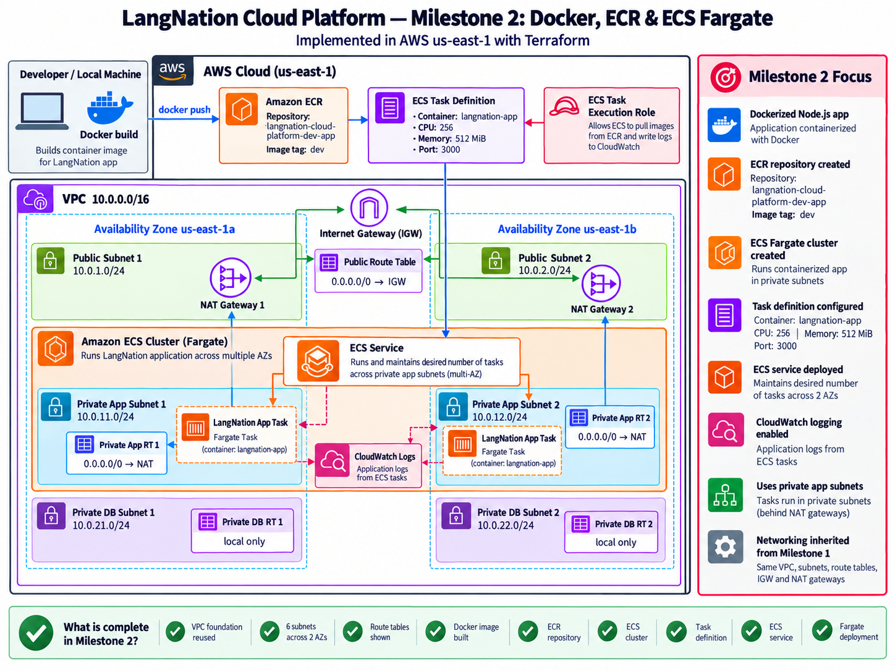

# LangNation Cloud Platform
## Milestone 2 — Docker, Amazon ECR & ECS Fargate

**Project:** LangNation Cloud Platform — Secure, Highly Available, Containerized Learning Platform with AI/RAG on AWS  
**Author:** Seraj Ahmad Siddiqui  
**Course:** AWS Cloud Computing with AI Bootcamp  
**Environment:** Development (`dev`)  
**AWS Region:** `us-east-1`  
**Infrastructure as Code:** Terraform  
**Relevant Technologies / Services:** Node.js, Express, Docker, Amazon ECR, Amazon ECS, AWS Fargate, IAM, CloudWatch Logs, Container Insights  
**Container Runtime:** Docker  
**Container Registry:** Amazon ECR  
**Container Orchestration:** Amazon ECS on AWS Fargate  
**Remote State / Authoritative Plan & Apply:** HCP Terraform  
**Status:** ✅ Complete

---

## 1. Objective

Milestone 2 moved the LangNation Cloud Platform from a network-only environment to a running containerized application on AWS.

The goal was to prove the complete path from application source code to a private managed compute workload:

```text
Node.js application
        ↓
Docker image
        ↓
Amazon ECR
        ↓
ECS task definition
        ↓
ECS service
        ↓
AWS Fargate
        ↓
Private application subnets
        ↓
CloudWatch Logs
```

The milestone introduced:

- a small Node.js / Express LangNation API
- Docker packaging and local container testing
- a private Amazon ECR repository
- an ECS Fargate cluster
- an ECS task execution IAM role
- CloudWatch logging
- an ECS task definition
- a Terraform-managed ECS service
- private task networking with no public IP
- desired-state recovery / basic self-healing
- repeatable rebuilds after sandbox cleanup

The network created in Milestone 1 therefore became a functioning private application runtime instead of remaining infrastructure only.

---

## 2. Architecture Design

### My Excalidraw Design Sketch

I first recreated the container flow in Excalidraw to understand the relationship between the application, Docker, ECR, ECS task definitions, the ECS service and Fargate tasks.



### Final Milestone Architecture

The final milestone architecture shows the container delivery and runtime components introduced in Milestone 2.



### Platform Design After Milestone 2

This cumulative view shows how the container platform builds on top of the Milestone 1 network foundation.





---

## 3. Application Architecture

A small controlled Node.js / Express API was created for the capstone rather than immediately deploying the full LangNation production application.

This kept the milestone focused on:

- containerization
- image distribution
- ECS runtime behavior
- private networking
- logging
- basic service recovery

### Application Structure

```text
application/
├── .dockerignore
├── Dockerfile
├── package-lock.json
├── package.json
└── server.js
```

### Endpoints

```text
GET /
GET /health
```

Example health response:

```json
{
  "status": "healthy"
}
```

The application listens on:

```text
0.0.0.0:3000
```

Binding to `0.0.0.0` allows the Node.js process to receive traffic through the container network interface rather than listening only on the local loopback interface.

---

## 4. Docker Containerization

### Dockerfile

```dockerfile
FROM node:22-alpine

WORKDIR /app

COPY package*.json ./

RUN npm ci --omit=dev

COPY server.js ./

ENV NODE_ENV=production
ENV PORT=3000

EXPOSE 3000

USER node

CMD ["npm", "start"]
```

### Container Design Decisions

- `node:22-alpine` keeps the base image relatively small
- `npm ci` installs versions from the lock file
- `--omit=dev` avoids unnecessary development dependencies
- `USER node` avoids running the application as root
- port `3000` is explicitly documented
- `NODE_ENV=production` is set inside the container

### `.dockerignore`

```text
node_modules
npm-debug.log
.git
.gitignore
.env*
```

This reduces the Docker build context and prevents local dependencies, Git metadata and environment files from being copied into the image.

---

## 5. Amazon ECR

Amazon Elastic Container Registry stores the private Docker image used by ECS.

Repository:

```text
langnation-cloud-platform-dev-app
```

Repository URI used during the milestone:

```text
881893827142.dkr.ecr.us-east-1.amazonaws.com/langnation-cloud-platform-dev-app
```

Configuration:

```text
Tag mutability: MUTABLE
Scan on push: enabled
Encryption: AES-256
```

The first application image was tagged:

```text
dev
```

A key operational lesson appeared after nightly sandbox cleanup:

```text
Terraform
→ can recreate the ECR repository

Terraform
→ does not recreate the Docker image stored inside it
```

This distinction later became one of the main reasons for separating infrastructure provisioning from application deployment automation.

> **Current-state note:** Later milestones replaced the initial moving `dev` tag strategy with Git-SHA image tags through GitHub Actions for traceability and automated deployment.

---

## 6. ECS Fargate Platform

### ECS Cluster

```text
langnation-cloud-platform-dev-cluster
```

Configuration:

```text
Launch model: AWS Fargate
Container Insights: Enabled
```

AWS Fargate was used so the project could run containers without provisioning or managing EC2 worker instances.

### Task Execution Role

```text
langnation-cloud-platform-dev-ecs-task-execution-role
```

The execution role is used by ECS/Fargate to:

- pull the application image from Amazon ECR
- publish container logs to CloudWatch
- perform startup operations required by the task

An important IAM distinction established in this milestone is:

```text
Execution Role
→ used by ECS/Fargate to start and operate the task

Task Role
→ used by application code when calling AWS APIs
```

The task role became more important in later milestones when the application began calling AWS services directly.

### CloudWatch Log Group

```text
/ecs/langnation-cloud-platform-dev-app
```

Retention:

```text
7 days
```

### ECS Task Definition

Family:

```text
langnation-cloud-platform-dev-app
```

Runtime configuration:

```text
Launch compatibility: FARGATE
Network mode: awsvpc
CPU: 256
Memory: 512 MiB
Container: langnation-app
Container port: 3000
Logging: awslogs
```

`awsvpc` networking gives each Fargate task its own elastic network interface inside the VPC.

---

## 7. ECS Service and Private Networking

The ECS service runs the application inside the two private application subnets created in Milestone 1:

```text
10.0.11.0/24
10.0.12.0/24
```

Task networking uses:

```text
Public IP: disabled
Security Group: ECS security group
```

The application workload is therefore not directly internet-facing.

Outbound traffic follows the private application route:

```text
Fargate Task
    ↓
Private App Route Table
    ↓
same-AZ NAT Gateway
    ↓
AWS services / public package endpoints
```

During Milestone 2, the ECS service was initially introduced with a desired count of one so service behavior and self-healing could be validated in a controlled way.

> **Current-state note:** Milestone 3 later changed the service baseline to two tasks across both Availability Zones and added an Application Load Balancer, target-group health checks and Auto Scaling with a minimum of 2 and maximum of 4 tasks.

---

## 8. Terraform Structure

Milestone 2 introduced the reusable container module:

```text
terraform/
└── modules/
    └── container/
        ├── main.tf
        ├── variables.tf
        └── outputs.tf
```

The module manages:

- Amazon ECR
- ECS cluster
- ECS task execution role
- IAM policy attachment
- CloudWatch log group
- ECS task definition
- ECS service

The module consumes subnet IDs and security-group IDs from the earlier Terraform modules rather than hard-coding AWS-generated resource IDs.

The dependency path is:

```text
networking module
      ↓ subnet IDs

security module
      ↓ ECS security group

container module
      ↓
ECR + ECS + Fargate
```

HCP Terraform remains the authoritative source for plan, apply and persistent remote state.

---

## 9. Implementation Summary

### Application and Docker

1. created the Node.js / Express application
2. implemented `/` and `/health`
3. verified the application locally
4. created `Dockerfile`
5. created `.dockerignore`
6. built the Docker image locally
7. ran the container using local port mapping
8. verified the application and container logs locally

### Amazon ECR

9. created the ECR repository with Terraform
10. authenticated Docker to ECR
11. tagged the local Docker image
12. pushed the image to ECR
13. verified the image tag and digest in AWS

### ECS / Fargate

14. created the ECS cluster
15. enabled Container Insights
16. created the ECS task execution role
17. created the CloudWatch log group
18. created the Fargate task definition
19. ran the first Fargate task in a private application subnet
20. verified that no public IP was assigned
21. verified application startup logs in CloudWatch
22. created the Terraform-managed ECS service
23. intentionally stopped the running service task
24. verified that ECS automatically created a replacement task

---

## 10. Useful Commands

### Local Application

```powershell
npm install
npm start
curl http://localhost:3000/
curl http://localhost:3000/health
```

These commands install dependencies, start the application locally and verify the two initial endpoints.

### Docker Build and Runtime

```powershell
docker build -t langnation-app:dev .
docker run -d --name langnation-app-dev -p 3000:3000 langnation-app:dev
docker ps
docker logs langnation-app-dev
```

These commands build the image, start the container, confirm the running container and inspect its logs.

### ECR Authentication

```powershell
aws ecr get-login-password --region us-east-1 |
docker login --username AWS --password-stdin 881893827142.dkr.ecr.us-east-1.amazonaws.com
```

This retrieves a temporary ECR authentication token through the AWS CLI and passes it to Docker.

### Tag and Push

```powershell
docker tag langnation-app:dev `
881893827142.dkr.ecr.us-east-1.amazonaws.com/langnation-cloud-platform-dev-app:dev

docker push `
881893827142.dkr.ecr.us-east-1.amazonaws.com/langnation-cloud-platform-dev-app:dev
```

The local image is tagged with the ECR repository URI and then uploaded to the private registry.

### Terraform Validation

```powershell
terraform init
terraform fmt -recursive
terraform validate
```

HCP Terraform remained authoritative for:

```text
plan
apply
state
```

---

## 11. Validation

The milestone was validated at each layer rather than treating successful resource creation as sufficient proof.

### Application

- [x] Node.js application runs locally
- [x] `/` responds successfully
- [x] `/health` responds successfully

### Docker

- [x] Docker image builds successfully
- [x] container runs locally
- [x] port mapping works
- [x] container logs are visible
- [x] container runs as the non-root `node` user

### Amazon ECR

- [x] ECR repository exists
- [x] Docker authentication succeeds
- [x] image pushes successfully
- [x] image tag and digest verified

### ECS / Fargate

- [x] ECS cluster is active
- [x] Container Insights is enabled
- [x] task execution role is created
- [x] CloudWatch log group is created
- [x] Fargate task definition is created
- [x] CPU and memory configuration is verified
- [x] task runs in a private application subnet
- [x] task has no public IP
- [x] application startup is visible in CloudWatch
- [x] ECS service is created successfully

### Reproducibility

- [x] infrastructure recreated after nightly sandbox cleanup
- [x] ECR repository recreated with Terraform
- [x] image artifact repushed separately

---

## 12. Controlled Failure / Self-Healing Test

To prove ECS service desired-state behavior, the running service task was intentionally stopped.

Initial state:

```text
ECS Service
Desired tasks: 1
Running tasks: 1
```

Controlled action:

```text
Stop running service task
```

Expected behavior:

```text
running < desired
        ↓
ECS detects missing task
        ↓
replacement task launched
        ↓
service returns to desired state
```

Observed result:

- [x] the original task stopped
- [x] ECS detected that running capacity was below the configured desired count
- [x] ECS automatically launched a replacement task
- [x] the service recovered without manually launching a new task

At this stage, ECS task health could still appear as `Unknown` because ALB target-group health checks had not yet been introduced.

Milestone 3 later connected the application `/health` endpoint to the Application Load Balancer target group.

---

## 13. Problems and Solutions

### Problem 1 — Docker Linux Engine Would Not Start

The first Docker build failed because Docker Desktop could not start the Linux container engine.

The error referenced:

```text
dockerDesktopLinuxEngine
```

Docker Desktop then reported that WSL was unavailable.

**Cause:**  
The Windows workstation did not yet have the required WSL 2 environment for Docker Linux containers.

**Fix:**

```powershell
wsl --install
```

After WSL 2 and Ubuntu were configured, Docker Desktop could run Linux containers successfully.

**Lesson:**  
Docker Desktop on Windows depends on a functioning Linux container backend. Local platform prerequisites should be validated before troubleshooting Dockerfile or application code.

---

### Problem 2 — ECR Image Disappeared After Sandbox Cleanup

Terraform recreated the ECR repository, but the container image itself was gone.

**Cause:**  
Terraform manages the ECR repository infrastructure, not the Docker image artifact stored inside the registry.

**Fix:**  
Authenticate to the recreated repository and push the Docker image again.

**Lesson:**

> Infrastructure provisioning and application artifact deployment are separate automation concerns.

This gap was later solved through GitHub Actions in Milestone 4.

---

### Problem 3 — ECS Task Health Showed `Unknown`

The ECS task did not yet have a load-balancer-based application health signal.

**Cause:**  
Milestone 2 had no ALB target group or target-group health check.

The application already exposed:

```text
/health
```

but ECS service health was not yet connected to that endpoint through an ALB.

**Resolution:**  
Milestone 3 introduced the ALB and configured `/health` as the target-group health check.

**Lesson:**  
A running container and an application-level health check are separate concepts. Later architecture should validate both process state and application responsiveness.

---

## 14. Security Decisions

### Private Fargate Tasks

Fargate tasks run only in private application subnets and receive no public IP.

This prevents direct public access to the application workload.

### Non-Root Container User

The Docker container runs as:

```dockerfile
USER node
```

Running the application as a non-root user reduces the privileges available inside the container.

### Build Context Protection

`.env` files, local dependencies and Git metadata are excluded from the Docker build context.

This reduces the risk of unintentionally copying local configuration or sensitive material into the image.

### IAM Role Separation

The ECS execution role is used for task startup operations.

Application-level AWS permissions are conceptually separated into the task role, which later milestones use for application runtime access.

### Centralized Logging

Container logs are sent to CloudWatch rather than depending only on ephemeral local container output.

---

## 15. Cost and Operational Decisions

### Fargate Task Size

The initial development task used:

```text
0.25 vCPU
512 MiB memory
```

This kept the Fargate footprint small while providing enough capacity for the controlled capstone API.

### CloudWatch Log Retention

CloudWatch log retention was limited to:

```text
7 days
```

This provides enough operational visibility for the training environment without retaining development logs indefinitely.

### Managed Compute

Fargate avoids operating EC2 instances for the container layer.

For this capstone, that reduces operational overhead and keeps the milestone focused on container orchestration rather than host management.

### Disposable Sandbox

Because the training sandbox regularly removes AWS resources, reproducibility is more important than manually preserving individual runtime resources.

The operational model therefore separates:

```text
Terraform
→ infrastructure definition

Docker / ECR
→ application artifact

ECS Service
→ desired runtime state
```

---

## 16. What I Learned

This milestone gave me practical experience with:

- Docker image creation
- local container testing
- Docker Desktop and WSL 2
- Amazon ECR
- image tags and image digests
- ECS clusters
- ECS task definitions
- ECS services
- AWS Fargate
- `awsvpc` networking
- ECS execution roles
- CloudWatch Logs
- Container Insights
- private subnet deployment
- service desired state
- task replacement / self-healing
- separation of infrastructure and deployment automation

One of the most useful lessons was understanding the difference between these ECS concepts:

```text
Cluster
Task Definition
Task
Service
```

They are related, but each solves a different problem.

Another important lesson was that infrastructure and application artifacts have different lifecycles. Terraform can recreate a repository or ECS service, but the application image still needs its own deployment process.

---

## 17. Result

Milestone 2 produced a working private container platform:

```text
Source Code
    ↓
Docker Image
    ↓
Amazon ECR
    ↓
ECS Task Definition
    ↓
ECS Service
    ↓
AWS Fargate
    ↓
Private Application Subnets
    ↓
CloudWatch Logs
```

Final milestone state:

```text
Node.js application                ✅
Docker containerization            ✅
Private ECR repository             ✅
ECS Fargate cluster                ✅
Task execution IAM role            ✅
CloudWatch logging                 ✅
Private task networking            ✅
No task public IP                  ✅
Terraform-managed ECS service      ✅
Desired-state task replacement     ✅
Sandbox rebuild understanding      ✅
```

The platform now had:

- containerized application delivery
- private managed compute
- centralized logs
- IAM-based task startup
- desired-state management
- automatic task replacement
- Terraform-managed infrastructure

This became the basis for **Milestone 3 — Application Load Balancer, Multi-AZ & Auto Scaling**.

---

## Presentation Summary

> In Milestone 2 I containerized a controlled LangNation Node.js API with Docker, tested it locally and pushed the image to a private Terraform-managed Amazon ECR repository. I then built an ECS Fargate platform with a cluster, task execution role, CloudWatch logging, task definition and ECS service. The application task runs in the private application tier created in Milestone 1 and receives no public IP. I also tested ECS desired-state behavior by deliberately stopping the running service task and confirming that ECS automatically launched a replacement. One of the most important operational lessons was that Terraform can recreate the ECR repository after sandbox cleanup, but the Docker image is an application artifact and requires its own deployment process. That separation later became the basis for the automated GitHub Actions deployment pipeline.
