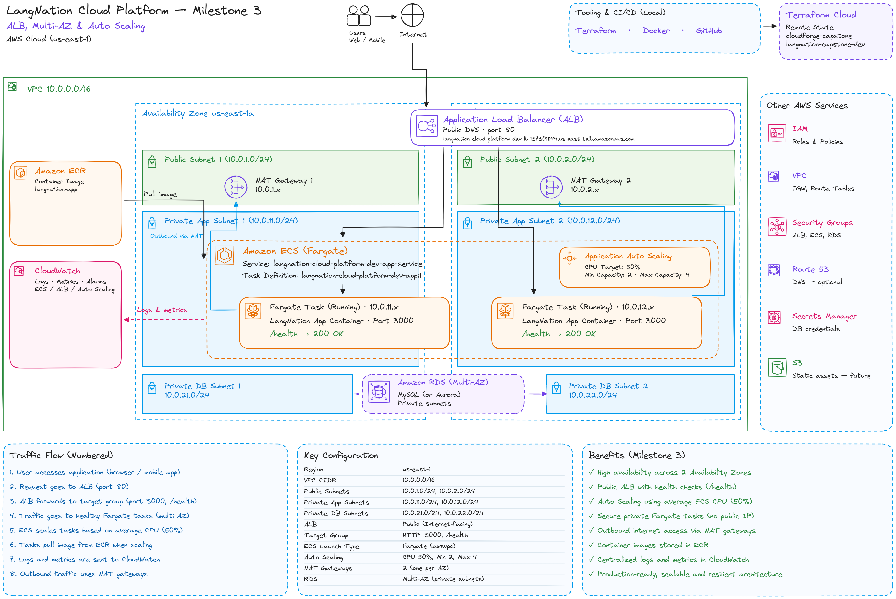
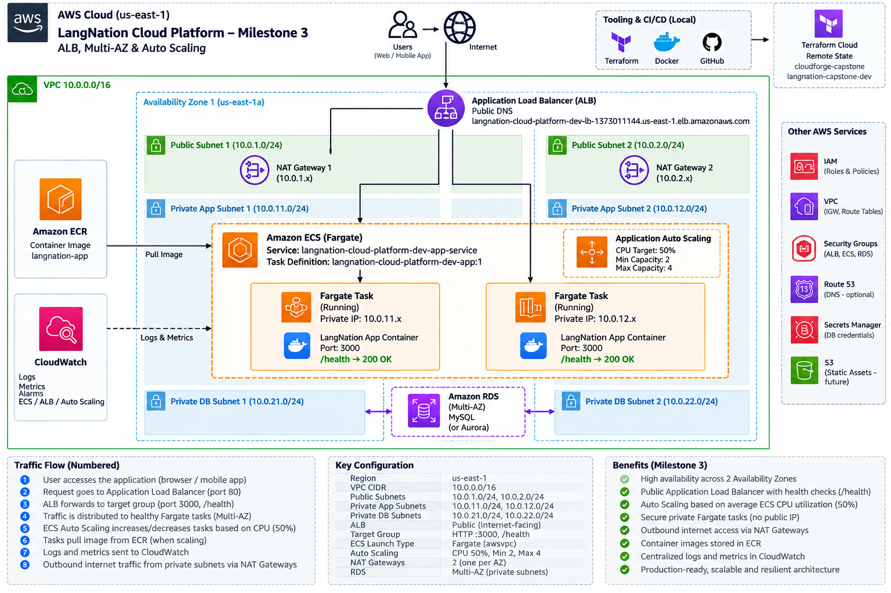
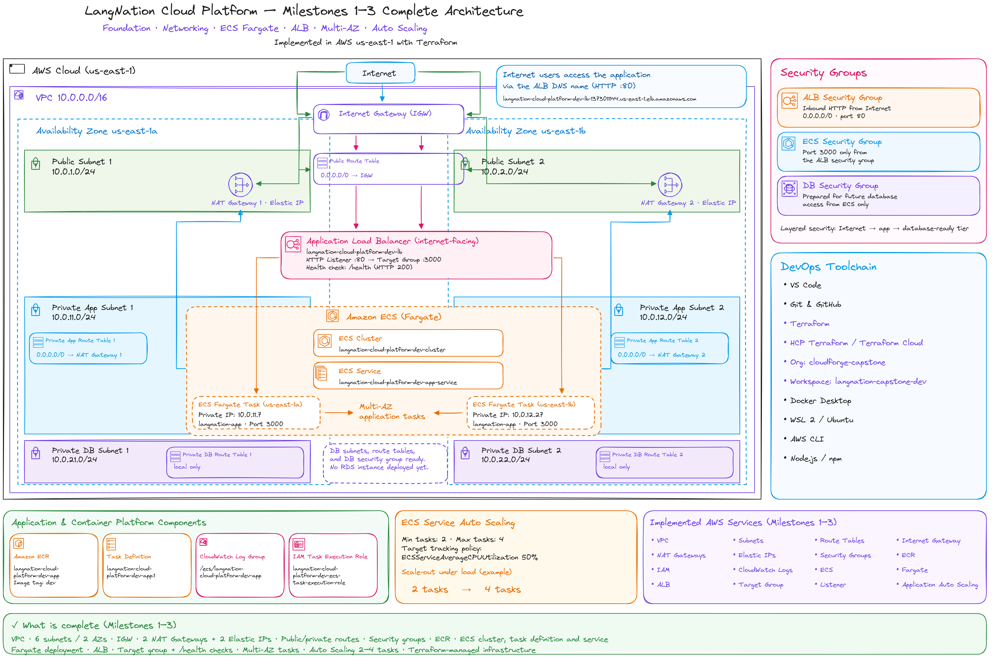
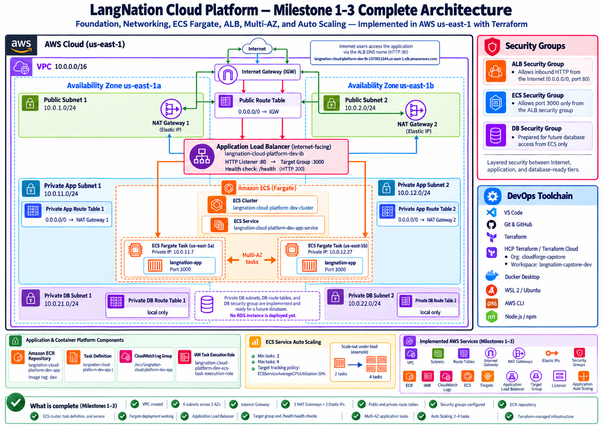

# LangNation Cloud Platform
## Milestone 3 — Application Load Balancer, Multi-AZ & Auto Scaling

**Project:** LangNation Cloud Platform — Secure, Highly Available, Containerized Learning Platform with AI/RAG on AWS
**Course:** AWS Cloud Computing with AI Bootcamp
**Environment:** Development (`dev`)
**AWS Region:** `us-east-1`
**Infrastructure as Code:** Terraform
**Status:** ✅ Complete

---

## 1. Objective

Milestone 3 made the private ECS/Fargate application reachable through an Application Load Balancer while keeping the application tasks themselves private.

The milestone added:

- an internet-facing Application Load Balancer
- one ALB deployment spanning both public subnets
- an HTTP listener on port 80
- an IP-based target group on port 3000
- `/health` target-group checks
- ECS Service integration with the target group
- two Fargate tasks across two Availability Zones
- health-aware request routing
- ECS Service Auto Scaling
- minimum capacity 2
- maximum capacity 4
- normal CPU target 50%
- a controlled scale-out test from 2 to 4 tasks

The result was the first fully working multi-AZ application path.

---

## 2. Architecture Design

### My Excalidraw Design Sketch

I first recreated the Milestone 3 architecture in Excalidraw to understand how the load balancer, target group, private ECS tasks and Auto Scaling fit together.



### Final Milestone Architecture



### Platform Design After Milestone 3

This cumulative view shows the platform after networking, containers, load balancing and Auto Scaling had been combined.





---

## 3. Request Path

The Milestone 3 request path was:

```text
Internet
   ↓
Application Load Balancer
   ↓
HTTP Listener :80
   ↓
Target Group
   ↓
HTTP :3000
   ↓
Healthy ECS Fargate task
   ↓
Node.js application
```

The application tasks remained in private application subnets:

```text
us-east-1a
10.0.11.0/24

us-east-1b
10.0.12.0/24
```

Neither task received a public IP.

---

## 4. Application Load Balancer

Terraform resource:

```text
aws_lb.app
```

Name:

```text
langnation-cloud-platform-dev-lb
```

Configuration:

```text
Scheme: Internet-facing
Type: Application
IP type: IPv4
Subnets: both public subnets
Security group: ALB security group
Deletion protection: disabled for sandbox/dev
```

The ALB spans:

```text
us-east-1a
us-east-1b
```

A naming issue was caught before deployment: the original planned ALB name exceeded the AWS name-length limit, so the shorter `-lb` suffix was used.

---

## 5. Target Group and Health Checks

Terraform resource:

```text
aws_lb_target_group.app
```

Name:

```text
langnation-cloud-platform-dev-tg
```

Configuration:

```text
Protocol: HTTP
Port: 3000
Target type: ip
VPC: LangNation VPC
```

`target_type = "ip"` is required because Fargate tasks using `awsvpc` networking register their task ENI/private IP rather than an EC2 instance ID.

### Health check

```text
Path: /health
Protocol: HTTP
Port: traffic-port
Healthy threshold: 2
Unhealthy threshold: 3
Timeout: 5 seconds
Interval: 30 seconds
Matcher: 200
```

Application response:

```json
{
  "status": "healthy"
}
```

This allowed the ALB to send traffic only to healthy ECS targets.

---

## 6. HTTP Listener

Terraform resource:

```text
aws_lb_listener.http
```

Configuration:

```text
Protocol: HTTP
Port: 80
Default action: forward to application target group
```

Milestone 3 therefore established:

```text
Client :80
   ↓
ALB Listener :80
   ↓
Target Group :3000
   ↓
Fargate task :3000
```

> **Current-state note:** Milestone 6 later placed CloudFront, WAF and ACM in front of the ALB. Viewer traffic now uses HTTPS at CloudFront, while CloudFront reaches the ALB over HTTP port 80. Direct public access to the ALB is blocked by restricting ALB ingress to the AWS-managed CloudFront origin-facing prefix list.

---

## 7. ECS Service Integration

The ECS Service receives the target-group ARN from the load-balancing module:

```hcl
load_balancer {
  target_group_arn = var.target_group_arn
  container_name   = "langnation-app"
  container_port   = var.container_port
}
```

Private networking remains intact:

```hcl
network_configuration {
  subnets          = var.private_app_subnet_ids
  security_groups  = [var.ecs_security_group_id]
  assign_public_ip = false
}
```

This separates public ingress from private compute.

---

## 8. Multi-AZ Application Layer

The ECS Service baseline was changed from one task to two:

```text
desired_count = 2
```

After deployment:

```text
Desired: 2
Running: 2
Pending: 0
```

Placement was verified across both application subnets:

```text
Task A
AZ: us-east-1a
Private subnet: 10.0.11.0/24
Public IP: none

Task B
AZ: us-east-1b
Private subnet: 10.0.12.0/24
Public IP: none
```

This created real application-layer redundancy across two Availability Zones.

---

## 9. ECS Service Auto Scaling

The container module was extended with:

```text
autoscaling_min_capacity = 2
autoscaling_max_capacity = 4
autoscaling_cpu_target   = 50
```

### Scalable target

```text
aws_appautoscaling_target.ecs_service
```

Configuration:

```text
Service namespace: ecs
Scalable dimension: ecs:service:DesiredCount
Minimum capacity: 2
Maximum capacity: 4
```

### Target-tracking policy

```text
aws_appautoscaling_policy.ecs_cpu
```

Configuration:

```text
Metric: ECSServiceAverageCPUUtilization
Target: 50%
Scale-out cooldown: 60 seconds
Scale-in cooldown: 300 seconds
```

---

## 10. Terraform Lifecycle Decision

The ECS Service includes:

```hcl
lifecycle {
  ignore_changes = [
    desired_count
  ]
}
```

This separates responsibilities:

```text
Terraform
→ defines the service and scaling configuration

Application Auto Scaling
→ controls the live desired task count
```

Without this lifecycle rule, Terraform could attempt to overwrite a task count changed dynamically by Auto Scaling.

---

## 11. Terraform Structure

Milestone 3 added the load-balancing module:

```text
terraform/
└── modules/
    └── load_balancing/
        ├── main.tf
        ├── variables.tf
        └── outputs.tf
```

Responsibilities after Milestone 3:

```text
networking
→ VPC, subnets, IGW, NAT, route tables

security
→ ALB SG, ECS SG, DB SG

container
→ ECR, ECS cluster, execution role, logs,
  task definition, ECS service, Auto Scaling

load_balancing
→ ALB, target group, listener, health checks
```

---

## 12. Implementation Summary

### Load balancing

1. created the `load_balancing` Terraform module
2. created the Application Load Balancer
3. deployed it to both public subnets
4. created the IP target group
5. configured `/health`
6. created the HTTP listener
7. passed the target-group ARN into the ECS Service
8. verified the public application endpoint

### Multi-AZ

9. changed the ECS baseline from one task to two
10. verified both tasks were running
11. verified one task in each Availability Zone
12. verified both tasks remained private

### Auto Scaling

13. created the Application Auto Scaling target
14. configured min 2 / max 4
15. added target tracking on average ECS CPU
16. configured the normal target at 50%
17. added `ignore_changes` for `desired_count`
18. performed a controlled scale-out test
19. confirmed the service automatically reached 4 running tasks
20. restored the CPU target to 50%

---

## 13. End-to-End Validation

The public root endpoint and health endpoint were both tested through the ALB.

The verified request path was:

```text
Client
   ↓
Internet
   ↓
ALB
   ↓
Listener
   ↓
Target Group
   ↓
Private Fargate task
   ↓
Node.js application
   ↓
Response
```

Validation included:

- [x] ALB active
- [x] ALB spans two public subnets
- [x] target type is `ip`
- [x] target group forwards to port 3000
- [x] `/health` check returns HTTP 200
- [x] ECS Service registered with the target group
- [x] Fargate tasks remain private
- [x] no public IP assigned to tasks
- [x] two ECS tasks running
- [x] tasks distributed across both AZs
- [x] healthy targets confirmed
- [x] Auto Scaling target active
- [x] minimum capacity = 2
- [x] maximum capacity = 4
- [x] normal CPU target = 50%
- [x] controlled scale-out from 2 to 4 tasks verified
- [x] normal 50% target restored after the test

---

## 14. Controlled Auto Scaling Test

To prove that Auto Scaling actually reacted, the CPU target was temporarily reduced from:

```text
50%
```

to:

```text
1%
```

Controlled HTTP load was then sent through the ALB.

Before the test:

```text
Desired: 2
Running: 2
```

After scaling:

```text
Desired: 4
Running: 4
Pending: 0
```

The desired count was not manually increased.

The observed behavior was:

```text
HTTP load
   ↓
CPU utilization increases
   ↓
Target Tracking reacts
   ↓
Desired task count increases
   ↓
ECS launches additional Fargate tasks
   ↓
Service reaches 4 running tasks
```

After validation, the normal 50% CPU target was restored.

---

## 15. Resilience Mechanisms Demonstrated

### ECS service self-healing

```text
Task stops
   ↓
running < desired
   ↓
ECS launches replacement task
```

### Multi-AZ redundancy

```text
Task A → us-east-1a
Task B → us-east-1b
```

### Health-aware routing

```text
ALB /health
   ↓
only healthy targets receive traffic
```

### Dynamic scaling

```text
CPU increases
   ↓
desired task count increases
   ↓
additional tasks launch
   ↓
maximum 4
```

---

## 16. Problems and Solutions

### Terraform started in the wrong directory

After reopening VS Code, the terminal started at the repository root.

Running `terraform init` there produced:

```text
Terraform initialized in an empty directory!
```

The correct working directory was:

```powershell
cd "D:\Project_All\LangNation-Cloud-Platform-Capstone\terraform\environments\dev"
```

This reinforced the value of keeping a dedicated Terraform terminal.

### New module did not appear in the diff

The load-balancing module was initially untracked, so it did not appear in a normal diff summary.

`git status --short` revealed:

```text
?? terraform/modules/load_balancing/
```

This was a useful reminder to check both tracked changes and untracked files before committing.

### Hidden trailing whitespace

`git diff --cached --check` detected trailing whitespace on a visually blank line.

The whitespace was removed before commit.

### `ignore_changes` was placed on the wrong resource

The lifecycle rule for `desired_count` was first placed under the task definition, which produced an unsupported-attribute error.

**Fix:** move the lifecycle rule into the ECS Service resource, where `desired_count` actually exists.

### ECS network configuration was accidentally removed

A staged-diff review caught that the ECS Service network block had been removed during Auto Scaling changes.

It was restored before commit:

```text
Private app subnets
ECS security group
No public IP
```

This is a good example of why reviewing the staged diff matters before pushing infrastructure code.

---

## 17. What I Learned

This milestone gave me practical experience with:

- Application Load Balancers
- public vs private application boundaries
- target groups
- Fargate IP targets
- health checks
- ECS-to-ALB integration
- multi-AZ task placement
- desired service capacity
- Application Auto Scaling
- target-tracking policies
- scale-out and scale-in cooldowns
- Terraform lifecycle rules
- validating autoscaling behavior with controlled load
- reviewing Terraform and Git changes before deployment

A key lesson was that high availability is not achieved by creating multiple resources alone. The resources must actually be distributed across failure domains and connected through health-aware routing.

---

## 18. Result

Milestone 3 transformed the containerized application into a multi-AZ, health-aware and automatically scalable service.

```text
Internet
   ↓
Application Load Balancer
   ↓
Target Group
   ↓
Healthy private ECS tasks
   ↓
Two Availability Zones
   ↓
Auto Scaling 2–4 tasks
```

The application now had:

- public entry through an ALB
- private ECS compute
- health-aware routing
- two-AZ application redundancy
- ECS self-healing
- automatic scale-out and scale-in

This prepared the platform for **Milestone 4 — Automated Deployment**.

---

## Interview / Presentation Summary

> I extended the private ECS/Fargate platform with an internet-facing Application Load Balancer spanning both public subnets. I used an IP target group because Fargate tasks run with `awsvpc` networking, and I connected the application's `/health` endpoint to the target-group health check. I then increased the ECS baseline to two private tasks and verified that they were distributed across both Availability Zones. Finally, I configured ECS Service Auto Scaling with a minimum of two tasks, maximum of four and a 50% average CPU target. To prove that scaling worked, I temporarily lowered the threshold, generated controlled HTTP load through the ALB and observed the service scale automatically from two to four running tasks before restoring the normal policy.
