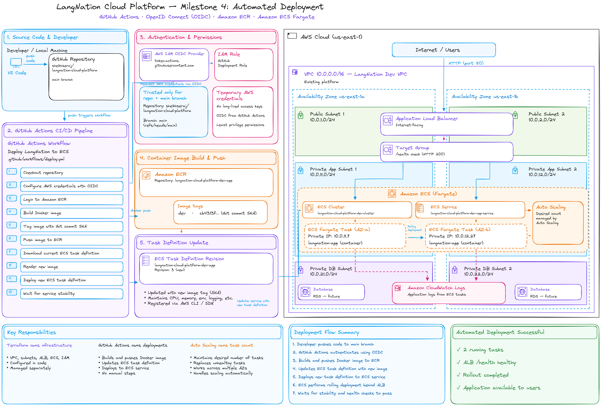
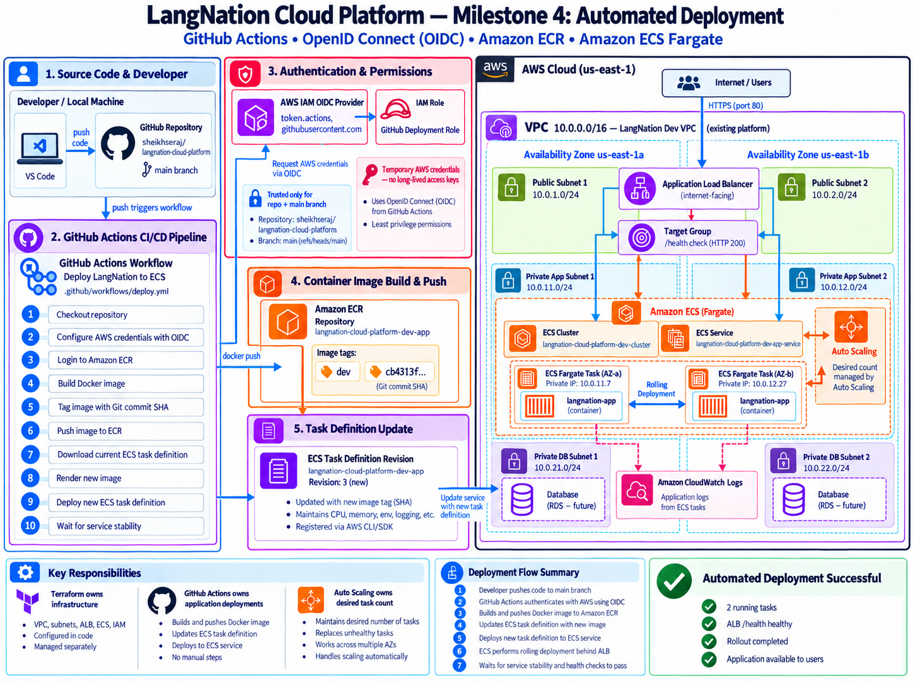
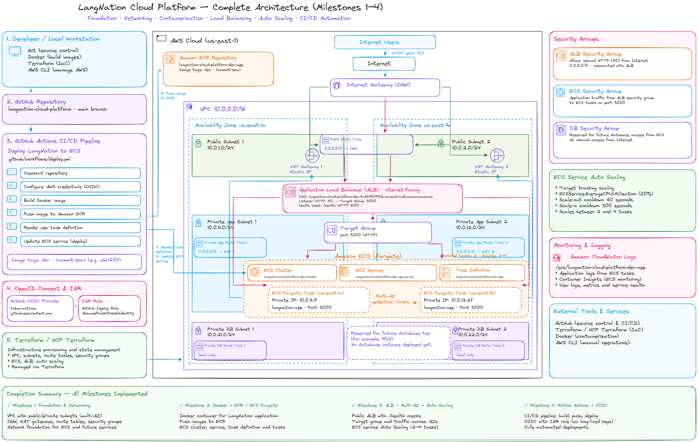
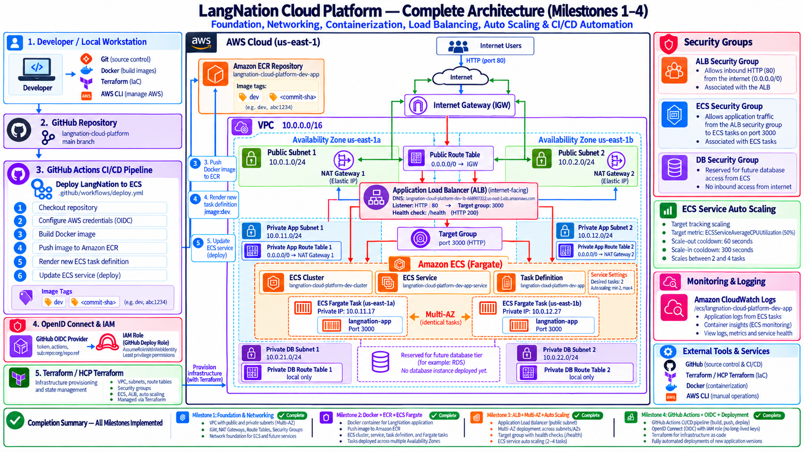
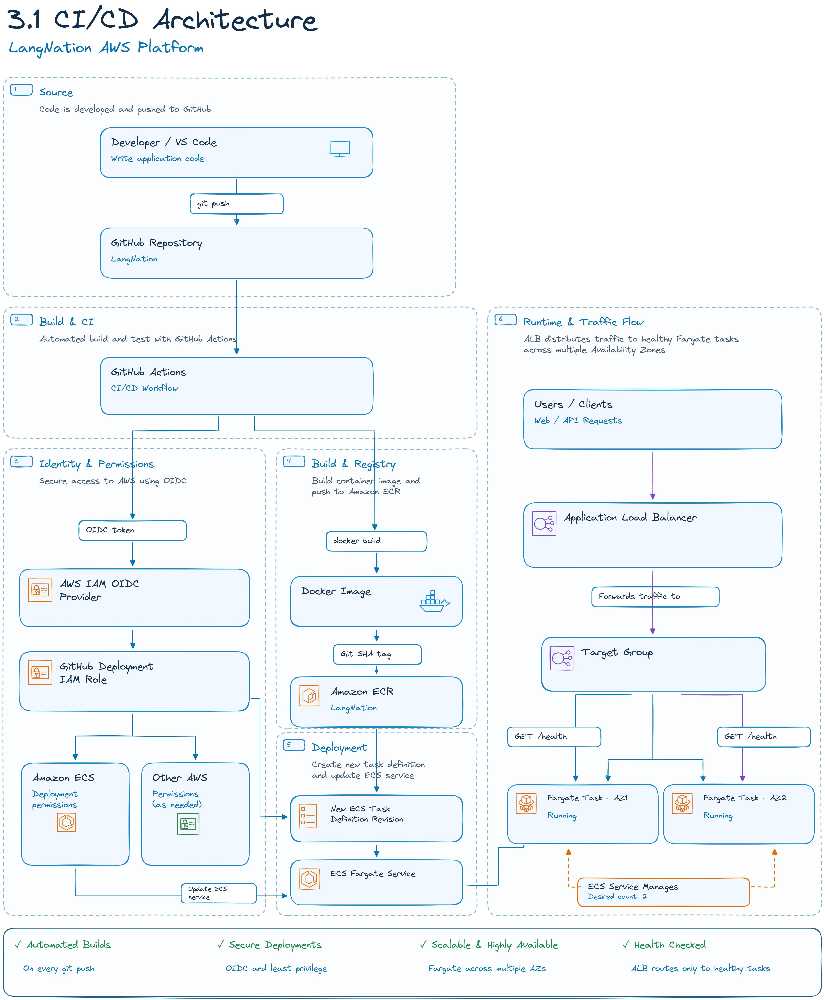
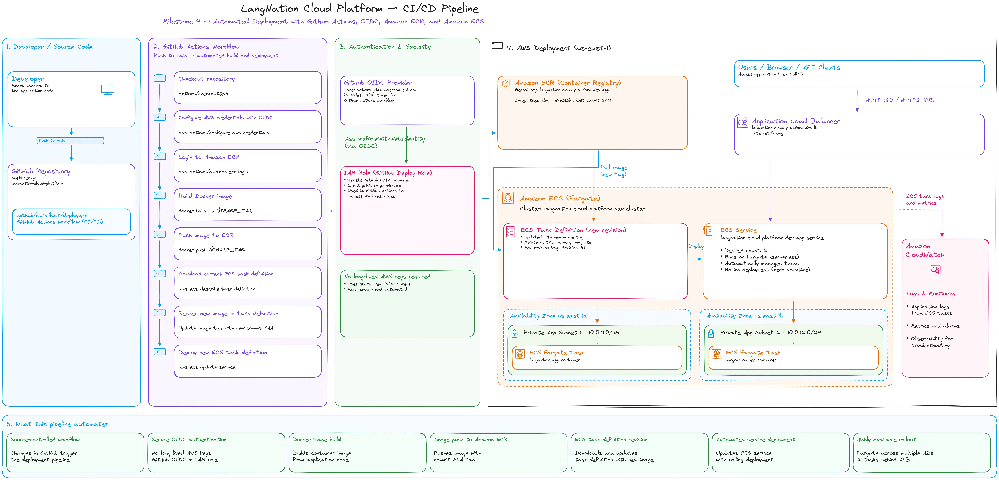
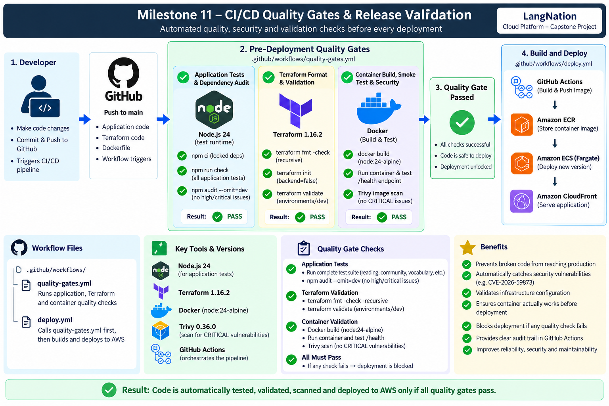

# LangNation Cloud Platform
## Milestone 4 — Automated Deployment

**Project:** LangNation Cloud Platform — Secure, Highly Available, Containerized Learning Platform with AI/RAG on AWS  
**Author:** Seraj Ahmad Siddiqui  
**Course:** AWS Cloud Computing with AI Bootcamp  
**Environment:** Development (`dev`)  
**AWS Region:** `us-east-1`  
**Infrastructure as Code:** Terraform  
**Relevant Technologies / Services:** GitHub Actions, GitHub OIDC, AWS STS, IAM, Amazon ECR, Amazon ECS, AWS Fargate  
**CI/CD:** GitHub Actions  
**AWS Authentication:** GitHub OIDC → AWS STS  
**Deployment Target:** Amazon ECS on AWS Fargate  
**Remote State / Authoritative Plan & Apply:** HCP Terraform  
**Status:** ✅ Complete

---

## 1. Objective

Milestone 4 replaced the manual container deployment process from Milestone 2 with an automated CI/CD pipeline.

The goal was to make an application change deployable through Git alone:

```text
Application change
      ↓
git push to main
      ↓
GitHub Actions
      ↓
OIDC authentication
      ↓
temporary AWS credentials
      ↓
Docker build
      ↓
Git-SHA image
      ↓
Amazon ECR
      ↓
new ECS task-definition revision
      ↓
rolling ECS deployment
      ↓
health + deployment verification
```

The pipeline was intentionally designed without storing long-lived AWS access keys in GitHub.

The main improvement over the previous deployment model was the separation of infrastructure provisioning from application delivery.

---

## 2. Architecture Design

### My Excalidraw Design Sketch

I recreated the CI/CD flow in Excalidraw first so I could clearly understand which system owns source code, identity, image storage, task definitions and the live ECS deployment.



### Final Milestone Architecture

The final milestone architecture shows the automated deployment components introduced in Milestone 4.



### Platform Design After Milestone 4

This cumulative view shows the platform after networking, containerization, load balancing, Auto Scaling and automated application deployment had been combined.





---

## 3. CI/CD Architecture

### CI/CD Architecture



### My CI/CD Pipeline Sketch



### Final CI/CD Deployment Flow



The deployment path is:

```text
Developer
   ↓
GitHub repository
   ↓
GitHub Actions
   ↓
GitHub OIDC token
   ↓
AWS STS / deployment role
   ↓
Docker build
   ↓
Amazon ECR
   ↓
ECS task definition
   ↓
ECS service
   ↓
Fargate tasks across two AZs
   ↓
application health verification
```

This created a repeatable release path without changing the private ECS architecture established in earlier milestones.

---

## 4. Ownership Model

One of the most important design decisions was to define which system owns each part of the platform.

```text
Terraform / HCP Terraform
├── networking
├── security groups
├── ECR repository
├── ECS cluster
├── ECS service infrastructure
├── base task definition
├── ALB / target group
├── Auto Scaling configuration
├── GitHub OIDC provider
└── GitHub deployment role

GitHub Actions
├── Docker image build
├── immutable Git-SHA image tag
├── ECR image push
├── live ECS task-definition revisions
└── application deployment

Application Auto Scaling
└── live ECS desired task count
```

This separation avoids Terraform, CI/CD and Application Auto Scaling competing for the same runtime properties.

---

## 5. GitHub OIDC Authentication

Instead of storing:

```text
AWS_ACCESS_KEY_ID
AWS_SECRET_ACCESS_KEY
```

in GitHub, the deployment uses:

```text
GitHub Actions
   ↓
OIDC token
   ↓
AWS IAM OIDC provider
   ↓
AWS STS
   ↓
temporary role credentials
```

Workflow permissions include:

```yaml
permissions:
  contents: read
  id-token: write
```

`id-token: write` allows GitHub Actions to request the OIDC token required for AWS federation.

### Deployment Role

```text
langnation-cloud-platform-dev-github-deploy-role
```

The repository stores the role ARN as the GitHub variable:

```text
AWS_ROLE_ARN
```

The ARN identifies a role but is not itself a secret credential.

---

## 6. Immutable GitHub Identity

The first OIDC deployment failed with:

```text
Not authorized to perform sts:AssumeRoleWithWebIdentity
```

The workflow was able to obtain an OIDC token, but AWS rejected the role assumption.

### Root Cause

The trust policy initially expected a repository-name-only subject.

The working identity uses the immutable GitHub owner and repository IDs:

```text
repo:sheikhseraj@242254883/langnation-cloud-platform@1407282665:ref:refs/heads/main
```

The trust relationship therefore restricts deployment to:

- the intended GitHub owner
- the immutable owner ID
- the intended repository
- the immutable repository ID
- the `main` branch
- the AWS STS audience

This is stronger than trusting a repository name alone because a rename cannot silently transfer AWS deployment trust to a different repository identity.

---

## 7. Least-Privilege Deployment Permissions

The deployment role does not use `AdministratorAccess`.

It receives only the permissions required for the release process.

### ECR Authentication

```text
ecr:GetAuthorizationToken
```

This action requires `Resource = "*"`.

### ECR Repository Operations

The role can perform the upload operations required to push the application image to the LangNation ECR repository.

### ECS Task-Definition Operations

```text
ecs:RegisterTaskDefinition
ecs:DescribeTaskDefinition
```

### ECS Service Operations

```text
ecs:DescribeServices
ecs:UpdateService
```

These permissions are restricted to the LangNation ECS service where possible.

### IAM PassRole

The workflow can pass the ECS task execution role only to:

```text
ecs-tasks.amazonaws.com
```

This keeps the deployment role focused on its required responsibilities.

---

## 8. GitHub Actions Workflow

Workflow:

```text
.github/workflows/deploy.yml
```

Primary application trigger:

```yaml
on:
  push:
    branches:
      - main
    paths:
      - "application/**"
      - ".github/workflows/deploy.yml"

  workflow_dispatch:
```

The workflow can also be called by the automated recovery workflow.

Restricting the push trigger to application and deployment-workflow changes prevents unrelated Terraform or documentation updates from unnecessarily redeploying the application.

---

## 9. Deployment Process

### 1. Checkout Source

The workflow checks out the repository.

### 2. Authenticate to AWS Using OIDC

GitHub exchanges its identity for temporary AWS credentials.

### 3. Login to Amazon ECR

The workflow authenticates Docker to the private ECR registry.

### 4. Build an Immutable Image

The Docker image is tagged with:

```text
GITHUB_SHA
```

This creates a direct mapping:

```text
Git commit
   ↕
Docker image
   ↕
ECS task definition
   ↕
running deployment
```

### 5. Push the Image to ECR

The Git-SHA-tagged image is pushed to the existing application repository.

### 6. Read the Current ECS Task Definition

The current definition is downloaded so CPU, memory, environment and logging configuration are preserved.

### 7. Render the New Image

Only the container image reference is replaced with the new immutable Git-SHA image.

### 8. Register and Deploy the New Revision

A new ECS task-definition revision is registered and the ECS service performs a rolling deployment.

### 9. Verify the Deployment

The workflow verifies that the intended application revision is actually running and that the service is healthy.

---

## 10. Hardened Deployment Verification

The original Milestone 4 pipeline relied on the ECS deployment action waiting for service stability.

Later testing exposed a case where the action reported a failure during a transient ECS deployment state even though the service eventually became healthy.

The workflow was therefore hardened.

The current verification sequence is:

```text
Deploy new task definition
        ↓
ECS deployment action starts rollout
        ↓
independent aws ecs wait services-stable
        ↓
verify active task image = current Git SHA
        ↓
verify desired == running
        ↓
verify pending == 0
        ↓
discover CloudFront distribution
        ↓
verify public /health
```

This is a stronger validation model because pipeline success depends on the final AWS state rather than only one action's transient interpretation of the rollout.

> **Current-state note:** after Milestone 6, public health verification is performed through CloudFront rather than directly through the ALB, because the ALB is intentionally no longer publicly bypassable.

---

## 11. Image Traceability

Each deployment uses the exact Git commit SHA as the Docker image tag.

Conceptually:

```text
Git commit
   ↓
ECR image :<git-sha>
   ↓
ECS task-definition revision
   ↓
running ECS service
```

This makes it possible to identify exactly which source-code revision produced the image running in ECS.

Using immutable SHA tags also avoids relying only on a moving tag such as:

```text
dev
```

---

## 12. Terraform Structure

Milestone 4 introduced the CI/CD Terraform module:

```text
terraform/
└── modules/
    └── cicd/
        ├── main.tf
        ├── variables.tf
        └── outputs.tf
```

The module manages:

- the GitHub Actions OIDC provider in AWS
- the GitHub deployment IAM role
- the OIDC trust relationship
- least-privilege deployment permissions

### Terraform / CI/CD Ownership Boundary

Before Milestone 4, Terraform directly controlled the ECS service task-definition reference.

After GitHub Actions began deploying new revisions, both systems could potentially try to control that property.

The ECS Service lifecycle was therefore updated:

```hcl
lifecycle {
  ignore_changes = [
    desired_count,
    task_definition
  ]
}
```

Ownership became:

```text
desired_count
→ Application Auto Scaling

task_definition
→ GitHub Actions

ECS infrastructure
→ Terraform
```

This prevents a later Terraform apply from rolling the application back to Terraform's older task-definition revision.

---

## 13. Implementation Summary

1. created the reusable Terraform `cicd` module
2. created the GitHub Actions OIDC provider in AWS
3. created the GitHub deployment IAM role
4. restricted the trust policy to the intended repository identity and `main` branch
5. configured least-privilege deployment permissions
6. created `.github/workflows/deploy.yml`
7. enabled GitHub OIDC token permissions
8. authenticated the workflow to AWS through STS
9. automated Docker image builds
10. changed image tagging to the triggering Git commit SHA
11. automated ECR authentication and image push
12. read the current ECS task definition
13. replaced only the application image reference
14. registered a new ECS task-definition revision
15. updated the ECS service
16. preserved the Application Auto Scaling ownership of `desired_count`
17. added Terraform `ignore_changes` for the live task definition
18. verified ECS service stability after deployment
19. verified the running image against the triggering Git SHA
20. verified desired, running and pending task counts
21. verified the public health endpoint
22. integrated application redeployment with the later sandbox recovery workflow

---

## 14. Useful Commands and Workflow Checks

### Git Status

```powershell
git status --short
```

Used before commits to confirm which application, workflow and Terraform files were changed or newly added.

### Terraform Validation

```powershell
terraform init
terraform fmt -recursive
terraform validate
```

Local Terraform remains focused on initialization, formatting and validation.

### ECS Stability Verification

The hardened workflow uses:

```text
aws ecs wait services-stable
```

after starting the deployment.

This ensures the workflow independently waits for ECS to reach a stable final state.

### Deployment State Checks

The workflow also verifies:

```text
running image = triggering Git SHA
desired count = running count
pending count = 0
public health = successful
```

These checks are more meaningful than treating task-definition registration alone as proof of a successful application release.

---

## 15. Validation

Milestone 4 proved:

### CI/CD

- [x] GitHub Actions workflow created
- [x] push-based application deployment
- [x] manual workflow dispatch
- [x] Docker image built automatically
- [x] Git-SHA image tagging
- [x] automated ECR push
- [x] new ECS task-definition revision registered
- [x] rolling ECS deployment

### Authentication and IAM

- [x] GitHub OIDC provider configured
- [x] temporary AWS credentials issued
- [x] no long-lived AWS deployment keys stored in GitHub
- [x] repository-specific trust
- [x] branch-specific trust
- [x] immutable GitHub owner/repository identity
- [x] least-privilege deployment permissions
- [x] required PassRole behavior validated

### Deployment Verification

- [x] service reaches stable state
- [x] deployed task image verified against Git SHA
- [x] desired and running task counts verified
- [x] pending task count verified as zero
- [x] public health endpoint verified

### Ownership

- [x] Terraform / CI ownership separated
- [x] Application Auto Scaling ownership preserved
- [x] live task-definition revision is controlled by GitHub Actions

---

## 16. Problems and Solutions

### Problem 1 — OIDC Role Assumption Failed

Error:

```text
Not authorized to perform sts:AssumeRoleWithWebIdentity
```

**Cause:**  
The IAM role trust policy did not match GitHub's immutable OIDC subject format.

**Fix:**  
Use the immutable owner ID, repository ID and `main` branch in the `sub` condition.

**Lesson:**  
OIDC troubleshooting requires checking the provider, `aud`, `sub`, role ARN, repository identity and branch identity together.

---

### Problem 2 — Terraform Could Revert GitHub Deployments

Once CI/CD began creating new task-definition revisions, Terraform's original service configuration could potentially restore an older revision.

**Cause:**  
Terraform and GitHub Actions would both otherwise control the ECS service task-definition property.

**Fix:**  
Add `task_definition` to the ECS Service `ignore_changes` list.

**Lesson:**  
Infrastructure automation and application deployment require an explicit ownership model.

---

### Problem 3 — Deployment Action Reported a Transient Failure

A later deployment showed that the ECS deployment action could report failure during a transient rollout condition even though ECS eventually recovered to a healthy state.

**Cause:**  
The action's transient rollout interpretation did not fully represent the final ECS service state.

**Fix:**  
Start the rollout without relying solely on the action's built-in stability result, then independently wait for ECS stability and verify the deployed image, task counts and public health.

**Lesson:**  
Production-style deployment validation should check the final system state.

---

## 17. Security Decisions

### OIDC Instead of Static AWS Keys

Selected:

```text
GitHub OIDC
→ AWS STS
→ short-lived credentials
```

instead of:

```text
long-lived AWS access keys
→ GitHub Secrets
```

Benefits include:

- no permanent deployment credential stored in GitHub
- short-lived AWS credentials
- repository-specific trust
- branch-specific trust
- better auditability

### Least Privilege

The deployment role is limited to the ECR, ECS and PassRole actions required for deployment.

It does not use broad administrator permissions.

### Immutable Repository Identity

The role trust policy is tied to the intended GitHub repository identity and branch rather than relying only on mutable repository naming.

### Private ECS Architecture Remains Unchanged

CI/CD changes the application revision, not the network design.

Fargate tasks remain:

- in private application subnets
- without public IPs
- reachable through the controlled load-balancing path

---

## 18. Cost and Operational Decisions

### Event-Driven Deployment

The workflow runs for relevant application or deployment-workflow changes rather than every repository change.

This avoids unnecessary application builds and deployments for unrelated documentation or Terraform edits.

### Immutable Image Tags

Git-SHA image tags increase traceability and reduce ambiguity during deployment and rollback analysis.

They also allow a running application revision to be mapped back to a specific source commit.

### Infrastructure and Artifact Recovery

The training sandbox periodically removes AWS resources.

Terraform can recreate infrastructure such as:

- ECR repository
- ECS cluster
- ECS service
- ALB
- IAM resources

But a recreated ECR repository is empty.

Milestone 4 solved the artifact-restoration gap:

```text
HCP Terraform
→ recreate infrastructure

GitHub Actions
→ rebuild/push image
→ redeploy application
```

This separation later became part of the automated morning recovery workflow.

For the complete operational recovery design, see:

[OP01 — Automated Morning Sandbox Recovery](../operations/OP01-automated-morning-sandbox-recovery.md)

### Ownership as an Operational Control

The project intentionally assigns:

```text
Infrastructure → Terraform
Application release → GitHub Actions
Live desired task count → Application Auto Scaling
```

This reduces configuration conflicts between automation systems.

---

## 19. What I Learned

Milestone 4 gave me practical experience with:

- GitHub Actions
- CI/CD workflow design
- GitHub OIDC
- AWS STS federation
- IAM trust policies
- immutable GitHub identities
- least-privilege deployment permissions
- ECR automation
- immutable image tagging
- ECS rolling deployments
- task-definition revisions
- deployment traceability
- final-state deployment verification
- Terraform lifecycle rules
- ownership boundaries between Terraform, CI/CD and Application Auto Scaling

A major lesson was that CI/CD is not only a YAML workflow. Identity, authorization, deployment ownership and validation are equally important parts of the design.

Another important lesson was that a successful deployment action is not always sufficient evidence. The final ECS state, image revision, task counts and public health should also be verified.

---

## 20. Result

Before Milestone 4:

```text
Developer
   ↓
manual Docker build
   ↓
manual ECR login / push
   ↓
manual ECS deployment
```

After Milestone 4:

```text
Application change
   ↓
git push main
   ↓
GitHub Actions
   ↓
OIDC authentication
   ↓
Docker build
   ↓
Git-SHA image
   ↓
Amazon ECR
   ↓
new ECS task-definition revision
   ↓
rolling Fargate deployment
   ↓
independent deployment validation
   ↓
healthy service
```

Final milestone state:

```text
GitHub Actions CI/CD                  ✅
GitHub OIDC                           ✅
Short-lived AWS credentials           ✅
Least-privilege deployment role       ✅
Git-SHA image traceability            ✅
Automated ECR push                    ✅
Automated ECS task revision           ✅
Rolling ECS deployment                ✅
Independent ECS stability check       ✅
Running-image verification            ✅
Task-count verification               ✅
Public health verification            ✅
Terraform / CI/CD ownership split     ✅
Auto Scaling ownership preserved      ✅
```

The deployment process became:

- automated
- traceable
- repeatable
- credential-safe
- compatible with Terraform
- compatible with ECS Auto Scaling

This prepared the platform for **Milestone 5 — Database & Storage**.

---

## Presentation Summary

> I automated the LangNation ECS deployment with GitHub Actions. GitHub authenticates to AWS through OIDC, so I do not store long-lived AWS access keys in the repository. The IAM trust relationship is restricted to the immutable GitHub repository identity and the main branch. On an application change, the workflow builds a Docker image, tags it with the Git commit SHA, pushes it to Amazon ECR, registers a new ECS task-definition revision and performs a rolling Fargate deployment. I also separated ownership so Terraform manages the infrastructure, GitHub Actions owns the live task-definition revision, and Application Auto Scaling owns the desired task count. The hardened workflow independently waits for ECS stability, verifies the exact deployed image SHA and task counts, and finally checks the public health endpoint.
