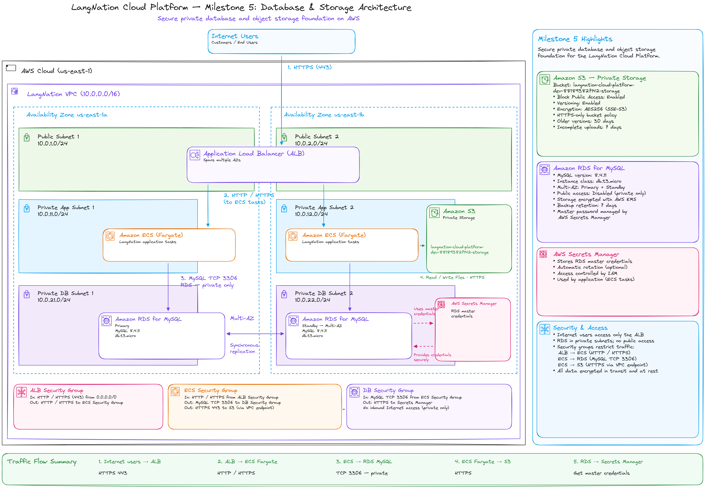
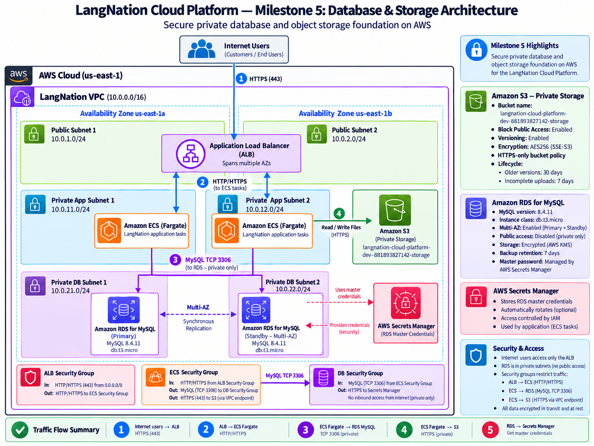
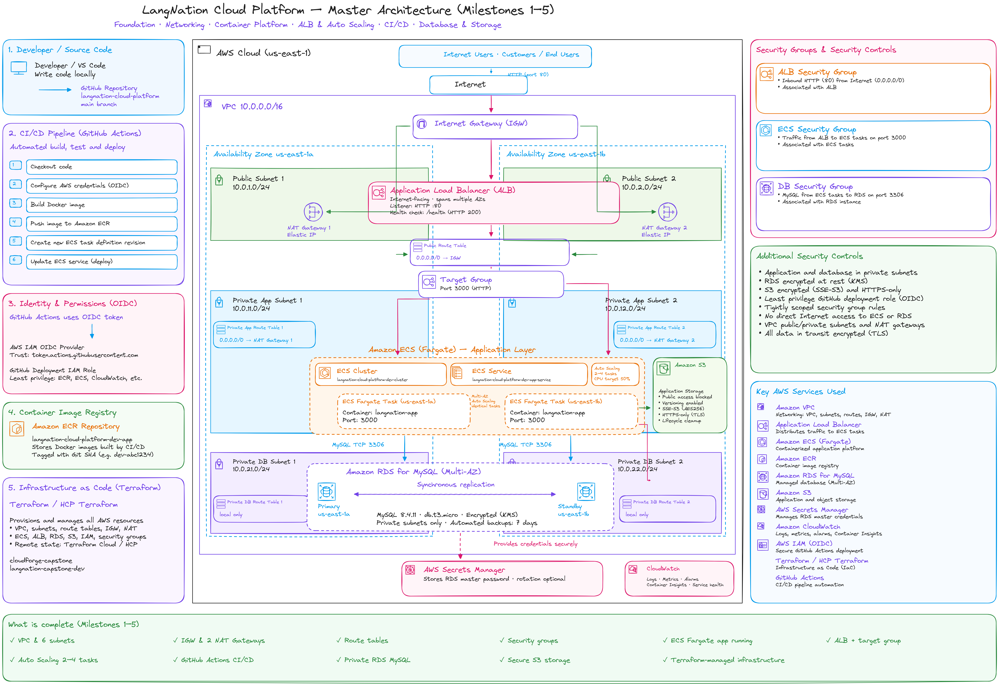
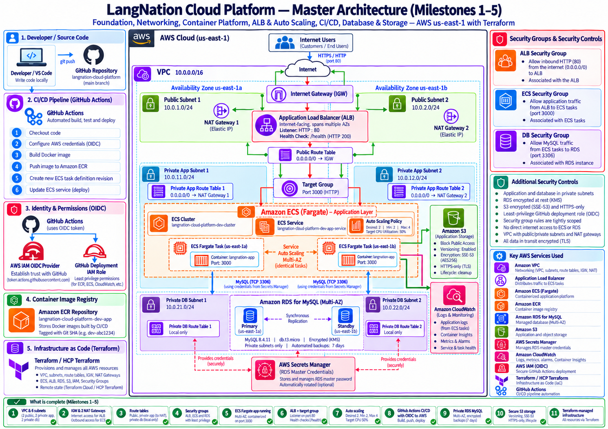

# LangNation Cloud Platform
## Milestone 5 — Database & Storage

**Project:** LangNation Cloud Platform — Secure, Highly Available, Containerized Learning Platform with AI/RAG on AWS
**Course:** AWS Cloud Computing with AI Bootcamp
**Environment:** Development (`dev`)
**AWS Region:** `us-east-1`
**Infrastructure as Code:** Terraform
**Database:** Amazon RDS for MySQL
**Object Storage:** Amazon S3
**Status:** ✅ Complete

---

## 1. Objective

Milestone 5 introduced persistent data services into the LangNation platform.

The milestone added two capabilities:

- **Amazon RDS for MySQL** for relational application data
- **Amazon S3** for private object storage and future application / RAG content

The design preserves the principles established in the earlier milestones:

- private application compute
- isolated database networking
- least-privilege security-group relationships
- Multi-AZ availability
- encryption at rest
- reproducible Terraform deployment

---

## 2. Architecture Design

### My Excalidraw Design Sketch

I first recreated the Milestone 5 architecture in Excalidraw to understand how ECS, the database security group, RDS, Secrets Manager and S3 fit into the existing platform.



### Final Milestone Architecture



### Platform Design After Milestone 5





---

## 3. Data-Layer Architecture

```text
ECS Fargate
Private application subnets
        │
        ├───────────────┐
        │               │
        │ TCP 3306      │ HTTPS
        ▼               ▼
DB Security Group      Amazon S3
        │              private
        ▼              encrypted
RDS MySQL              versioned
        │              HTTPS-only
        │
  Private DB Subnets
  us-east-1a + us-east-1b
```

The database remains reachable only from the application security group, while S3 provides private object storage for files and future AI/RAG source material.

---

## 4. Amazon RDS MySQL

### Final configuration

```text
Engine: MySQL
Deployed version: 8.4.11
Instance class: db.t3.micro
Storage: 20 GiB gp3
Max storage: 100 GiB
Encryption: enabled
Multi-AZ: enabled
Public access: disabled
Backup retention: 7 days
Port: 3306
Database name: langnation
Master password: managed by AWS Secrets Manager
```

The explicit engine version was not pinned because the training sandbox denied the RDS engine-version discovery APIs. AWS selected a supported MySQL version during deployment.

### DB subnet group

RDS uses both private database subnets:

```text
10.0.21.0/24 — us-east-1a
10.0.22.0/24 — us-east-1b
```

These subnets use private DB route tables with no default internet route.

### Terraform configuration

The database resource uses:

```hcl
storage_type      = "gp3"
storage_encrypted = true

manage_master_user_password = true

publicly_accessible = false
multi_az            = true

backup_retention_period = 7
copy_tags_to_snapshot   = true

auto_minor_version_upgrade = true
```

For this training sandbox:

```hcl
deletion_protection = false
skip_final_snapshot = true
```

Those settings make rebuilds practical in an environment that is cleaned regularly.

---

## 5. Database Security

The database security-group path is:

```text
ECS Security Group
       │
       │ TCP 3306
       ▼
Database Security Group
       │
       ▼
RDS MySQL
```

The important controls are:

- RDS is not publicly accessible
- RDS is placed only in private DB subnets
- the DB security group accepts TCP `3306` only from the ECS security group
- no public IPv4 or IPv6 CIDR rule is configured
- the private DB route tables have no internet default route

So the intended network relationship is:

```text
Internet → RDS          ❌
ECS → TCP 3306 → RDS   ✅
```

---

## 6. Credential Management

The database password is not stored in:

- Terraform source
- GitHub
- `.env` files
- documentation

Instead:

```hcl
manage_master_user_password = true
```

allows RDS to manage the master password through AWS Secrets Manager.

Only the secret reference/ARN is exposed through Terraform outputs; the secret value itself is never printed into the project documentation.

---

## 7. Amazon S3

Milestone 5 also introduced a private object-storage layer.

Bucket:

```text
langnation-cloud-platform-dev-881893827142-storage
```

The bucket is intended for:

- application files
- learning materials
- future user uploads
- exports
- future AI/RAG source documents

The storage module remains independent from the later RAG implementation.

### Security configuration

```text
Block Public Access: enabled
Object ownership: BucketOwnerEnforced
Versioning: enabled
Server-side encryption: SSE-S3 / AES256
HTTPS-only access: enforced
```

### Public-access protection

All four S3 public-access controls are enabled:

```text
BlockPublicAcls: true
IgnorePublicAcls: true
BlockPublicPolicy: true
RestrictPublicBuckets: true
```

### HTTPS-only bucket policy

The bucket policy denies requests when:

```text
aws:SecureTransport = false
```

Therefore:

```text
HTTPS → S3 ✅
HTTP  → S3 ❌
```

---

## 8. S3 Lifecycle Management

The lifecycle policy controls storage growth caused by versioning and abandoned uploads.

```text
Noncurrent object versions: 30 days
Incomplete multipart uploads: 7 days
```

Current object versions are not automatically deleted by this rule.

This keeps versioning useful for recovery while preventing unlimited accumulation of old versions.

---

## 9. Terraform Structure

Milestone 5 introduced two reusable modules:

```text
terraform/
└── modules/
    ├── database/
    │   ├── main.tf
    │   ├── variables.tf
    │   └── outputs.tf
    │
    └── storage/
        ├── main.tf
        ├── variables.tf
        └── outputs.tf
```

The modules intentionally separate:

```text
database concerns
→ RDS, DB subnet group, Secrets Manager integration

storage concerns
→ S3 security, versioning, encryption, lifecycle
```

---

## 10. Implementation Summary

### Database

1. created the database Terraform module
2. created the RDS DB subnet group
3. placed the subnet group across both private DB subnets
4. created the MySQL RDS instance
5. enabled storage encryption
6. enabled Multi-AZ
7. disabled public accessibility
8. configured 7-day backups
9. enabled RDS-managed master credentials
10. restricted TCP 3306 to the ECS security group
11. exposed safe database outputs without exposing the password

### Storage

12. created the storage Terraform module
13. created the S3 bucket
14. enabled Block Public Access
15. enabled `BucketOwnerEnforced`
16. enabled versioning
17. enabled SSE-S3 encryption
18. enforced HTTPS-only access
19. added lifecycle cleanup for old versions
20. added cleanup for incomplete multipart uploads

---

## 11. Validation

### RDS

- [x] RDS instance status is `available`
- [x] engine is MySQL
- [x] deployed version verified as `8.4.11`
- [x] instance class is `db.t3.micro`
- [x] storage is encrypted
- [x] Multi-AZ is enabled
- [x] public access is disabled
- [x] 20 GiB gp3 storage configured
- [x] backup retention is 7 days
- [x] DB subnet group spans both AZs
- [x] DB security group accepts only ECS SG traffic on port 3306
- [x] master credentials are managed through Secrets Manager

### S3

- [x] bucket created successfully
- [x] public access fully blocked
- [x] object ownership set to `BucketOwnerEnforced`
- [x] versioning enabled
- [x] SSE-S3 / AES256 encryption enabled
- [x] HTTPS-only policy applied
- [x] noncurrent-version cleanup configured
- [x] incomplete multipart cleanup configured

### Terraform

- [x] `terraform fmt -recursive`
- [x] `terraform validate`
- [x] HCP Terraform plan/apply completed successfully
- [x] unrelated infrastructure was not modified by the S3 module deployment

---

## 12. Sandbox Rebuild Validation

The training sandbox removes AWS resources regularly.

On the next rebuild, HCP Terraform detected the missing environment and recreated the infrastructure from code.

The database resources were recreated as part of that process.

At the same time, the recreated ECR repository was empty, so the application could not start until the Milestone 4 deployment workflow restored the image.

The recovery relationship became:

```text
HCP Terraform
→ infrastructure recovery

GitHub Actions
→ application artifact + deployment recovery
```

After the deployment pipeline completed, the ECS service returned to:

```text
Desired: 2
Running: 2
Pending: 0
```

This demonstrated that infrastructure and application recovery work together.

---

## 13. Problems and Solutions

### RDS engine discovery APIs were denied

The sandbox denied:

```text
rds:DescribeDBEngineVersions
rds:DescribeOrderableDBInstanceOptions
```

**Impact:** local CLI discovery of supported versions/classes was limited.

**Decision:** do not pin an explicit engine version in Terraform; allow AWS to select a supported version.

**Result:** MySQL `8.4.11` was deployed successfully.

### New Terraform module was not initialized

After adding a new local module, validation reported:

```text
Module not installed
```

**Fix:**

```powershell
terraform init
```

### Terminal output was accidentally pasted into PowerShell

Prompt and output characters were pasted together with commands, causing PowerShell to try to execute non-command text.

**Lesson:** copy only the command itself, especially during step-by-step troubleshooting.

---

## 14. Security Decisions

### Database

```text
Private DB subnets           ✅
No public RDS access         ✅
Storage encryption           ✅
Secrets Manager credentials  ✅
ECS SG → DB SG only          ✅
TCP 3306 only                ✅
Automated backups            ✅
Multi-AZ                     ✅
```

### S3

```text
Public access blocked        ✅
ACL-based ownership disabled ✅
Versioning enabled           ✅
SSE-S3 encryption            ✅
HTTPS-only                   ✅
Old-version cleanup          ✅
Multipart cleanup            ✅
```

> **Current-state note:** Milestone 6 later hardened the public application path with CloudFront, WAF and Cognito, but the private RDS/S3 design established here remains part of the current architecture.

---

## 15. Cost Decisions

The largest Milestone 5 cost driver is Multi-AZ RDS.

Multi-AZ improves availability but requires additional database infrastructure compared with a Single-AZ development database.

Other cost considerations include:

- gp3 storage
- backup storage
- Secrets Manager
- data transfer
- S3 stored object versions
- S3 requests

The S3 lifecycle rule helps prevent indefinite growth of old object versions.

---

## 16. What I Learned

This milestone gave me practical experience with:

- RDS subnet groups
- private database placement
- Multi-AZ RDS
- security-group-to-security-group database access
- managed database credentials
- AWS Secrets Manager integration
- RDS backup retention
- S3 Block Public Access
- S3 object ownership
- versioning
- SSE-S3 encryption
- HTTPS-only bucket policies
- lifecycle management
- infrastructure recovery after sandbox cleanup

One important lesson was that a database can still have a DNS endpoint while remaining private. Public accessibility depends on network placement, routing, security groups and the RDS public-access setting—not merely on whether an endpoint exists.

---

## 17. Result

Before Milestone 5:

```text
LangNation
├── VPC / networking
├── ECS Fargate
├── ALB
├── Auto Scaling
└── CI/CD
```

After Milestone 5:

```text
LangNation
├── VPC / networking
├── ECS Fargate
├── ALB
├── Auto Scaling
├── CI/CD
├── RDS MySQL
│   ├── private
│   ├── Multi-AZ
│   ├── encrypted
│   └── Secrets Manager credentials
│
└── Amazon S3
    ├── private
    ├── encrypted
    ├── versioned
    ├── HTTPS-only
    └── lifecycle managed
```

Milestone 5 added a secure, persistent data layer and prepared the platform for **Milestone 6 — Edge, DNS, Security & Authentication**.

---

## Interview / Presentation Summary

> I added the persistent data layer using Amazon RDS MySQL and Amazon S3. RDS runs in dedicated private database subnets across two Availability Zones, is encrypted, is not publicly accessible and only accepts MySQL traffic on port 3306 from the ECS security group. RDS manages the master password through Secrets Manager, so the password is not stored in Terraform or GitHub. For object storage, I created a private S3 bucket with Block Public Access, BucketOwnerEnforced ownership, versioning, SSE-S3 encryption, HTTPS-only access and lifecycle cleanup. I also validated that after the training sandbox removed the environment, Terraform could recreate the infrastructure and the GitHub Actions pipeline could restore the application separately.
