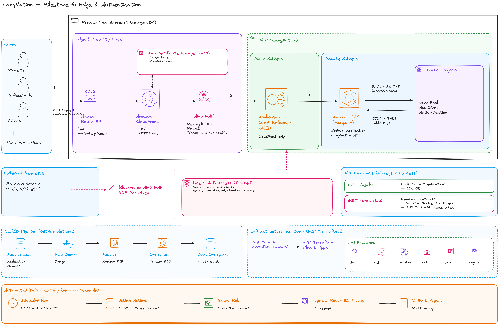
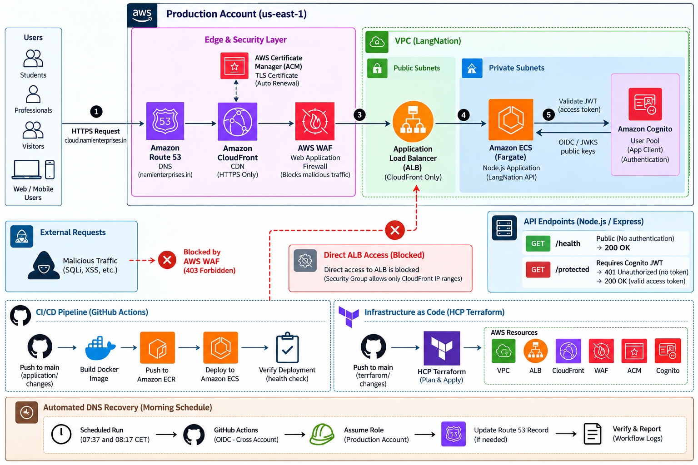
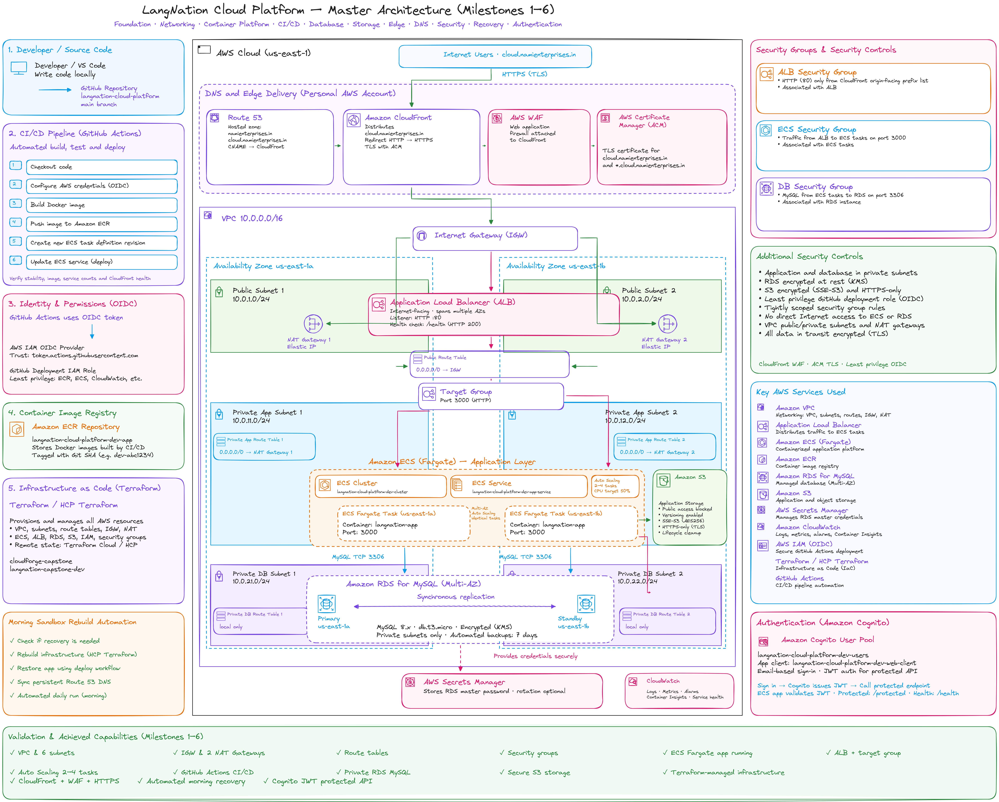
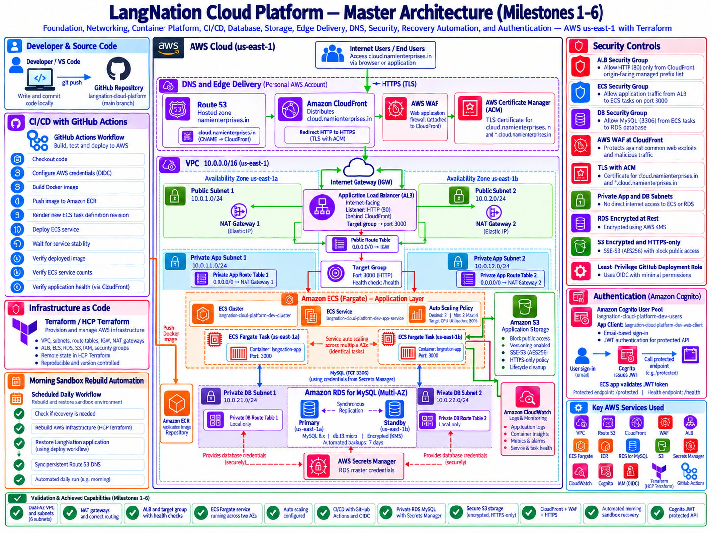

# LangNation Cloud Platform
## Milestone 6 — Edge, DNS, Security & Authentication

**Project:** LangNation Cloud Platform — Secure, Highly Available, Containerized Learning Platform with AI/RAG on AWS<br>
**Course:** AWS Cloud Computing with AI Bootcamp<br>
**Environment:** Development (`dev`)<br>
**AWS Region:** `us-east-1`<br>
**Public Capstone Endpoint:** `cloud.namienterprises.in`<br>
**Infrastructure as Code:** Terraform<br>
**Status:** ✅ Complete

---

## 1. Objective

Milestone 6 added the secure public edge and authentication layer to the LangNation platform.

The main goals were:

- keep the existing LangNation production domain untouched
- use a separate experimental domain for the capstone
- keep authoritative DNS persistent outside the disposable training sandbox
- terminate public HTTPS at CloudFront
- protect the edge with AWS WAF
- prevent direct ALB bypass
- add Cognito authentication
- validate JWT-protected application access
- extend recovery automation so DNS follows recreated CloudFront infrastructure

This milestone turned the application from a publicly reachable ALB-backed service into a protected edge architecture with persistent DNS and authenticated API access.

---

## 2. Architecture Design

### My Excalidraw Design Sketch

I recreated the Milestone 6 architecture in Excalidraw to understand the relationship between persistent DNS, CloudFront, WAF, ACM, the ALB, ECS and Cognito.



### Final Milestone Architecture



### Platform Design After Milestone 6





---

## 3. Final Public Request Path

```text
User
  ↓
Route 53
  ↓
CloudFront
  ├── ACM certificate
  └── AWS WAF
  ↓
Application Load Balancer
  ↓
Target Group
  ↓
Private ECS Fargate tasks
  ↓
Node.js application
```

Authentication adds:

```text
Client
  ↓
Cognito
  ↓
access token
  ↓
GET /protected
  ↓
application verifies JWT
  ↓
authorized response
```

The platform still retains the earlier milestones:

- Multi-AZ VPC
- public, private-app and private-DB subnets
- NAT Gateways
- ECS Fargate
- Application Load Balancer
- Auto Scaling
- Amazon ECR
- RDS MySQL Multi-AZ
- private S3 storage
- GitHub Actions CI/CD
- HCP Terraform remote plan/apply/state

---

## 4. Persistent DNS Strategy

The training sandbox is disposable, but public DNS should remain stable.

The design therefore separates:

```text
Personal AWS account
→ persistent Route 53 hosted zone

Training sandbox AWS account
→ disposable CloudFront, WAF, ACM, ALB, ECS, RDS, S3, etc.
```

This became an important architectural principle:

> **Persistent DNS + disposable infrastructure**

The experimental hostname used for the capstone is:

```text
cloud.namienterprises.in
```

The existing root website and email DNS records were preserved when authoritative DNS moved to Route 53.

---

## 5. ACM and HTTPS

The CloudFront certificate covers:

```text
cloud.namienterprises.in
*.cloud.namienterprises.in
```

DNS validation is stored in the persistent Route 53 zone.

A useful recovery behavior was observed after sandbox cleanup:

```text
old sandbox ACM certificate removed
        ↓
Terraform creates a new certificate
        ↓
same DNS validation record is reused
        ↓
persistent Route 53 record already exists
        ↓
new certificate reaches ISSUED
```

Terraform uses an explicit certificate-validation dependency so CloudFront waits for ACM validation before using the certificate.

### Viewer security

```text
HTTP
  ↓
301 redirect
  ↓
HTTPS

Minimum TLS:
TLSv1.2_2021
```

---

## 6. CloudFront

CloudFront sits in front of the Application Load Balancer.

Key settings:

```text
Alias: cloud.namienterprises.in
IPv6: enabled
Viewer protocol: redirect HTTP to HTTPS
Minimum TLS: TLSv1.2_2021
Price class: PriceClass_100
Origin: Application Load Balancer
Origin protocol: HTTP :80
Cache policy: CachingDisabled
Origin request policy: AllViewerExceptHostHeader
```

Caching is disabled because the current application is a dynamic API and `/health` should represent the current runtime state.

### Important TLS boundary

Public viewer traffic is encrypted to CloudFront.

The current origin path is:

```text
CloudFront
   ↓ HTTP :80
ALB
```

This project does **not** claim end-to-end TLS between CloudFront and the ALB.

A future production-hardening option is HTTPS between CloudFront and the ALB.

---

## 7. AWS WAF

A CloudFront-scoped WAF Web ACL protects the edge.

Rules include:

```text
AWSManagedRulesCommonRuleSet
RateLimitPerIP
```

The per-IP rate rule uses a limit of:

```text
1000 requests
```

### Functional validation

Normal request:

```text
GET /health
→ HTTP 200
```

Controlled suspicious/XSS-style request:

```text
GET /health?test=<script>...</script>
→ HTTP 403
```

This verified that WAF was actively filtering traffic, not merely attached to the distribution.

---

## 8. Blocking Direct ALB Bypass

Before hardening, the ALB could be called directly from the internet.

That would allow a user to bypass:

```text
CloudFront
+
AWS WAF
```

The ALB security group was therefore restricted to the AWS-managed CloudFront origin-facing prefix list:

```text
com.amazonaws.global.cloudfront.origin-facing
```

Validated prefix list:

```text
pl-3b927c52
```

Final ALB ingress:

```text
Protocol: TCP
Port: 80
Source: CloudFront origin-facing managed prefix list
Public CIDR: none
```

The old public HTTPS rule was removed because CloudFront currently reaches the ALB over HTTP port 80.

### Validation

Protected public path:

```text
https://cloud.namienterprises.in/health
→ 200
```

Direct ALB path:

```text
http://<alb-dns>/health
→ timeout / blocked
```

This proved that the ALB could no longer be used to bypass CloudFront and WAF.

---

## 9. Cognito Authentication

Milestone 6 introduced a dedicated authentication module.

### User Pool

Configuration includes:

- email-based sign-in
- automatic email verification
- account recovery through verified email
- minimum password length 8
- uppercase required
- lowercase required
- number required
- symbol required
- MFA off for the initial implementation
- deletion protection inactive in the disposable sandbox

### App Client

The browser-style app client uses:

```text
generate_secret = false
```

Supported flows include:

```text
ALLOW_USER_SRP_AUTH
ALLOW_USER_PASSWORD_AUTH
ALLOW_REFRESH_TOKEN_AUTH
```

Security setting:

```text
prevent_user_existence_errors = ENABLED
```

Token lifetimes:

```text
Access token: 60 minutes
ID token: 60 minutes
Refresh token: 30 days
```

The app client does not use a client secret because a browser-style public client cannot safely protect one.

---

## 10. Cognito Integration with ECS

Terraform passes these identifiers into the ECS task definition:

```text
COGNITO_USER_POOL_ID
COGNITO_CLIENT_ID
```

Dependency path:

```text
authentication module
        ↓
Cognito IDs
        ↓
container module
        ↓
ECS task definition
        ↓
Node.js application
```

These values are identifiers rather than secret credentials, so normal ECS environment variables are appropriate.

Passwords, access tokens and refresh tokens are not stored in Terraform.

---

## 11. JWT-Protected API

The Node.js application uses:

```text
aws-jwt-verify
```

Public endpoints remain:

```text
GET /
GET /health
```

Protected endpoint:

```text
GET /protected
Authorization: Bearer <access-token>
```

JWT validation checks include:

- Cognito JWT signature
- expected user pool
- token use = `access`
- expected app client ID
- token expiration

### Functional tests

Public health:

```text
GET /health
→ HTTP 200
```

Protected endpoint without a token:

```text
GET /protected
→ HTTP 401
```

Protected endpoint with a valid Cognito access token:

```text
GET /protected
→ HTTP 200
```

This demonstrated authenticated access through the complete public path:

```text
Route 53
  ↓
CloudFront
  ↓
WAF
  ↓
ALB
  ↓
ECS
  ↓
JWT verification
```

---

## 12. Deployment Verification Hardening

Milestone 6 also strengthened the GitHub Actions deployment checks.

The earlier pipeline could report a transient ECS deployment failure even though ECS later converged to the correct healthy state.

The current sequence is:

```text
Build Docker image
        ↓
Push Git-SHA image to ECR
        ↓
Register task-definition revision
        ↓
Update ECS service
        ↓
aws ecs wait services-stable
        ↓
verify running task image = triggering Git SHA
        ↓
verify desired == running
        ↓
verify pending == 0
        ↓
discover CloudFront distribution
        ↓
GET /health through CloudFront
```

This validates the final service state rather than relying only on one transient deployment identifier.

---

## 13. Automated Morning Recovery

The nightly sandbox cleanup means edge resources such as CloudFront and ACM can be recreated.

The recovery workflow therefore also handles public DNS.

**Operational prerequisite:** the neue-fische training sandbox must be activated manually before AWS API access is available. The scheduled workflow can trigger automatically, but it cannot activate the educational sandbox. Once the sandbox session is active, the remaining recovery sequence is automated.

### Schedule

```text
07:37 Europe/Berlin — primary
08:17 Europe/Berlin — fallback
```

The fallback skips the rebuild when the endpoint is already healthy.

### Recovery flow

```text
Manual: activate training sandbox
        ↓
active AWS session available
        ↓
Scheduled or manually triggered GitHub workflow
        ↓
HCP Terraform rebuild
        ↓
application deployment
        ↓
read new CloudFront domain
        ↓
assume restricted personal-AWS Route 53 role
        ↓
UPSERT cloud.namienterprises.in
        ↓
wait for Route 53 INSYNC
        ↓
verify public HTTPS /health
```

A dedicated cross-account GitHub OIDC role is restricted to the Route 53 operations needed for the hosted zone.

No long-lived personal AWS access keys are stored in GitHub.

### Validation status

Before activation, recovery attempts produced explicit-deny errors because the training sandbox session was inactive. After manually activating the sandbox, a complete `workflow_dispatch` run was validated successfully:

```text
Check Whether Recovery Is Needed   PASS
Rebuild AWS Infrastructure         PASS
Restore LangNation Application     PASS
Sync Persistent Route 53 DNS       PASS
```

The scheduled primary/fallback behavior is implemented. Both schedules still depend on an active training-sandbox session; sandbox activation itself remains manual. Observing additional real scheduled runs remains useful ongoing operational evidence rather than a missing implementation requirement.

For the full recovery design, see:

[OP01 — Automated Morning Sandbox Recovery](../operations/OP01-automated-morning-sandbox-recovery.md)

---

## 14. Terraform Modules Added / Extended

Milestone 6 introduced or extended infrastructure for:

```text
edge
→ ACM
→ CloudFront
→ WAF

authentication
→ Cognito User Pool
→ Cognito App Client

security
→ CloudFront-only ALB ingress

container
→ Cognito environment values

CI/CD / recovery
→ CloudFront health verification
→ cross-account Route 53 update
```

The result remains reproducible through Terraform and GitHub Actions rather than manual console configuration.

---

## 15. Validation

### DNS / HTTPS

- [x] Route 53 is authoritative for the capstone domain
- [x] public DNS delegation verified
- [x] ACM certificate issued
- [x] recreated ACM certificate validates using persistent DNS
- [x] CloudFront distribution deployed
- [x] custom hostname resolves to CloudFront
- [x] HTTPS `/health` returns 200
- [x] HTTP redirects to HTTPS

### WAF / Origin Protection

- [x] AWS managed common rules attached
- [x] per-IP rate rule attached
- [x] normal request returns 200
- [x] controlled suspicious request returns 403
- [x] ALB ingress restricted to CloudFront origin-facing prefix list
- [x] direct public ALB request blocked

### Authentication

- [x] Cognito User Pool created
- [x] Cognito public app client created
- [x] test authentication returns tokens
- [x] `/health` remains public
- [x] `/protected` without JWT returns 401
- [x] `/protected` with valid access token returns 200

### Automation

- [x] GitHub deployment verifies CloudFront health
- [x] cross-account Route 53 OIDC role works
- [x] recovery workflow reads the recreated CloudFront domain
- [x] Route 53 update reaches `INSYNC`
- [x] manual full recovery workflow completed successfully

---

## 16. Problems and Solutions

### DNS delegation took time to propagate

After changing nameservers, some public resolvers continued returning the previous nameservers for several hours.

**Lesson:** normal DNS propagation should be allowed to complete before repeatedly changing delegation settings.

### ACM ARN changed after sandbox cleanup

A hard-coded ACM ARN became invalid when the sandbox removed the certificate.

**Fix:** rely on Terraform-managed dependencies and outputs rather than treating disposable-resource ARNs as persistent.

### ECS deployment action reported a false failure

One deployment action reported a failure even though ECS later converged to the correct Git SHA and healthy state.

**Fix:** use independent ECS stability waiting plus exact image, task-count and public-health verification.

### PowerShell AWS CLI shorthand parsing

Compound AWS CLI arguments containing commas were initially parsed incorrectly.

**Lesson:** quote compound shorthand values carefully in PowerShell or construct the full argument in a variable before passing it to the AWS CLI.

---

## 17. Security Decisions

### Why persistent Route 53?

DNS must survive nightly cleanup even when the workload does not.

### Why CloudFront in front of ALB?

CloudFront provides:

- HTTPS termination
- AWS WAF integration
- a controlled public entry point
- future caching possibilities for static content

### Why block direct ALB access?

Leaving the ALB publicly accessible would allow users to bypass CloudFront and WAF.

### Why keep `/health` public?

Infrastructure health checks and deployment validation require a non-authenticated health endpoint.

### Why no Cognito client secret?

A browser/public client cannot safely store a long-lived client secret.

### Why Cognito IDs are normal environment variables

The User Pool ID and Client ID identify resources but are not credentials.

### Why origin traffic remains HTTP

Viewer traffic is encrypted to CloudFront, and the ALB accepts origin traffic only from CloudFront addresses.

For this milestone, that provided a simpler edge design without claiming end-to-end TLS.

---

## 18. Cost Decisions

Milestone 6 introduces additional cost areas:

- CloudFront requests and data transfer
- AWS WAF Web ACL, rules and requests
- Route 53 hosted zone and DNS queries
- Cognito usage
- CloudWatch metrics

CloudFront uses:

```text
PriceClass_100
```

to limit the edge footprint and reduce cost for the capstone environment.

---

## 19. What I Learned

Milestone 6 gave me practical experience with:

- Route 53 authoritative DNS
- cross-account architecture
- persistent vs disposable infrastructure
- ACM DNS validation
- CloudFront aliases and TLS
- WAF managed rules
- WAF rate-based rules
- CloudFront origin hardening
- AWS-managed prefix lists
- Cognito User Pools
- Cognito App Clients
- JWT verification in Node.js
- cross-account OIDC
- deployment final-state validation
- automated DNS synchronization
- recovery design for recreated edge infrastructure

The most important architecture lesson was that recoverability is not only about recreating AWS resources. External dependencies such as DNS must also be designed so they remain stable while disposable infrastructure changes underneath them.

---

## 20. Result

Milestone 6 completed the secure public-access layer:

```text
Persistent Route 53
        ↓
CloudFront + ACM
        ↓
AWS WAF
        ↓
CloudFront-only ALB
        ↓
Private ECS Fargate
        ↓
Cognito JWT authorization
```

The platform now has:

- persistent DNS
- HTTPS
- WAF protection
- direct-ALB bypass prevention
- automated DNS recovery
- Cognito authentication
- JWT-protected API access
- hardened deployment verification

The next implementation phase is **Milestone 7 — Serverless & Event-Driven Architecture**.

---

## Interview / Presentation Summary

> In Milestone 6 I added the secure edge and authentication layer to the LangNation platform. I kept authoritative DNS in a persistent Route 53 hosted zone outside the disposable training sandbox, then placed CloudFront, ACM and AWS WAF in front of the existing ALB. I hardened the origin by allowing ALB port 80 only from the AWS-managed CloudFront origin-facing prefix list, which prevents users from bypassing WAF through the ALB DNS name. I also added Cognito and implemented JWT verification in the Node.js API, where `/health` stays public and `/protected` returns 401 without a token and 200 with a valid access token. The training sandbox itself still requires manual activation; once its AWS session is active, the recovery automation can recreate the edge infrastructure, discover the new CloudFront distribution, update persistent Route 53 through a restricted cross-account OIDC role and verify the public HTTPS health endpoint.
