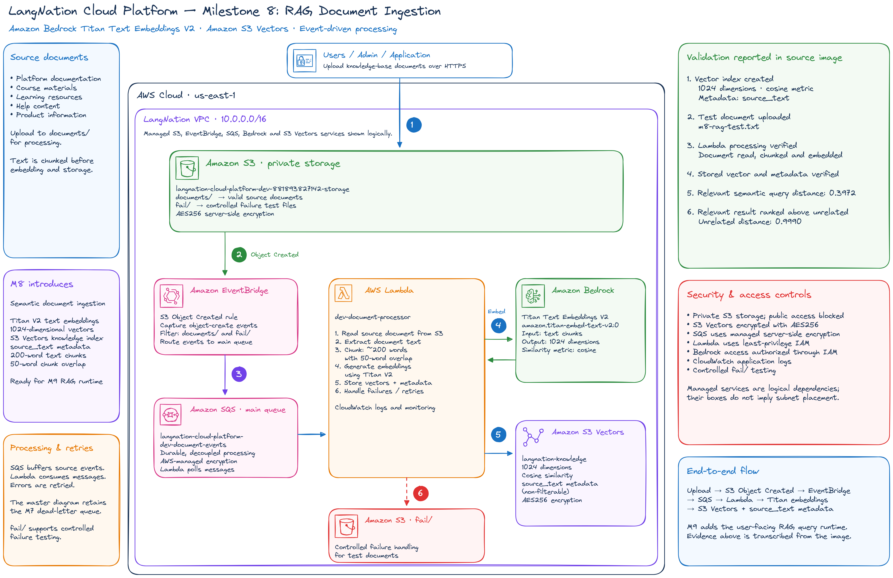
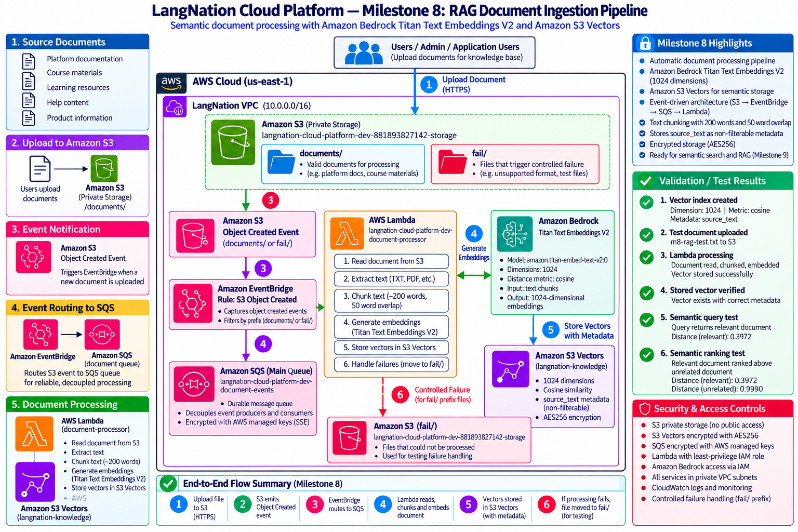
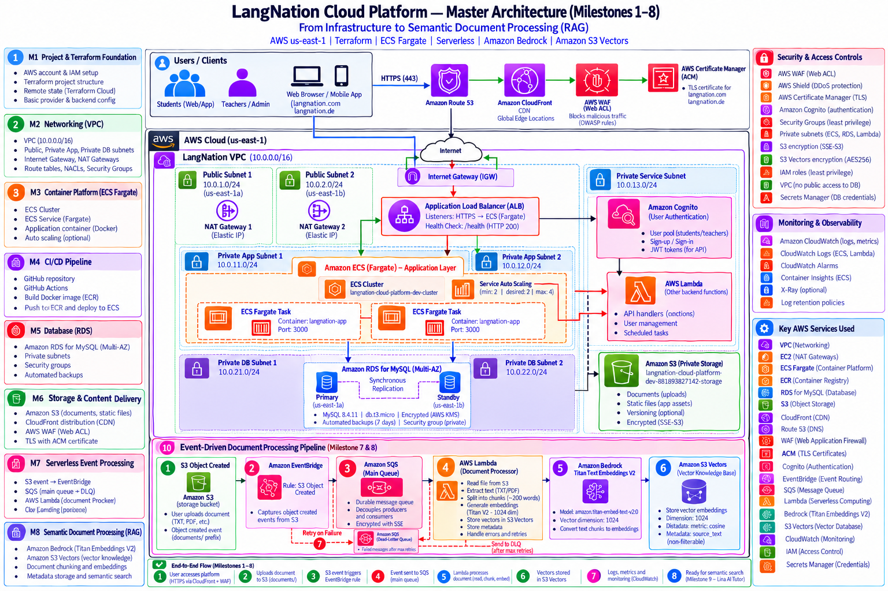

# LangNation Cloud Platform
## Milestone 8 — RAG Knowledge Pipeline

**Project:** LangNation Cloud Platform — Secure, Highly Available, Containerized Learning Platform with AI/RAG on AWS  
**Author:** Seraj Ahmad Siddiqui  
**Course:** AWS Cloud Computing with AI Bootcamp  
**Environment:** Development (`dev`)  
**AWS Region:** `us-east-1`  
**Infrastructure as Code:** Terraform  
**Relevant Technologies / Services:** Amazon S3, Amazon EventBridge, Amazon SQS, AWS Lambda, Amazon Bedrock, Titan Text Embeddings V2, Amazon S3 Vectors, Amazon CloudWatch, IAM, HCP Terraform  
**Embedding Model:** `amazon.titan-embed-text-v2:0`  
**Vector Store:** Amazon S3 Vectors  
**Remote State / Authoritative Plan & Apply:** HCP Terraform  
**Status:** ✅ Complete

---

## 1. Objective

Milestone 8 extended the Milestone 7 event-driven document-processing pipeline into a working RAG knowledge-ingestion and semantic-retrieval foundation.

The milestone added the ability to:

- read uploaded documents from the private S3 bucket
- extract UTF-8 text
- split text into overlapping chunks
- generate embeddings with Amazon Bedrock Titan Text Embeddings V2
- store vectors in Amazon S3 Vectors
- preserve source metadata and original chunk text
- perform semantic similarity search
- verify that relevant content ranks above unrelated content
- retain the Milestone 7 SQS retry and Dead Letter Queue resilience design

The ingestion path became:

```text
S3
 ↓ Object Created
EventBridge
 ↓
SQS
 ↓
Lambda
 ↓
S3 GetObject
 ↓
Text extraction
 ↓
Chunking
 ↓
Titan Text Embeddings V2
 ↓
1024-dimensional vector
 ↓
S3 Vectors
```

The retrieval-validation path became:

```text
Question
 ↓
Titan Text Embeddings V2
 ↓
1024-dimensional query vector
 ↓
S3 Vectors cosine search
 ↓
Relevant chunks
 ↓
source_text + metadata
```

Milestone 8 intentionally stops at retrieval.

Final AI answer generation is introduced in Milestone 9.

---

## 2. Architecture Design

### My Excalidraw Design Sketch

The Milestone 8 design sketch should show the ingestion flow from the existing S3/EventBridge/SQS/Lambda pipeline into Bedrock embeddings and S3 Vectors.



### Final Milestone Architecture

The final milestone architecture should show both the knowledge-ingestion path and semantic-query validation path.



### Platform Design After Milestone 8

This cumulative view should show how the RAG knowledge layer extends the existing M1–M7 platform.




---

## 3. RAG Knowledge Architecture

Milestone 8 builds directly on the Milestone 7 event-processing foundation.

### Ingestion

```text
Private S3 source bucket
        ↓ Object Created
Amazon EventBridge
        ↓
Amazon SQS
        ↓
AWS Lambda
        ↓
S3 GetObject
        ↓
UTF-8 text extraction
        ↓
200-word chunks
        ↓
40-word overlap
        ↓
Titan Text Embeddings V2
        ↓
1024-dimensional normalized embedding
        ↓
Amazon S3 Vectors
        ↓
langnation-knowledge index
```

### Retrieval Validation

```text
Question
        ↓
Titan Text Embeddings V2
        ↓
1024-dimensional query embedding
        ↓
S3 Vectors cosine search
        ↓
Top matching vector chunks
        ↓
source_text + source metadata
```

The existing M7 resilience path remains active:

```text
Lambda failure
    ↓
SQS retry
    ↓
repeated failure
    ↓
Dead Letter Queue
```

---

## 4. Amazon Bedrock Embedding Model

Embedding model:

```text
amazon.titan-embed-text-v2:0
```

Sandbox validation confirmed:

```text
Titan Text Embeddings V2
Status: ACTIVE
```

Direct model invocation also succeeded.

Embedding configuration:

```text
dimensions = 1024
normalize  = true
```

Observed embedding size:

```text
1024
```

The same embedding model is used for both:

```text
document chunks
+
semantic query text
```

Using the same model allows vectors to be compared meaningfully in the same vector space.

---

## 5. Amazon S3 Vectors

Vector bucket:

```text
langnation-cloud-platform-dev-881893827142-vectors
```

Vector index:

```text
langnation-knowledge
```

Configuration:

```text
Data type:       float32
Dimension:       1024
Distance metric: cosine
Encryption:      AES256
```

The index stores both vector values and metadata required for later retrieval.

### Stored Metadata

```text
source_bucket
source_key
chunk_index
chunk_count
event_time
source_text
```

The metadata field:

```text
source_text
```

is configured as non-filterable metadata.

This allows the original chunk text to be returned with the vector search result while avoiding use of the full source text as a filtering field.

---

## 6. Document Processing

The Lambda function was extended from metadata-only processing to actual document ingestion.

Supported source formats:

```text
.txt
.md
.csv
.json
```

Folder-marker objects ending in:

```text
/
```

are skipped.

Unsupported file types are logged and skipped.

The document-processing flow is:

```text
SQS event
 ↓
extract S3 bucket/key
 ↓
S3 GetObject
 ↓
decode UTF-8 text
 ↓
split into chunks
 ↓
embed each chunk
 ↓
write vectors + metadata
```

This milestone does not yet implement PDF, DOCX or OCR extraction.

---

## 7. Chunking Strategy

Current chunk configuration:

```text
Chunk size: 200 words
Overlap:     40 words
```

The overlap preserves context across chunk boundaries.

Conceptually:

```text
Chunk 1
words 1–200

Chunk 2
words 161–360

Chunk 3
words 321–520
```

This prevents important context near a chunk boundary from being completely separated from the next chunk.

The chosen configuration is intentionally simple and easy to inspect for the capstone.

---

## 8. Deterministic Vector Keys

Vector keys are generated from:

```text
bucket + object key + chunk index
```

using SHA-256.

Example:

```text
chunk-00000-d354a5eab85a4688a76ab9e1
```

This makes vector identifiers deterministic for a given source object and chunk position.

The main operational benefit is retry safety.

If the same SQS message is processed again:

```text
same source
+
same chunk index
→ same vector key
```

This helps prevent duplicate logical vectors when event processing is retried.

---

## 9. Lambda Runtime Configuration

The Lambda environment includes:

```text
FAILURE_TEST_PREFIX
STORAGE_BUCKET_NAME
VECTOR_BUCKET_NAME
VECTOR_INDEX_NAME
BEDROCK_EMBEDDING_MODEL_ID
EMBEDDING_DIMENSIONS
```

The M7 failure-test capability is retained so resilience behavior can continue to be tested.

Milestone 8 extends the Lambda responsibility from:

```text
event metadata logging
```

to:

```text
document retrieval
+
text processing
+
embedding generation
+
vector persistence
```

---

## 10. Least-Privilege IAM

Milestone 8 added only the permissions required for knowledge ingestion.

New permissions:

```text
s3:GetObject
bedrock:InvokeModel
s3vectors:PutVectors
```

Scope remains least privilege:

- S3 access is limited to LangNation source bucket objects
- Bedrock invocation is limited to Titan Text Embeddings V2
- S3 Vectors write access is limited to the LangNation knowledge index

The existing Milestone 7 permissions remain for:

```text
SQS
CloudWatch Logs
```

No broad `AdministratorAccess` policy was added.

This shows a progressive-permission model:

```text
M7
→ event metadata only

M8
→ add only permissions required to read, embed and store knowledge
```

---

## 11. Terraform Structure

Milestone 8 introduced the dedicated RAG knowledge module:

```text
terraform/
└── modules/
    └── rag_knowledge/
        ├── main.tf
        ├── variables.tf
        └── outputs.tf
```

Terraform resources include:

```text
aws_s3vectors_vector_bucket
aws_s3vectors_index
```

The development vector bucket uses:

```text
force_destroy = true
```

because the training sandbox is disposable.

Milestone 8 also extends the existing event-processing infrastructure with:

- additional Lambda environment variables
- additional Lambda IAM permissions
- RAG vector-resource references
- embedding-model configuration

The module design avoids hard-coding disposable AWS-generated resource IDs.

---

## 12. Implementation Summary

1. verified Titan Text Embeddings V2 availability in the sandbox
2. successfully invoked the embedding model directly
3. selected 1024 embedding dimensions
4. enabled normalized embeddings
5. created the `rag_knowledge` Terraform module
6. created the S3 Vectors vector bucket
7. created the `langnation-knowledge` vector index
8. configured `float32` vector data
9. configured 1024 dimensions
10. configured cosine distance
11. configured AES256 encryption
12. configured `source_text` as non-filterable metadata
13. extended Lambda IAM with `s3:GetObject`
14. extended Lambda IAM with `bedrock:InvokeModel`
15. extended Lambda IAM with `s3vectors:PutVectors`
16. added RAG-related Lambda environment variables
17. added UTF-8 text retrieval from S3
18. added supported-format validation
19. added folder-marker skipping
20. implemented 200-word chunking
21. implemented 40-word overlap
22. implemented Titan embedding generation
23. implemented deterministic vector keys
24. implemented vector writes to S3 Vectors
25. preserved source metadata and `source_text`
26. ran an end-to-end ingestion test
27. validated stored vector metadata
28. generated a query embedding
29. queried S3 Vectors semantically
30. validated the expected source result
31. added an unrelated document
32. confirmed the relevant AWS/RAG document ranked above the unrelated cooking document

---

## 13. Useful Commands and Validation Operations

### Terraform Initialization

```powershell
terraform init
```

Used when introducing the new RAG module and updated dependencies.

### Terraform Formatting

```powershell
terraform fmt -recursive
```

Keeps Terraform formatting consistent across the project.

### Terraform Validation

```powershell
terraform validate
```

Confirms the Terraform configuration is structurally valid.

### Bedrock Model Validation

The embedding model was checked for availability and invoked directly before integration.

Validated model:

```text
amazon.titan-embed-text-v2:0
```

### Semantic Query Validation

A query embedding was generated with the same Titan model and sent to the S3 Vectors index.

The returned distance values were then compared to verify semantic ranking.

---

## 14. Validation

Milestone 8 was validated at the embedding, vector-storage, ingestion and semantic-retrieval layers.

### Bedrock

- [x] Titan Text Embeddings V2 is available
- [x] direct model invocation succeeds
- [x] embedding dimensions = 1024
- [x] normalized embedding configuration works

### S3 Vectors

- [x] vector bucket created
- [x] vector index created
- [x] data type = `float32`
- [x] dimension = `1024`
- [x] distance metric = `cosine`
- [x] AES256 encryption enabled
- [x] `source_text` metadata configured
- [x] vectors successfully written

### Lambda Ingestion

- [x] S3 document retrieved
- [x] UTF-8 text extracted
- [x] document chunked
- [x] embedding generated
- [x] vector stored
- [x] source metadata stored
- [x] deterministic vector key generated
- [x] M7 retry and DLQ architecture retained

### Semantic Retrieval

- [x] query embedding generated
- [x] S3 Vectors queried
- [x] relevant result returned
- [x] source metadata returned
- [x] full `source_text` returned
- [x] relevant document ranked above unrelated content

---

## 15. End-to-End Ingestion Test

Test source:

```text
documents/m8-rag-test.txt
```

CloudWatch confirmed:

```text
Received 1 SQS record
Reading source document from S3
Source document read successfully
Document chunked
Embedding generated | dimensions=1024
Writing vectors
Vector batch stored
RAG document processing completed
```

Observed:

```text
chunks=1
vectors_written=1
```

Validated path:

```text
S3
→ EventBridge
→ SQS
→ Lambda
→ S3 GetObject
→ Chunking
→ Titan Embeddings
→ S3 Vectors
```

This proved that the complete knowledge-ingestion path worked end to end.

---

## 16. Stored Vector Validation

Stored vector:

```text
chunk-00000-d354a5eab85a4688a76ab9e1
```

Source:

```text
documents/m8-rag-test.txt
```

Returned metadata included:

```text
source_bucket
source_key
chunk_index
chunk_count
event_time
source_text
```

This proved that the vector store preserved enough information for later grounding and answer-generation workflows.

---

## 17. Semantic Query Validation

Question:

```text
Which AWS service is used to create LangNation semantic embeddings?
```

Returned source:

```text
documents/m8-rag-test.txt
```

Observed distance:

```text
0.3972092270851135
```

This validated:

```text
question
→ Titan query embedding
→ S3 Vectors search
→ relevant source chunk
```

The semantic query therefore retrieved the intended LangNation knowledge rather than relying on exact keyword matching alone.

---

## 18. Semantic Ranking Test

A deliberately unrelated document was added:

```text
documents/m8-unrelated-test.txt
```

It contained content about cooking and kitchen appliances.

Top-two results:

```text
1. documents/m8-rag-test.txt
   distance = 0.3972092270851135

2. documents/m8-unrelated-test.txt
   distance = 0.9990147352218628
```

Because the index uses cosine distance:

```text
smaller distance
→ greater semantic similarity
```

The AWS/RAG document correctly ranked above the unrelated cooking document.

This is stronger evidence than simply showing that a vector existed.

It demonstrated that the stored embeddings supported meaningful semantic ranking.

---

## 19. Terraform Deployment Validation

Initial RAG vector-storage plan:

```text
+2
~0
-0
```

Later ingestion/index-metadata plan:

```text
+1
~2
-1
```

This represented:

```text
-1 old empty vector index
+1 new index with source_text metadata configuration
~1 Lambda
~1 Lambda IAM policy
```

Apply completed successfully.

This validated both initial vector infrastructure creation and the later metadata / ingestion integration changes.

---

## 20. Problems and Solutions

### Problem 1 — Empty Initial Vector Index Needed Metadata Reconfiguration

The vector index was initially created before the final metadata requirements were fully defined.

The later Terraform plan showed:

```text
-1 old empty vector index
+1 new index with source_text metadata configuration
```

**Cause:**  
The index needed to be recreated with the intended metadata configuration.

**Fix:**  
Replace the still-empty index before production knowledge data depended on the earlier structure.

**Lesson:**  
Schema-like vector-index decisions should be validated early because some metadata changes can require resource replacement.

---

### Problem 2 — Folder Marker Objects Should Not Be Embedded

S3 tooling can create objects whose keys end in:

```text
/
```

These are folder-marker objects rather than useful knowledge documents.

**Fix:**  
Detect and skip object keys ending in `/`.

**Lesson:**  
The ingestion pipeline must validate object type and content before invoking embeddings.

---

### Problem 3 — Unsupported Formats Should Not Fail the Pipeline

Milestone 8 only supports:

```text
.txt
.md
.csv
.json
```

Files outside those formats should not be treated as valid text-ingestion sources.

**Fix:**  
Log unsupported formats and skip them.

**Lesson:**  
A production ingestion system needs explicit format handling rather than assuming every uploaded object contains directly decodable text.

---

## 21. Security Decisions

### Private Source Storage

Knowledge source documents remain in the private S3 bucket created in Milestone 5.

### Least-Privilege S3 Access

Lambda receives only the object-read permission required for ingestion:

```text
s3:GetObject
```

and only for the intended source bucket objects.

### Restricted Bedrock Access

Lambda receives:

```text
bedrock:InvokeModel
```

only for the selected Titan embedding model.

### Restricted Vector Write Access

Lambda receives:

```text
s3vectors:PutVectors
```

only for the intended knowledge index.

### Encryption

The S3 Vectors configuration uses:

```text
AES256
```

for vector data at rest.

### Existing Resilience Controls

Milestone 8 retains:

- encrypted SQS buffering
- retries
- DLQ handling
- CloudWatch logging

No broad administrator policy was introduced.

---

## 22. Cost and Operational Decisions

### Serverless Ingestion

The pipeline uses:

```text
S3 + EventBridge + SQS + Lambda + Bedrock + S3 Vectors
```

instead of a permanently running ingestion server.

This keeps the architecture event-driven and aligns processing cost more closely with document activity.

### Chunk Size and Overlap

The current configuration uses:

```text
200 words
40-word overlap
```

Smaller chunks increase the number of embeddings and vector writes.

Larger chunks reduce vector count but may reduce retrieval precision.

The chosen values provide a simple, explainable capstone balance.

### Deterministic Vector Keys

Deterministic keys reduce the risk of duplicate logical vectors during message retries.

This is especially important because Milestone 7 intentionally retains retry behavior.

### `force_destroy`

The development vector bucket uses:

```text
force_destroy = true
```

because the AWS training environment is disposable.

This is an environment-specific operational choice that simplifies recreation and cleanup.

### Supported Formats

Limiting ingestion to directly readable text formats keeps the first RAG pipeline simple and avoids adding document-parser dependencies before the core vector flow is proven.

---

## 23. Current Limitations

Milestone 8 intentionally does not yet implement:

```text
PDF extraction
DOCX extraction
OCR
final LLM answer generation
application-facing semantic-search endpoint
conversational memory
answer citations
```

The milestone goal is to prove:

```text
document
→ embedding
→ vector storage
→ semantic retrieval
```

before introducing answer generation.

---

## 24. What I Learned

Milestone 8 gave me practical experience with:

- Amazon Bedrock model invocation
- Titan Text Embeddings V2
- embedding dimensions
- normalized embeddings
- vector databases / vector indexes
- Amazon S3 Vectors
- cosine distance
- semantic retrieval
- metadata preservation
- RAG document chunking
- overlap strategy
- deterministic vector identifiers
- retry-safe ingestion design
- Lambda access to S3
- least-privilege Bedrock permissions
- semantic ranking validation

A major lesson was that RAG is more than calling an LLM.

The knowledge layer must first prove:

```text
source document
→ reliable ingestion
→ meaningful chunks
→ embeddings
→ vector persistence
→ semantic retrieval
```

Another important lesson was that a plausible search result is not enough. Adding an unrelated document and confirming that the relevant source ranks better provides stronger evidence that semantic retrieval is working correctly.

---

## 25. Result

Milestone 8 produced a working RAG knowledge-ingestion and semantic-retrieval foundation:

```text
S3 document
    ↓
EventBridge
    ↓
SQS
    ↓
Lambda
    ↓
S3 GetObject
    ↓
Text extraction
    ↓
Chunking
    ↓
Titan embeddings
    ↓
S3 Vectors
    ↓
Semantic query
    ↓
Relevant source chunks
```

Final milestone state:

```text
Bedrock model availability          ✅
Bedrock InvokeModel                 ✅
1024-dimensional embeddings         ✅
Normalized embeddings               ✅
S3 Vectors bucket                   ✅
S3 Vectors index                    ✅
Cosine similarity                   ✅
AES256 encryption                   ✅
source_text metadata                ✅
S3 GetObject                        ✅
UTF-8 text extraction               ✅
200-word chunks                     ✅
40-word overlap                     ✅
Deterministic vector keys           ✅
PutVectors                          ✅
Metadata retrieval                  ✅
Semantic QueryVectors               ✅
Semantic ranking                    ✅
Relevant > unrelated result         ✅
M7 retry / DLQ retained             ✅
```

This prepared the platform for **Milestone 9 — Real Application Integration, Database Restore & Lina RAG Runtime**, where retrieved LangNation knowledge would be passed to a Bedrock language model to generate grounded answers.

---

## Presentation Summary

> In Milestone 8 I extended the existing S3, EventBridge, SQS and Lambda pipeline into a working RAG knowledge layer. Lambda now reads supported text documents from the private S3 bucket, splits them into 200-word chunks with 40-word overlap, generates normalized 1024-dimensional embeddings with Amazon Titan Text Embeddings V2 and stores them in an encrypted Amazon S3 Vectors index together with source metadata and the original chunk text. I used deterministic vector keys so message retries do not create duplicate logical chunks. I then validated semantic retrieval by embedding a question and querying the vector index with cosine distance. The relevant AWS/RAG document returned a distance of about 0.397, while an unrelated cooking document returned about 0.999, so the relevant source correctly ranked first. The key lesson was that a reliable RAG system must first prove ingestion, chunking, embedding, vector persistence and semantic ranking before adding final LLM answer generation.
