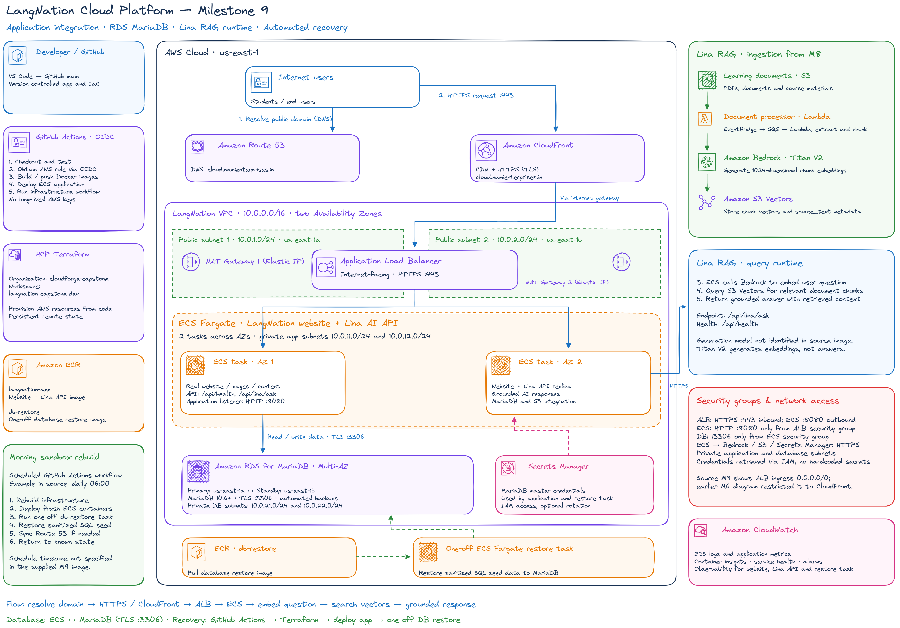
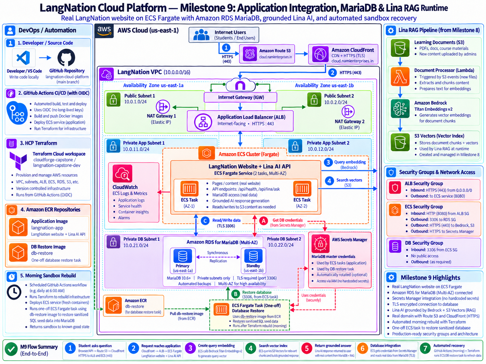
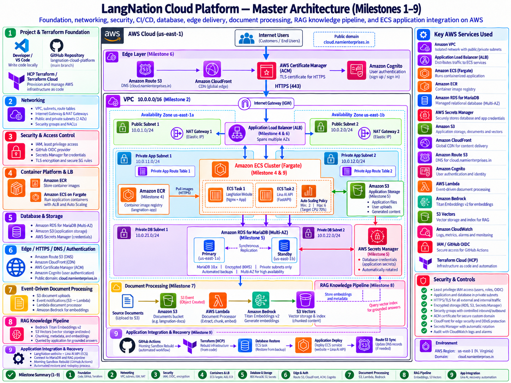

# LangNation Cloud Platform
## Milestone 9 — Real Application Integration, Database Restore & Lina RAG Runtime

**Project:** LangNation Cloud Platform — Secure, Highly Available, Containerized Learning Platform with AI/RAG on AWS  
**Author:** Seraj Ahmad Siddiqui  
**Course:** AWS Cloud Computing with AI Bootcamp  
**Environment:** Development (`dev`)  
**AWS Region:** `us-east-1`  
**Public Capstone Endpoint:** `cloud.namienterprises.in`  
**Infrastructure as Code:** Terraform  
**Relevant Technologies / Services:** Amazon ECS Fargate, Amazon ECR, Amazon RDS for MariaDB, AWS Secrets Manager, Amazon Bedrock, Titan Text Embeddings V2, Claude Haiku 4.5, Amazon S3 Vectors, GitHub Actions, GitHub OIDC, HCP Terraform  
**Application Runtime:** Amazon ECS Fargate  
**Database:** Amazon RDS for MariaDB 11.8.9  
**AI Runtime:** Amazon Bedrock + Amazon S3 Vectors  
**Remote State / Authoritative Plan & Apply:** HCP Terraform  
**Status:** ✅ Complete

---

## 1. Objective

Milestone 9 replaced the earlier controlled demonstration application with a sanitized copy of the real LangNation website and connected it to the AWS platform created in Milestones 1–8.

The main goals were to:

- deploy the real LangNation Node.js website to ECS Fargate
- connect the application to a private RDS MariaDB database
- inject database credentials securely through AWS Secrets Manager
- automate restoration of the sanitized LangNation database after sandbox rebuilds
- preserve the nightly disposable-sandbox recovery model
- expose Lina as a live RAG-powered API inside the application
- use Titan Text Embeddings V2 for query embeddings
- retrieve relevant LangNation knowledge from Amazon S3 Vectors
- use Claude Haiku 4.5 through Amazon Bedrock for grounded answer generation
- keep deployment infrastructure dynamic instead of hard-coding disposable AWS resource IDs
- validate the complete application, database, CI/CD and RAG paths end to end

Milestone 9 is the point where the project changed from an infrastructure demonstration into an integrated cloud application.

The public runtime became:

```text
User
  ↓
Persistent Route 53
  ↓
CloudFront + ACM + WAF
  ↓
Application Load Balancer
  ↓
Private ECS Fargate
  ↓
Real LangNation Node.js application
  ├── private RDS MariaDB
  └── Lina RAG runtime
        ├── Titan embeddings
        ├── S3 Vectors retrieval
        └── Claude Haiku answer generation
```

---

## 2. Architecture Design

### My Excalidraw Design Sketch

The Milestone 9 design sketch should show the real LangNation application connected to MariaDB and the Lina RAG runtime on top of the existing secure platform.



### Final Milestone Architecture

The final milestone architecture should show the application, database restore path, runtime database connection and Lina retrieval/generation path.



### Platform Design After Milestone 9

This cumulative view should show the complete platform through application integration, database recovery and grounded RAG.




---

## 3. Integrated Application Architecture

The final public application path is:

```text
User
  ↓
Persistent Route 53
  ↓
Amazon CloudFront
  ├── ACM
  └── AWS WAF
  ↓
Application Load Balancer
  ↓
Private ECS Fargate Tasks
  ↓
Real LangNation Node.js Application
  ├── Amazon RDS MariaDB
  │     └── credentials from AWS Secrets Manager
  │
  └── Lina RAG Runtime
        ├── Amazon Bedrock
        │     ├── Titan Text Embeddings V2
        │     └── Claude Haiku 4.5
        │
        └── Amazon S3 Vectors
              └── LangNation knowledge chunks
```

The nightly recovery path adds:

```text
Training sandbox cleanup
        ↓
Morning GitHub workflow
        ↓
HCP Terraform rebuild
        ↓
Sanitized MariaDB restore
        ↓
Real LangNation image deployment
        ↓
Persistent Route 53 synchronization
        ↓
Public health verification
```

---

## 4. Real LangNation Application

The application used in Milestone 2 was intentionally small and controlled.

Milestone 9 introduced:

```text
demo-website/
```

This directory contains a sanitized copy of the real LangNation website used for the capstone runtime.

Key components include:

```text
demo-website/
├── Dockerfile
├── package.json
├── package-lock.json
├── server.js
├── lib/
├── routes/
├── views/
├── public/
├── content/
├── services/
│   └── rag.js
└── MySQL/
```

The capstone application remains separate from the production LangNation repository.

The production website repository is not modified by this project.

### Git Safety

Before committing the sanitized application, the repository was checked for:

- environment files
- private keys
- large binaries
- local dependencies
- exam-paper archives
- runtime-generated files
- temporary migration data

The project retains:

```text
.env.example
```

as a safe configuration template while real credentials remain excluded.

---

## 5. Application Container and Deployment

The LangNation application is packaged with Docker and deployed through Amazon ECR to ECS Fargate.

Deployment flow:

```text
Git commit
    ↓
GitHub Actions
    ↓
Docker build
    ↓
Amazon ECR
    ↓
new ECS task-definition revision
    ↓
ECS rolling deployment
```

Each image is tagged with the triggering Git commit SHA.

This provides traceability:

```text
source commit
↕
Docker image
↕
ECS task-definition revision
↕
running application
```

The application continues to run in private ECS subnets without a public IP.

---

## 6. MariaDB Architecture

Amazon RDS configuration:

```text
Engine:               MariaDB
Version:              11.8.9
Instance class:       db.t3.micro
Deployment:           Multi-AZ
Public access:        disabled
Storage encryption:   enabled
Backup retention:     7 days
Master password:      AWS-managed
Credentials location: AWS Secrets Manager
Database:             langnation
```

RDS is placed only in the private database subnets.

The database security group allows MariaDB traffic only from the ECS application security group.

Network path:

```text
Private ECS Fargate task
        ↓ TCP 3306
Database security group
        ↓
Private RDS MariaDB
```

No public database access is exposed.

---

## 7. Sanitized Database Restore

The capstone does not contain the production database.

A sanitized SQL seed is used:

```text
database/seed/langnation-capstone-sanitized.sql
```

Restore validation expects:

```text
58 tables
```

The restore system uses a dedicated image and one-off ECS Fargate task:

```text
database/
├── restore/
│   ├── Dockerfile
│   └── restore.sh
└── seed/
    └── langnation-capstone-sanitized.sql
```

Terraform creates:

```text
Dedicated restore ECR repository
CloudWatch restore log group
Restore ECS execution role
One-off Fargate task definition
```

The restore task receives:

```text
DB_HOST
DB_PORT
DB_NAME
DB_USER
DB_PASSWORD
```

The username and password are injected through AWS Secrets Manager.

The actual credentials are not stored in:

- Git
- Docker images
- GitHub Actions
- Terraform source
- application source

---

## 8. Automated Morning Database Recovery

The AWS training environment is disposable and may be cleaned automatically.

The recovery workflow performs:

```text
AWS sandbox available
        ↓
HCP Terraform rebuild
        ↓
build database-restore image
        ↓
push restore image to ECR
        ↓
run one-off Fargate restore task
        ↓
restore sanitized SQL seed
        ↓
validate expected 58 tables
        ↓
deploy LangNation application
        ↓
sync persistent Route 53
        ↓
verify public HTTPS health
```

Validated workflow stages:

```text
Check Whether Recovery Is Needed       ✅
Rebuild AWS Infrastructure             ✅
Restore Sanitized LangNation Database  ✅
Restore LangNation Application         ✅
Sync Persistent Route 53 DNS           ✅
```

This proved that the application can recover after complete sandbox resource recreation.

---

## 9. ECS Database Runtime Integration

The container module was extended with dynamic database configuration.

Terraform passes:

```text
DB_HOST
DB_PORT
DB_NAME
```

ECS injects:

```text
DB_USER
DB_PASSWORD
```

from the RDS-managed Secrets Manager secret.

The ECS execution role receives only the permission required to retrieve the database secret.

The task definition therefore stores references to configuration and secrets rather than plaintext database passwords.

---

## 10. Verified MariaDB TLS

After the first real-website deployment, the lightweight public health endpoint was healthy while the stronger application health endpoint reported:

```json
"database": false
```

CloudWatch logs showed:

```text
Connections using insecure transport are prohibited while --require_secure_transport=ON.
```

This proved:

```text
ECS could reach RDS
credentials were present
database existed
but the client connection was not using TLS
```

The secure solution was to keep MariaDB secure transport enabled and update the application.

The application now uses the Amazon RDS certificate profile through:

```text
aws-ssl-profiles
```

The MySQL connection pool automatically enables verified TLS for RDS endpoints.

The application does not disable certificate validation and does not weaken the RDS security configuration.

Final validation:

```json
"database": true
```

This proves the application-to-database connection is functional and encrypted.

---

## 11. Lina RAG Runtime

The real application contains:

```text
demo-website/services/rag.js
```

Lina endpoint:

```text
POST /api/lina/ask
```

Example request:

```json
{
  "question": "Wann benutze ich der, die oder das?"
}
```

Runtime flow:

```text
Student question
      ↓
Titan Text Embeddings V2
      ↓
1024-dimensional query embedding
      ↓
Amazon S3 Vectors
      ↓
similarity search
      ↓
relevant LangNation knowledge chunks
      ↓
Claude Haiku 4.5
      ↓
grounded answer
```

Milestone 9 therefore completes the RAG loop that Milestone 8 stopped before final answer generation.

---

## 12. Bedrock Runtime Configuration

Embedding model:

```text
amazon.titan-embed-text-v2:0
```

Answer-generation inference profile:

```text
us.anthropic.claude-haiku-4-5-20251001-v1:0
```

Underlying foundation model:

```text
anthropic.claude-haiku-4-5-20251001-v1:0
```

These values are passed into the ECS task definition.

No AWS API keys are stored inside the application.

The AWS SDK receives temporary credentials through the ECS task role.

---

## 13. S3 Vector Knowledge Retrieval

Milestone 8 provides the vector infrastructure used by Lina.

The validated knowledge source for the final M9 test was:

```text
documents/german-a1-articles.txt
```

Knowledge ingestion remains:

```text
S3 document
    ↓
EventBridge
    ↓
SQS
    ↓
Lambda
    ↓
Titan embedding
    ↓
S3 Vectors
```

Milestone 9 adds:

```text
Student question
    ↓
ECS application
    ↓
Titan query embedding
    ↓
S3 Vectors query
    ↓
retrieved source_text
    ↓
Claude Haiku
    ↓
grounded Lina answer
```

The answer-generation path therefore uses retrieved LangNation knowledge rather than only the model's general knowledge.

---

## 14. Least-Privilege Runtime IAM

The ECS application task role is separate from the ECS execution role.

The application task role allows only the runtime actions required by Lina.

Responsibilities include:

```text
bedrock:InvokeModel
→ Titan embedding model

bedrock:InvokeModel
→ configured Claude inference profile

S3 Vectors
→ query the LangNation vector index
→ read matching vector metadata
```

The Bedrock model permission is restricted to the configured model/inference-profile path.

The application does not receive broad administrator permissions.

GitHub Actions also continues to use OIDC and can pass only the required ECS roles:

```text
application execution role
application task role
database restore execution role
```

The deployment workflow cannot pass arbitrary IAM roles.

---

## 15. Dynamic GitHub Deployment

The application deployment workflow was rewritten so disposable AWS resource identifiers are not hard-coded.

The workflow reads current infrastructure from HCP Terraform outputs:

```text
aws_region
ecr_repository_url
ecs_cluster_name
ecs_service_name
ecs_task_definition_arn
cloudfront_domain_name
```

Deployment flow:

```text
Read HCP Terraform outputs
        ↓
Authenticate to current AWS sandbox using OIDC
        ↓
Build demo-website Docker image
        ↓
Push Git-SHA image to ECR
        ↓
download Terraform-managed task definition
        ↓
validate MariaDB + Lina configuration
        ↓
replace only application image
        ↓
register new ECS revision
        ↓
update ECS service
        ↓
wait for stable service
        ↓
verify deployed image
        ↓
verify ECS counts
        ↓
verify CloudFront /health
```

This avoids coupling application deployment to disposable AWS-generated IDs.

---

## 16. Task-Definition Source-of-Truth Decision

The deployment workflow intentionally starts from the task-definition ARN exposed by HCP Terraform rather than blindly downloading whichever revision the ECS service currently runs.

This protects the Milestone 9 runtime configuration.

The Terraform-managed definition contains:

```text
DB_HOST
DB_PORT
DB_NAME
DB_USER secret
DB_PASSWORD secret
BEDROCK_EMBEDDING_MODEL_ID
BEDROCK_CHAT_MODEL_ID
VECTOR_BUCKET_NAME
VECTOR_INDEX_NAME
application task role
execution role
```

Before deployment, GitHub validates that these settings are present.

If an outdated task definition were returned, deployment would fail instead of silently removing database or RAG configuration.

---

## 17. Terraform Structure

Milestone 9 extended the existing infrastructure rather than introducing only one isolated module.

The platform now connects:

```text
container
→ ECS runtime configuration
→ application task role
→ database settings
→ Bedrock settings
→ S3 Vector settings

database
→ MariaDB
→ RDS-managed secret

event_processing
→ ingestion pipeline

rag_knowledge
→ vector bucket + index

CI/CD
→ dynamic HCP-output-driven deployment
```

The container environment was extended with:

```text
AWS account identity
RDS endpoint
RDS port
database name
RDS secret ARN
Bedrock chat-model configuration
S3 Vector configuration
```

The account ID is discovered dynamically with:

```hcl
data.aws_caller_identity.current.account_id
```

No sandbox account ID is embedded in the container module.

The ECS service depends on the database and RAG infrastructure required by the runtime.

---

## 18. HCP Terraform State Model

HCP Terraform remains the persistent infrastructure source of truth for the disposable sandbox.

An important operational issue occurred during M9:

```text
local terraform state list
→ 46 objects

local terraform plan
→ attempted to add approximately the entire environment
```

The local CLI was reading incomplete or stale local state rather than the HCP workspace used by the automated recovery workflow.

The safe model is therefore:

```text
Local Terraform
├── terraform fmt       ✅
└── terraform validate  ✅

HCP / GitHub workflow
├── Plan                ✅
├── Apply               ✅
├── Rebuild             ✅
└── Destroy             ✅
```

HCP Terraform workspace:

```text
Organization: cloudforge-capstone
Workspace:    langnation-capstone-dev
```

This avoids accidentally applying against stale local state.

---

## 19. Implementation Summary

1. introduced the sanitized LangNation application into `demo-website/`
2. reviewed the application copy for secrets, local dependencies and unnecessary artifacts
3. built the real application Docker image
4. deployed the application through ECR and ECS Fargate
5. configured MariaDB runtime environment variables
6. configured RDS-managed database secrets in ECS
7. created the dedicated database-restore container path
8. created the restore ECR repository and restore task definition
9. restored the sanitized SQL seed
10. validated the expected 58 database tables
11. integrated database restore into morning recovery
12. diagnosed the managed-password special-character parsing issue
13. corrected credential escaping in the restore process
14. added repository-level LF handling for shell scripts
15. deployed the application against MariaDB
16. detected that `/api/health` reported `"database": false`
17. used CloudWatch logs to identify `require_secure_transport`
18. added verified RDS TLS through `aws-ssl-profiles`
19. validated `"database": true`
20. integrated Lina into the real application
21. configured Titan query embeddings
22. configured S3 Vectors retrieval
23. configured Claude Haiku 4.5 answer generation
24. created the application task-role permissions required by Lina
25. changed deployment to read dynamic HCP Terraform outputs
26. protected the Terraform-managed task-definition configuration
27. validated the Git-SHA application deployment
28. validated Lina end to end with a real LangNation knowledge source
29. validated complete rebuild, database restore, application deployment, DNS synchronization and public health

---

## 20. Useful Commands and Operational Checks

### Terraform Local Validation

```powershell
terraform fmt -recursive
terraform validate
```

These are safe local checks for this project.

### Authoritative Terraform Operations

```text
Plan / Apply / Rebuild / Destroy
→ HCP Terraform / GitHub workflow
```

Local `terraform plan` or `apply` is avoided because local state is not the authoritative state source.

### Lightweight Health Endpoint

```text
GET /health
```

Expected response:

```json
{
  "status": "healthy",
  "service": "langnation-demo"
}
```

### Dependency-Aware Health Endpoint

```text
GET /api/health
```

The key final database result is:

```json
"database": true
```

### Lina API

```text
POST /api/lina/ask
```

Example body:

```json
{
  "question": "Wann benutze ich der, die oder das?"
}
```

---

## 21. Validation

Milestone 9 was validated across the application, database, CI/CD, RAG and recovery layers.

### Real Application

- [x] sanitized LangNation website integrated
- [x] Docker image builds successfully
- [x] application image pushed to ECR
- [x] ECS service runs the Git-SHA image
- [x] CloudFront `/health` returns healthy

### Database

- [x] RDS MariaDB available in private subnets
- [x] RDS master credentials managed by Secrets Manager
- [x] DB credentials injected into ECS
- [x] database restore task runs in Fargate
- [x] sanitized seed restored
- [x] expected 58 tables validated
- [x] application database connection validated
- [x] MariaDB transport encrypted with TLS
- [x] `/api/health` returns `"database": true`

### CI/CD

- [x] workflow reads HCP Terraform outputs
- [x] workflow avoids disposable resource IDs
- [x] GitHub authenticates through OIDC
- [x] Git-SHA image tagging works
- [x] task-definition runtime settings validated before deployment
- [x] ECS rolling deployment reaches stable state
- [x] desired/running/pending counts validated
- [x] public CloudFront health validated

### Lina RAG

- [x] Lina API available in the real application
- [x] Titan Text Embeddings V2 invoked
- [x] S3 Vector index queried
- [x] LangNation knowledge source retrieved
- [x] Claude Haiku 4.5 invoked through Bedrock
- [x] final answer returned
- [x] `grounded=true`
- [x] source `documents/german-a1-articles.txt` returned

### Recovery

- [x] automated HCP infrastructure rebuild
- [x] automated database restore
- [x] automated application deployment
- [x] persistent Route 53 synchronization
- [x] final public health verification

---

## 22. End-to-End Lina Validation

Final test question:

```text
Wann benutze ich der, die oder das?
```

The API returned:

```json
{
  "grounded": true,
  "sources": [
    {
      "sourceKey": "documents/german-a1-articles.txt"
    }
  ]
}
```

The returned answer explained the German articles `der`, `die` and `das`.

The validated path was:

```text
Public API
   ↓
ECS Node.js
   ↓
Titan query embedding
   ↓
S3 Vectors similarity search
   ↓
LangNation source retrieval
   ↓
Claude answer generation
   ↓
grounded=true
```

The combination of:

```text
grounded=true
+
retrieved LangNation source
```

provides stronger RAG evidence than a plausible model answer alone.

---

## 23. Application Health Validation

The platform uses two different health levels.

### Lightweight Runtime Health

```text
GET /health
```

Response:

```json
{
  "status": "healthy",
  "service": "langnation-demo"
}
```

This validates the container/application process path through ECS, ALB and CloudFront.

### Dependency-Aware Application Health

```text
GET /api/health
```

Final validated output included:

```json
{
  "ok": true,
  "content": {
    "courses": 14,
    "team": 7,
    "events": 10,
    "gallery": 8,
    "posts": 5,
    "pages": 37,
    "testimonials": 10,
    "faqs": 29
  },
  "database": true,
  "email": "not configured"
}
```

The email subsystem is intentionally outside the Milestone 9 objective.

The important dependency result is:

```json
"database": true
```

This distinction proved that a process can be healthy while one of its dependencies is not.

---

## 24. Problems and Solutions

### Problem 1 — Local Terraform Proposed Recreating Most of the Environment

Local Terraform showed only part of the actual persistent state and attempted to add approximately the entire environment.

**Cause:**  
The local working directory was not using the authoritative HCP Terraform state.

**Fix:**  
Use local Terraform only for formatting and validation and keep plan/apply/rebuild/destroy in HCP/GitHub.

**Lesson:**  
Terraform configuration can be correct while a plan is unsafe if it is evaluated against the wrong state.

---

### Problem 2 — HCP Workspace Lock

A Git push automatically started an HCP Terraform run.

A second infrastructure plan then failed because the workspace was already locked.

**Fix:**  
Inspect and use the existing run instead of starting a duplicate plan.

**Lesson:**  
Automated and manual Terraform workflows must coordinate around the same authoritative workspace.

---

### Problem 3 — RDS-Managed Password Contained a Special Character

The restore script initially failed because the generated MariaDB password was not safely represented in the option-file handling.

**Fix:**  
Safely escape generated credentials and validate authentication using a real SQL query before importing the seed.

**Lesson:**  
Generated credentials must be treated as arbitrary strings and should not be assumed to contain only shell- or config-safe characters.

---

### Problem 4 — Real Application Started but Database Health Was False

The application had the expected database variables and secrets, but:

```json
"database": false
```

CloudWatch showed:

```text
Connections using insecure transport are prohibited while --require_secure_transport=ON.
```

**Cause:**  
The client connection was not using TLS.

**Fix:**  
Keep secure transport enabled and add verified Amazon RDS TLS support to the Node.js connection pool.

**Lesson:**  
Security settings should be preserved and the application should be corrected rather than weakening the database configuration.

---

### Problem 5 — Deployment Workflow Contained Static Infrastructure Names

The original deployment flow referenced static ECR, ECS and CloudFront values.

**Cause:**  
That approach assumes AWS identifiers remain stable.

**Fix:**  
Read current infrastructure outputs dynamically from HCP Terraform on every deployment.

**Lesson:**  
Disposable infrastructure requires automation that discovers current resources rather than depending on old identifiers.

---

## 25. Security Decisions

### Managed Database Credentials

Database credentials remain in AWS Secrets Manager.

They are injected into ECS at task start and are not committed to Git.

### Verified Database TLS

RDS secure transport remains enabled.

The application verifies Amazon RDS certificates rather than disabling certificate validation.

### Private Database Network

RDS remains private and accepts MariaDB traffic only from the ECS security group.

### GitHub OIDC

GitHub uses OIDC and temporary AWS credentials instead of permanent AWS access keys.

### ECS Task Role

Lina uses ECS task-role credentials for Bedrock and S3 Vectors rather than embedded AWS credentials.

### Role Separation

Execution-role responsibilities and application runtime permissions remain separated.

### Sanitized Application and Database

The capstone uses a sanitized application/database copy rather than the production database.

This allows realistic application integration without placing the production environment inside the capstone repository.

---

## 26. Cost and Operational Decisions

### One-Off Database Restore Task

The database restore runs as a one-off Fargate task instead of as a permanently running restore service.

This matches the recovery use case and avoids keeping an unnecessary worker active.

### Multi-AZ MariaDB

The database remains Multi-AZ.

This costs more than a Single-AZ development database, but it preserves the production-style availability design already established by the capstone.

### Dynamic Infrastructure Discovery

Reading HCP outputs removes the operational burden of updating CI/CD whenever nightly cleanup creates new AWS identifiers.

### Layered Health Checks

The platform intentionally keeps:

```text
/health
→ lightweight runtime health

/api/health
→ application + dependency health
```

This improves troubleshooting because deployment health and database dependency health are not treated as the same signal.

### Disposable Sandbox Recovery

The operational model is:

```text
HCP Terraform
→ recreate infrastructure

database restore task
→ recreate sanitized data

GitHub Actions
→ deploy application

Route 53 automation
→ restore stable public endpoint
```

Each automation layer owns a distinct recovery responsibility.

---

## 27. What I Learned

Milestone 9 gave me practical experience with:

- integrating a real application into an existing cloud platform
- sanitized production-like data
- one-off ECS Fargate restore tasks
- Secrets Manager integration
- generated-password handling
- MariaDB secure transport
- verified RDS TLS
- dependency-aware health checks
- ECS execution roles vs task roles
- Bedrock query embeddings
- S3 Vectors runtime retrieval
- grounded LLM generation
- dynamic HCP-output-driven deployments
- Git-SHA deployment traceability
- authoritative Terraform state management
- multi-layer recovery automation

A major lesson was that:

```text
/health → healthy
```

does not necessarily mean:

```text
all dependencies → healthy
```

The stronger `/api/health` endpoint exposed the database TLS problem even while the public process health remained green.

Another important lesson was that logs should drive debugging. The CloudWatch `require_secure_transport` message identified the real problem immediately and avoided unnecessary changes to Terraform or network security.

A third lesson was that RAG should be validated with evidence. The final Lina test returned both `grounded=true` and the retrieved LangNation source.

---

## 28. Result

Milestone 9 produced a fully integrated application runtime:

```text
Persistent Route 53
        ↓
CloudFront + WAF
        ↓
ALB
        ↓
Private ECS Fargate
        ├── verified-TLS MariaDB
        └── Lina RAG
              ├── Titan embeddings
              ├── S3 Vectors
              └── Claude Haiku 4.5
```

Final milestone state:

```text
Real LangNation website in ECS Fargate         ✅
Docker image stored in ECR                     ✅
Private Multi-AZ MariaDB                       ✅
Secrets Manager DB credentials                 ✅
Automated sanitized DB restore                 ✅
58-table restore validation                    ✅
Application → MariaDB                          ✅
Application → MariaDB over verified TLS        ✅
Dynamic HCP-driven deployment                  ✅
GitHub OIDC                                    ✅
Git-SHA deployment traceability                ✅
CloudFront public application                  ✅
Lina API                                       ✅
Titan query embeddings                         ✅
S3 Vectors retrieval                           ✅
Claude Haiku grounded generation               ✅
grounded=true                                  ✅
Knowledge source returned                      ✅
Morning rebuild + restore + deploy              ✅
```

Milestone 9 leaves the platform ready for **Milestone 10 — Security, Monitoring & Governance**, where observability and audit controls can be added around the integrated runtime.

---

## Presentation Summary

> In Milestone 9 I replaced the small demonstration service with a sanitized copy of the real LangNation Node.js application and connected it to the cloud platform built in the previous milestones. The application runs on private ECS Fargate tasks, connects to a private Multi-AZ MariaDB database using Secrets Manager credentials and verified RDS TLS, and can be fully recovered after sandbox cleanup through an automated one-off database-restore task that validates all 58 expected tables. I also integrated Lina into the application: a student question is embedded with Titan Text Embeddings V2, relevant LangNation chunks are retrieved from S3 Vectors, and Claude Haiku 4.5 generates a grounded answer. The final validation returned `grounded=true` together with the source `documents/german-a1-articles.txt`. I also changed the deployment workflow to read live infrastructure values from HCP Terraform rather than hard-coding disposable AWS identifiers. The main lessons were to preserve security settings instead of bypassing them, use dependency-aware health checks, and validate RAG with retrieved evidence rather than only a plausible answer.
