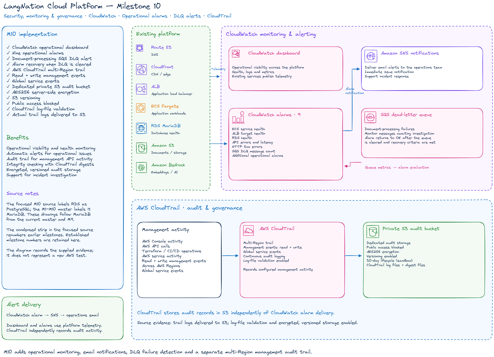
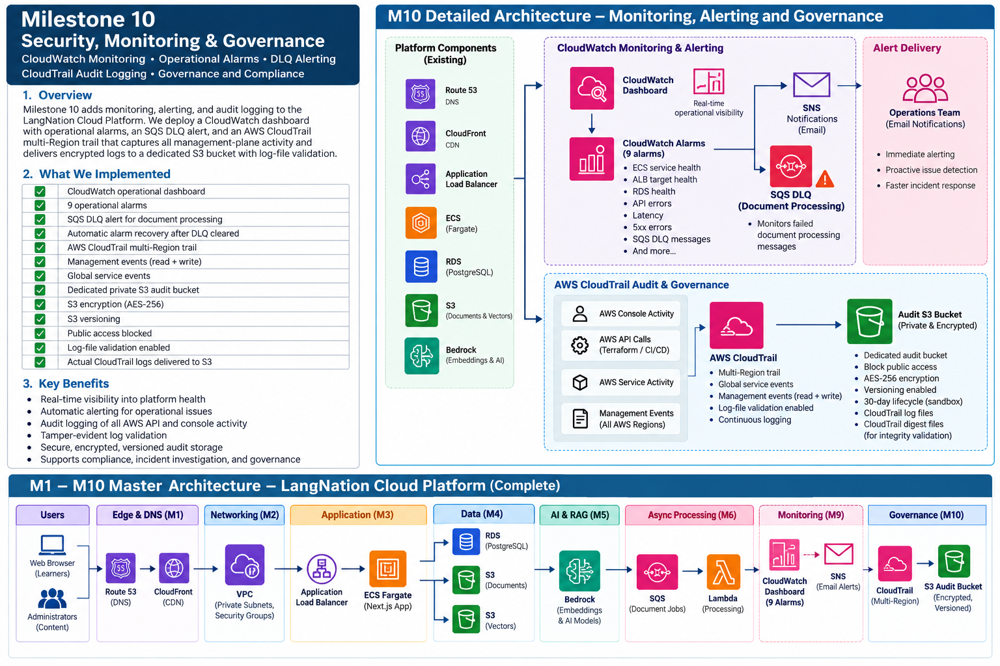
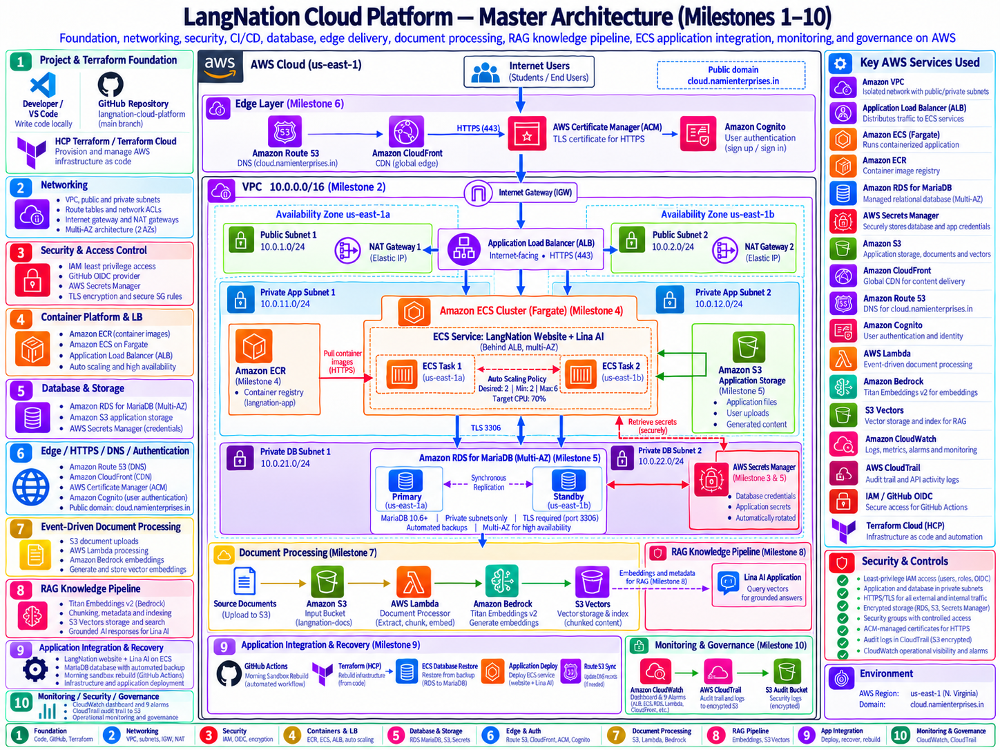

# LangNation Cloud Platform
## Milestone 10 — Security, Monitoring & Governance

**Project:** LangNation Cloud Platform — Secure, Highly Available, Containerized Learning Platform with AI/RAG on AWS  
**Author:** Seraj Ahmad Siddiqui  
**Course:** AWS Cloud Computing with AI Bootcamp  
**Environment:** Development (`dev`)  
**AWS Region:** `us-east-1`  
**Public Capstone Endpoint:** `cloud.namienterprises.in`  
**Infrastructure as Code:** Terraform  
**Relevant Technologies / Services:** Amazon CloudWatch, CloudWatch Dashboards, CloudWatch Alarms, Amazon ECS, Application Load Balancer, Amazon RDS, AWS Lambda, Amazon SQS, Amazon CloudFront, AWS CloudTrail, Amazon S3, IAM, HCP Terraform  
**Monitoring:** Amazon CloudWatch  
**Governance / Audit:** AWS CloudTrail + dedicated Amazon S3 audit bucket  
**Remote State / Authoritative Plan & Apply:** HCP Terraform  
**Status:** ✅ Complete

---

## 1. Objective

Milestone 10 added the operational visibility, alerting and governance layer on top of the application platform completed in Milestones 1–9.

The main goals were to:

- create a reusable CloudWatch operations dashboard
- monitor ECS, ALB, RDS, Lambda, SQS/DLQ and CloudFront
- create actionable operational alarms
- verify alarm behavior with a real DLQ condition
- add persistent multi-Region AWS API auditing with CloudTrail
- deliver audit logs to a dedicated private S3 bucket
- enable S3 encryption, versioning and public-access blocking
- enable CloudTrail log-file integrity validation
- keep monitoring and governance reproducible with Terraform
- avoid enabling expensive or noisy services without a clear capstone requirement

The platform now answers three different operational questions:

```text
Is the application running?
→ CloudFront / ALB / ECS / health checks

Are dependencies healthy?
→ RDS / Lambda / SQS / DLQ / API health

Who changed the AWS environment?
→ CloudTrail / private audit logs
```

This milestone therefore extended the platform from application functionality into operational observability and auditability.

---

## 2. Architecture Design

### My Excalidraw Design Sketch

The Milestone 10 design sketch should show the monitoring path from application services into CloudWatch and the governance path from AWS management activity into CloudTrail and the dedicated audit bucket.



### Final Milestone Architecture

The final milestone architecture should show CloudWatch dashboards and alarms alongside the multi-Region CloudTrail audit path.



### Platform Design After Milestone 10

This cumulative view should show the complete M1–M10 platform with monitoring and governance added around the application, database, RAG and edge layers.




---

## 3. Monitoring and Governance Architecture

The Milestone 10 architecture adds two operational layers.

### Monitoring

```text
Route 53 / CloudFront
        ↓
AWS WAF + ALB
        ↓
ECS Fargate Application
      /              \
     v                v
RDS MariaDB        Lina RAG
                   Bedrock
                   S3 Vectors

        ↓ metrics / logs

Amazon CloudWatch
├── Operations Dashboard
├── 9 Custom Alarms
└── Existing Log Groups
```

### Governance

```text
AWS management activity
        ↓
AWS CloudTrail
        ↓
Multi-Region management-event trail
        ↓
Dedicated private S3 audit bucket
├── AES-256 encryption
├── Versioning
├── Public access blocked
├── 30-day lifecycle
└── Log-file validation
```

Monitoring focuses on the current operational state.

Governance focuses on historical AWS management activity and audit evidence.

---

## 4. Baseline Before Milestone 10

Before M10:

```text
Custom CloudWatch dashboards   0
Custom operational alarms      0
```

The only existing CloudWatch alarms were the AWS-managed target-tracking alarms created automatically by ECS Application Auto Scaling.

Existing log groups already included:

```text
/ecs/langnation-cloud-platform-dev-app
Retention: 7 days

/aws/lambda/langnation-cloud-platform-dev-document-processor
Retention: 7 days
```

CloudTrail Event History was available, but the platform did not yet have a dedicated persistent customer-managed trail.

Baseline governance:

```text
CloudTrail Event History       ✅
Custom persistent trail        ❌
Dedicated audit S3 bucket      ❌
Multi-Region trail             ❌
Log-file validation            ❌
```

Milestone 10 therefore built on existing service logs while adding centralized operational monitoring and persistent audit storage.

---

## 5. CloudWatch Operations Dashboard

Dashboard:

```text
langnation-cloud-platform-dev-operations
```

The dashboard covers the main application and supporting services.

### ECS Fargate

```text
CPUUtilization
MemoryUtilization
```

### Application Load Balancer

```text
RequestCount
HTTPCode_Target_5XX_Count
UnHealthyHostCount
```

### RDS MariaDB

```text
CPUUtilization
DatabaseConnections
FreeStorageSpace
```

### AWS Lambda

```text
Invocations
Errors
Duration
```

### Amazon SQS

```text
Processing queue backlog
Dead Letter Queue backlog
```

### Amazon CloudFront

```text
Requests
4xxErrorRate
5xxErrorRate
```

CloudFront metrics are read from `us-east-1` because CloudFront is a global AWS service.

The dashboard provides one operational view instead of requiring each service to be inspected separately.

---

## 6. Operational Alarms

Nine custom alarms were created:

```text
langnation-cloud-platform-dev-ecs-cpu-high
langnation-cloud-platform-dev-ecs-memory-high
langnation-cloud-platform-dev-alb-unhealthy-targets
langnation-cloud-platform-dev-alb-target-5xx
langnation-cloud-platform-dev-rds-cpu-high
langnation-cloud-platform-dev-rds-low-storage
langnation-cloud-platform-dev-lambda-errors
langnation-cloud-platform-dev-document-dlq-messages
langnation-cloud-platform-dev-cloudfront-5xx
```

Thresholds:

```text
ECS CPU                   >= 80% for 2 x 5-minute datapoints
ECS Memory                >= 80% for 2 x 5-minute datapoints
ALB Unhealthy Targets     >= 1 for 2 x 1-minute datapoints
ALB Target 5XX            >= 5 in 5 minutes
RDS CPU                   >= 80% for 2 x 5-minute datapoints
RDS Free Storage          < 2 GiB for 2 x 5-minute datapoints
Lambda Errors             >= 1 in 5 minutes
DLQ Messages              >= 1 in 5 minutes
CloudFront 5XX            >= 5% for 5 x 1-minute datapoints
```

Missing data is treated as:

```text
notBreaching
```

This avoids unnecessary alarm states when a metric is temporarily absent in the low-volume development environment.

---

## 7. DLQ Alarm Controlled Validation

The Milestone 7 controlled-failure test had intentionally generated two failed messages that remained in the Dead Letter Queue.

Initial queue state:

```text
ApproximateNumberOfMessages            2
ApproximateNumberOfMessagesDelayed     0
ApproximateNumberOfMessagesNotVisible  0
```

After the monitoring layer was deployed, the DLQ alarm correctly entered:

```text
ALARM
```

The stale controlled-test messages were then purged.

Post-cleanup queue state:

```text
ApproximateNumberOfMessages            0
ApproximateNumberOfMessagesDelayed     0
ApproximateNumberOfMessagesNotVisible  0
```

After the next CloudWatch evaluation:

```text
ALARM → OK
```

The complete validation path was:

```text
M7 controlled failure
        ↓
messages arrive in DLQ
        ↓
M10 CloudWatch detects backlog
        ↓
alarm enters ALARM
        ↓
engineer investigates
        ↓
stale test messages removed
        ↓
CloudWatch observes recovery
        ↓
alarm returns OK
```

This proved both alarm detection and recovery behavior with a real condition.

---

## 8. CloudTrail Governance

Milestone 10 introduced a dedicated CloudTrail governance layer.

Architecture:

```text
AWS management activity
        ↓
AWS CloudTrail
        ↓
Multi-Region management-event trail
        ↓
Dedicated private S3 audit bucket
        ↓
encrypted + versioned audit evidence
```

The trail records management-plane actions such as:

- IAM changes
- ECS updates
- RDS configuration changes
- Security Group changes
- CloudFront changes
- Terraform/API actions
- AWS Console actions
- AssumeRole activity

Data events and CloudTrail Insights are intentionally excluded from this sandbox milestone to control event volume and cost.

---

## 9. CloudTrail Configuration

Trail:

```text
langnation-cloud-platform-dev-audit
```

Validated configuration:

```text
IsMultiRegionTrail           True
IncludeGlobalServiceEvents   True
LogFileValidationEnabled     True
IsLogging                    True
```

Event selector:

```text
ReadWriteType             All
IncludeManagementEvents   True
```

This creates a persistent management-event audit trail instead of relying only on CloudTrail Event History.

---

## 10. Dedicated Audit S3 Bucket

Audit bucket:

```text
langnation-cloud-platform-dev-881893827142-cloudtrail
```

The name is generated dynamically from:

```text
project name
+
environment
+
current AWS account ID
```

No AWS account ID is hard-coded inside the reusable governance module.

Validated controls:

```text
Encryption: AES256
Versioning: Enabled

Public Access Block:
BlockPublicAcls        True
BlockPublicPolicy      True
IgnorePublicAcls       True
RestrictPublicBuckets  True

Lifecycle retention: 30 days
```

The 30-day lifecycle is intentional for the disposable training sandbox.

A production audit environment would normally use a longer retention period and stronger deletion protection.

---

## 11. CloudTrail Bucket Policy

The audit bucket policy permits CloudTrail only the operations required for delivery:

```text
s3:GetBucketAcl
s3:PutObject
```

Delivery is restricted through:

```text
aws:SourceArn
```

CloudTrail writes under:

```text
AWSLogs/<AWS-account-id>/*
```

This keeps audit storage separate from application data and limits write access to the intended CloudTrail source.

---

## 12. Log Integrity Validation

The trail uses:

```text
enable_log_file_validation = true
```

CloudTrail can therefore generate digest files that are used to validate whether audit log files were modified or deleted.

At final Milestone 10 validation time:

```text
normal CloudTrail log delivery   ✅
first digest file                not yet observed
```

The digest had not yet appeared because digest delivery occurs periodically rather than immediately after enabling validation.

The configuration itself was verified as enabled.

---

## 13. Actual Audit Log Delivery

A real CloudTrail log object was delivered to S3.

Observed path:

```text
AWSLogs/881893827142/CloudTrail/us-east-1/2026/10/22/
..._CloudTrail_us-east-1_20261022T1200Z_....json.gz
```

This proved:

```text
AWS activity
   ↓
CloudTrail
   ↓
S3 audit-log delivery
```

The governance implementation was therefore validated with actual audit data rather than only Terraform resource creation.

---

## 14. Terraform Structure

Milestone 10 introduced two reusable Terraform modules:

```text
terraform/
└── modules/
    ├── monitoring/
    │   ├── main.tf
    │   ├── variables.tf
    │   └── outputs.tf
    │
    └── governance/
        ├── main.tf
        ├── variables.tf
        └── outputs.tf
```

Both modules are connected from:

```text
terraform/environments/dev/main.tf
terraform/environments/dev/outputs.tf
```

The modules consume dynamic outputs from the existing:

- ECS infrastructure
- ALB
- RDS
- Lambda
- SQS / DLQ
- CloudFront

No disposable AWS-generated resource IDs are hard-coded.

### Monitoring Plan

HCP Terraform plan:

```text
+10
~1
-0
```

The ten new resources were:

```text
1 CloudWatch dashboard
9 CloudWatch operational alarms
```

The single modified resource was the already-known RAG seed object:

```text
aws_s3_object.knowledge_seed["german-a1-articles.txt"]
```

No resources were destroyed.

### Governance Plan

HCP Terraform plan:

```text
+7
~1
-0
```

The seven new resources were:

```text
S3 audit bucket
S3 public-access block
S3 versioning
S3 encryption configuration
S3 lifecycle configuration
S3 bucket policy
CloudTrail trail
```

The single modified resource was again the already-known RAG seed object.

No existing infrastructure was destroyed.

---

## 15. Implementation Summary

1. inspected the pre-M10 monitoring and governance baseline
2. created the reusable `monitoring` Terraform module
3. created the CloudWatch operations dashboard
4. added ECS CPU and memory metrics
5. added ALB request, target 5XX and unhealthy-target metrics
6. added RDS CPU, connection and free-storage metrics
7. added Lambda invocation, error and duration metrics
8. added SQS processing-queue and DLQ backlog metrics
9. added CloudFront request and error-rate metrics
10. created nine custom operational alarms
11. configured missing metric data as `notBreaching`
12. deployed the monitoring module through HCP Terraform
13. validated the dashboard and alarm count
14. observed the existing M7 DLQ messages triggering the new alarm
15. purged the stale controlled-test DLQ messages
16. verified the DLQ alarm recovered from `ALARM` to `OK`
17. created the reusable `governance` Terraform module
18. created the dedicated private audit S3 bucket
19. enabled S3 AES256 encryption
20. enabled S3 versioning
21. enabled full Block Public Access
22. configured a 30-day lifecycle
23. created the CloudTrail delivery bucket policy
24. created the multi-Region CloudTrail trail
25. enabled global service events
26. enabled management read/write events
27. enabled log-file integrity validation
28. deployed the governance module through HCP Terraform
29. verified CloudTrail logging status
30. verified an actual CloudTrail log object was delivered to the audit bucket

---

## 16. Useful Commands and Validation Checks

### Terraform Local Validation

```powershell
terraform fmt -recursive
terraform validate
```

These remain the safe local Terraform checks for this project.

### Authoritative Terraform Operations

```text
Plan / Apply
→ HCP Terraform
```

### SQS / DLQ Validation

Queue attributes were inspected to validate the controlled backlog:

```text
ApproximateNumberOfMessages
ApproximateNumberOfMessagesDelayed
ApproximateNumberOfMessagesNotVisible
```

### CloudTrail Configuration Checks

The trail was validated for:

```text
IsMultiRegionTrail
IncludeGlobalServiceEvents
LogFileValidationEnabled
IsLogging
```

### S3 Audit Delivery Check

The audit bucket was inspected for objects under:

```text
AWSLogs/<AWS-account-id>/CloudTrail/
```

The presence of a real `.json.gz` CloudTrail object proved delivery.

---

## 17. Validation

### CloudWatch Dashboard

- [x] operations dashboard created
- [x] ECS CPU and memory monitoring
- [x] ALB request / 5XX / unhealthy-target monitoring
- [x] RDS CPU / connections / storage monitoring
- [x] Lambda invocation / error / duration monitoring
- [x] SQS processing-queue monitoring
- [x] DLQ monitoring
- [x] CloudFront request / 4XX / 5XX monitoring

### Operational Alarms

- [x] nine custom operational alarms created
- [x] ECS CPU alarm
- [x] ECS memory alarm
- [x] ALB unhealthy-target alarm
- [x] ALB target 5XX alarm
- [x] RDS CPU alarm
- [x] RDS low-storage alarm
- [x] Lambda errors alarm
- [x] DLQ messages alarm
- [x] CloudFront 5XX alarm
- [x] DLQ alarm entered `ALARM` correctly
- [x] DLQ alarm returned to `OK` correctly

### CloudTrail

- [x] custom trail created
- [x] multi-Region enabled
- [x] global service events enabled
- [x] management read/write events enabled
- [x] log-file validation enabled
- [x] logging enabled
- [x] real audit log delivered

### Audit S3 Bucket

- [x] dedicated private bucket created
- [x] public access fully blocked
- [x] AES-256 encryption enabled
- [x] versioning enabled
- [x] lifecycle retention configured
- [x] CloudTrail-restricted bucket policy configured

---

## 18. Controlled Monitoring Test

The strongest monitoring validation in M10 reused a real condition created by the Milestone 7 controlled-failure test.

Initial state:

```text
DLQ messages = 2
```

Monitoring state:

```text
document-dlq-messages alarm = ALARM
```

Corrective action:

```text
purge stale controlled-test messages
```

Recovered state:

```text
DLQ messages = 0
alarm = OK
```

This proved the complete operator loop:

```text
condition occurs
   ↓
metric changes
   ↓
alarm fires
   ↓
condition investigated
   ↓
condition corrected
   ↓
metric recovers
   ↓
alarm returns OK
```

This is stronger evidence than showing an alarm definition alone.

---

## 19. Problems and Solutions

### Problem 1 — Existing DLQ Messages Triggered the New Alarm

Immediately after the monitoring layer was deployed, the DLQ alarm entered:

```text
ALARM
```

**Cause:**  
Two real messages from the M7 controlled-failure test were still present in the DLQ.

**Resolution:**  
Inspect the queue, confirm the messages were known test artifacts, purge them and wait for the next CloudWatch evaluation.

**Result:**

```text
ALARM → OK
```

**Lesson:**  
A monitoring system is most useful when it identifies real operational state, even when the condition originates from an earlier test.

---

### Problem 2 — CloudTrail Digest Was Not Immediately Visible

A real CloudTrail log object was delivered, but the first digest file had not yet appeared at the time of validation.

**Cause:**  
CloudTrail digest files are delivered periodically rather than immediately with every log object.

**Resolution:**  
Validate that:

```text
LogFileValidationEnabled = True
```

and confirm normal CloudTrail log delivery separately.

**Lesson:**  
Asynchronous governance evidence should be interpreted according to the service delivery model rather than treated as an immediate failure.

---

## 20. Security Decisions

### Separate Monitoring and Governance Modules

Monitoring and audit responsibilities are separated into independent Terraform modules.

This improves clarity and avoids mixing operational metrics with audit-storage configuration.

### Dedicated Audit Storage

CloudTrail logs use a dedicated S3 bucket rather than the normal application storage bucket.

This separates audit evidence from application data.

### Private Audit Bucket

The audit bucket uses:

```text
Block Public Access
AES256 encryption
Versioning
restricted CloudTrail bucket policy
```

### No Hard-Coded Disposable IDs

Monitoring dimensions and governance resources are connected using module outputs and dynamically discovered account information.

### Existing Auto Scaling Alarms Remain Untouched

AWS-managed target-tracking alarms support scaling behavior.

M10 custom alarms are operator-facing.

The two alarm types have different responsibilities and should not be conflated.

### No Blind Security-Service Expansion

GuardDuty, Security Hub and AWS Config were not enabled automatically simply because they exist.

The milestone intentionally limits governance to services with a clear capstone purpose and acceptable sandbox cost/noise.

---

## 21. Cost and Operational Decisions

### Custom Alarms vs Auto Scaling Alarms

Application Auto Scaling already creates alarms that control scaling.

Milestone 10 adds separate alarms for operational investigation.

This avoids modifying AWS-managed scaling behavior.

### Missing Data

Operational alarms use:

```text
notBreaching
```

for missing data.

This suits the low-volume development environment and reduces noisy false alarms.

### CloudTrail Scope

The trail includes management events but intentionally excludes:

```text
data events
CloudTrail Insights
```

for the capstone sandbox.

This controls event volume and cost while still providing persistent governance evidence for infrastructure changes.

### Audit Retention

The CloudTrail bucket uses:

```text
30-day lifecycle
```

because the training sandbox is temporary.

A production governance environment would normally use longer retention.

### Additional Security Services

GuardDuty, Security Hub and AWS Config were not enabled without a specific requirement.

This reflects an important architectural principle:

> **Cost awareness is part of architecture.**

---

## 22. What I Learned

Milestone 10 gave me practical experience with:

- CloudWatch dashboards
- service-level metrics
- operational alarm design
- alarm thresholds and evaluation periods
- missing-data behavior
- distinguishing Auto Scaling alarms from operator alarms
- SQS / DLQ backlog monitoring
- real alarm-state validation
- alarm recovery validation
- AWS CloudTrail
- multi-Region audit trails
- management-event selectors
- CloudTrail log-file validation
- dedicated audit S3 storage
- bucket encryption
- versioning
- public-access blocking
- restricted service bucket policies
- governance cost trade-offs

One important lesson was that monitoring becomes much more meaningful when it detects a real condition.

The DLQ alarm did not need an artificial metric injection; it found two actual leftover M7 test messages and then returned to `OK` after the queue was cleaned.

Another lesson was that CloudTrail Event History is not the same as a persistent audit architecture.

A customer-managed trail and dedicated S3 bucket provide durable audit evidence beyond the console's default event-history view.

A third lesson was that governance should be proportional to the environment. Enabling every available security service without considering cost, event volume and project requirements is not automatically better architecture.

---

## 23. Result

Milestone 10 added operational visibility and persistent governance to the platform.

```text
Application platform
        ↓
CloudWatch
├── dashboard
├── metrics
└── operational alarms

AWS management activity
        ↓
CloudTrail
        ↓
private audit S3 bucket
```

Final milestone state:

```text
CloudWatch operations dashboard           ✅
9 custom operational alarms               ✅
ECS monitoring                            ✅
ALB monitoring                            ✅
RDS monitoring                            ✅
Lambda monitoring                         ✅
SQS / DLQ monitoring                      ✅
CloudFront monitoring                     ✅
Real alarm detection                      ✅
Alarm recovery validation                 ✅

CloudTrail multi-Region trail             ✅
Management-event auditing                 ✅
Global service events                     ✅
Private audit S3 bucket                   ✅
AES-256 encryption                        ✅
S3 versioning                             ✅
Public-access blocking                    ✅
30-day lifecycle retention                ✅
Log-file validation enabled               ✅
Actual audit-log delivery                 ✅
```

After Milestone 10, the platform contains:

```text
Infrastructure
+ application
+ database
+ RAG
+ CI/CD
+ recovery
+ monitoring
+ operational alarms
+ audit governance
```

This prepared the platform for **Milestone 11 — CI/CD Quality Gates & Release Hardening**.

---

## Presentation Summary

> In Milestone 10 I added the operational monitoring and governance layer to the LangNation platform. I created a CloudWatch operations dashboard covering ECS, ALB, RDS, Lambda, SQS/DLQ and CloudFront, together with nine custom alarms for conditions such as high CPU, unhealthy ALB targets, application 5XX errors, low RDS storage, Lambda failures, DLQ backlog and CloudFront 5XX rate. The strongest validation came from two real controlled-test messages left in the DLQ from Milestone 7: the new alarm entered `ALARM`, I verified the backlog, removed the known test messages and then observed the alarm return to `OK`. For governance, I created a multi-Region CloudTrail trail for management events and delivered logs to a dedicated private S3 bucket with AES256 encryption, versioning, Block Public Access, a 30-day lifecycle and log-file validation enabled. I also confirmed that a real CloudTrail log object was delivered. The main lesson was that good monitoring must prove both detection and recovery, while governance should provide durable audit evidence without enabling unnecessary cost or noise.
