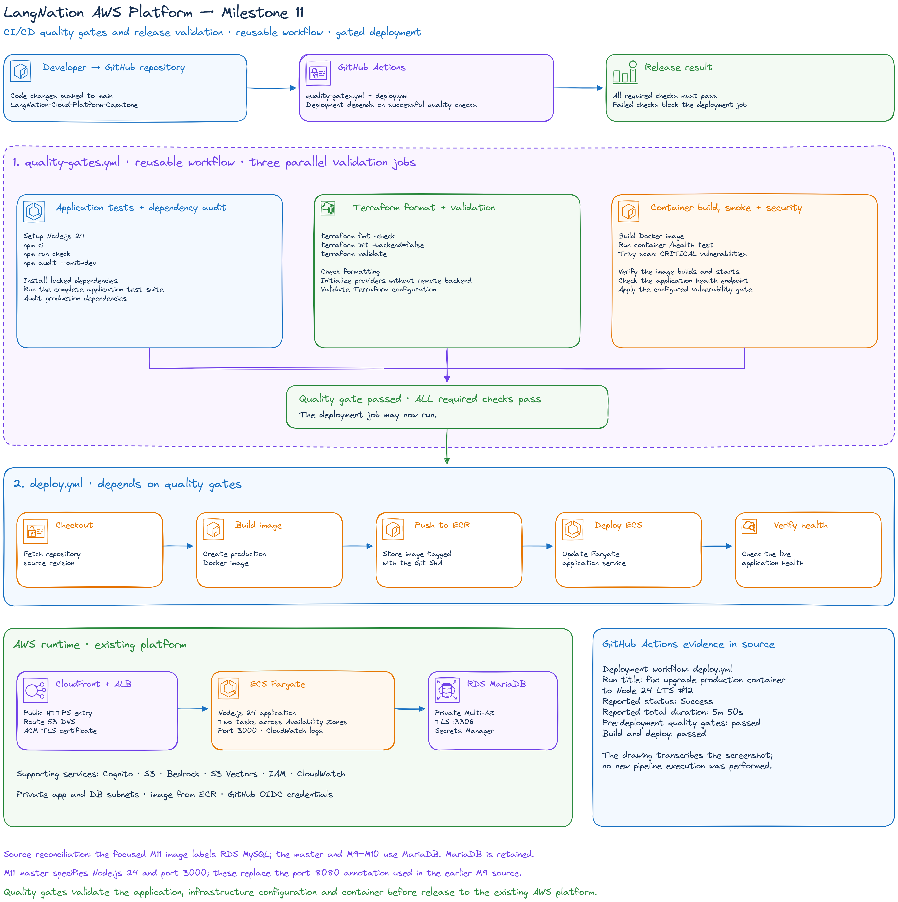
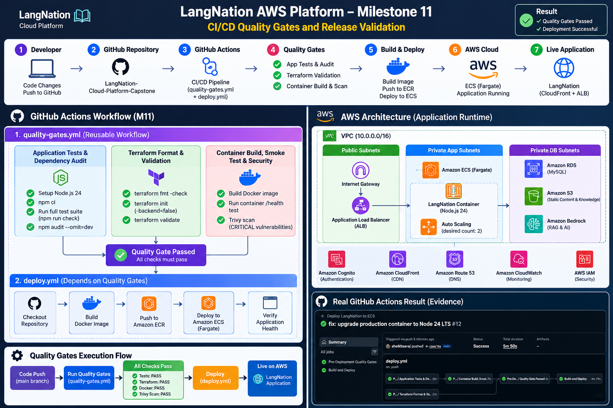
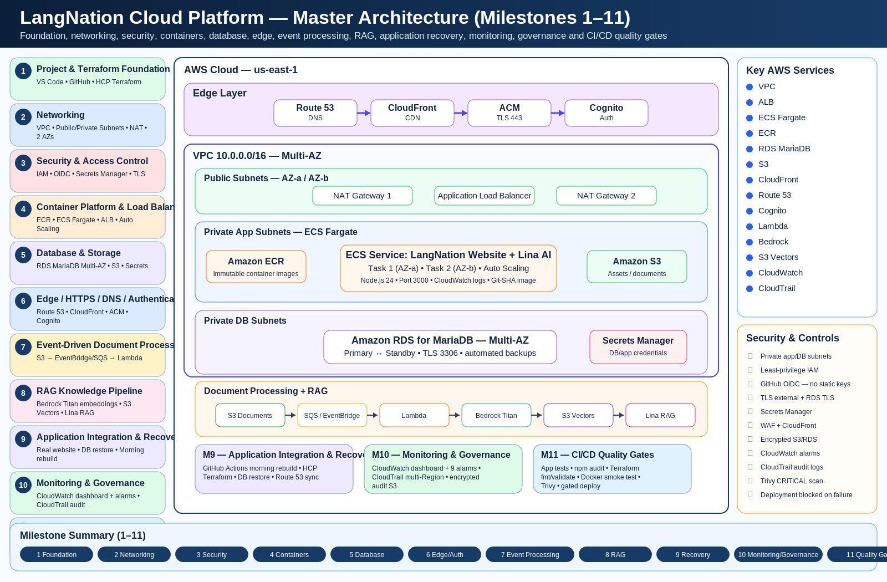

# LangNation Cloud Platform
## Milestone 11 — CI/CD Quality Gates & Release Hardening

**Project:** LangNation Cloud Platform — Secure, Highly Available, Containerized Learning Platform with AI/RAG on AWS  
**Author:** Seraj Ahmad Siddiqui  
**Course:** AWS Cloud Computing with AI Bootcamp  
**Environment:** Development (`dev`)  
**AWS Region:** `us-east-1`  
**Infrastructure as Code:** Terraform  
**Relevant Technologies / Services:** GitHub Actions, Node.js, npm, Terraform, Docker, Trivy, Amazon ECR, Amazon ECS Fargate, GitHub OIDC  
**CI/CD:** GitHub Actions  
**Quality Gates:** Application tests, dependency audit, Terraform validation, container smoke test, container vulnerability scan  
**Deployment Target:** Amazon ECS on AWS Fargate  
**Remote State / Authoritative Plan & Apply:** HCP Terraform  
**Status:** ✅ Complete

---

## 1. Objective

Milestone 11 hardened the existing GitHub Actions deployment pipeline by introducing mandatory pre-deployment quality and security gates.

Before this milestone, the application deployment workflow could build and deploy a new application revision after the normal deployment checks.

Milestone 11 changed the release model to:

```text
Git push
   ↓
Pre-Deployment Quality Gates
   ↓
Application tests + dependency audit
   ↓
Terraform format + validation
   ↓
Container build
   ↓
Container smoke test
   ↓
Trivy CRITICAL vulnerability scan
   ↓
Quality Gate Passed
   ↓
Build immutable application image
   ↓
Push to Amazon ECR
   ↓
Deploy to ECS Fargate
   ↓
Final runtime validation
```

The key objective was simple:

> **A deployment must not begin unless the application, Terraform configuration and container image pass the required quality and security checks.**

This milestone therefore changed CI/CD from deployment automation into controlled release automation.

---

## 2. Architecture Design

### My Excalidraw Design Sketch

The Milestone 11 design sketch should show the quality-gate workflow positioned before the existing application deployment path.



### Final Milestone Architecture

The final milestone architecture should show the separate quality-gate jobs, the final gate decision and the downstream ECS deployment.



### Platform Design After Milestone 11

This cumulative view should show CI/CD quality enforcement around the complete M1–M10 platform.




---

## 3. Quality-Gate Architecture

Milestone 11 introduced a dedicated workflow:

```text
.github/workflows/quality-gates.yml
```

The release flow is:

```text
GitHub event
     ↓
quality-gates.yml
     │
     ├── Application Tests & Dependency Audit
     │
     ├── Terraform Format & Validation
     │
     └── Container Build, Smoke Test & Security
     │
     ↓
Quality Gate Passed
     ↓
deploy.yml
     ↓
Build + push immutable image
     ↓
ECS rolling deployment
     ↓
runtime validation
```

The existing deployment workflow:

```text
.github/workflows/deploy.yml
```

was updated so deployment depends on the quality-gate result.

This creates a release boundary:

```text
quality failure
→ deployment blocked

all gates pass
→ deployment allowed
```

---

## 4. Reusable GitHub Actions Design

The quality-gate workflow supports:

```text
workflow_call
workflow_dispatch
pull_request
push
```

This allows the same validation logic to be used:

- automatically during normal repository changes
- manually when required
- from the deployment workflow
- during pull-request validation

Using one reusable quality workflow avoids maintaining separate copies of the same checks in multiple CI/CD workflows.

The deployment workflow now treats the quality gate as a prerequisite rather than an optional validation step.

---

## 5. Application Tests & Dependency Audit

The first quality-gate job validates the Node.js application.

Runtime:

```text
Node.js 24
```

Main checks:

```text
npm ci
npm run check
npm audit --audit-level=high
```

### `npm ci`

`npm ci` installs dependencies exactly from the lock file.

This improves CI reproducibility compared with allowing dependency resolution to drift during the workflow.

### Application Check

```text
npm run check
```

validates the application using the project's configured application test/check command.

### Dependency Audit

```text
npm audit --audit-level=high
```

fails the quality gate when dependency vulnerabilities at the configured severity threshold are detected.

This allows dependency-security issues to block release before the image reaches production-like runtime infrastructure.

---

## 6. Terraform Format & Validation Gate

The second job validates the Terraform configuration.

Terraform version:

```text
1.16.2
```

The quality gate runs:

```text
terraform fmt -check -recursive
terraform init -backend=false
terraform validate
```

### Formatting

```text
terraform fmt -check -recursive
```

checks formatting without modifying files.

This means improperly formatted Terraform fails the CI gate instead of being silently corrected in CI.

### Initialization

```text
terraform init -backend=false
```

initializes providers and modules without connecting CI to the project's remote Terraform backend.

This is important because the quality workflow needs configuration validation, not infrastructure mutation.

### Validation

```text
terraform validate
```

checks Terraform configuration syntax and internal consistency.

The gate therefore validates infrastructure code without running:

```text
terraform plan
terraform apply
```

against the live HCP Terraform state.

---

## 7. Container Build, Smoke Test & Security Gate

The third quality-gate job validates the production container.

The sequence is:

```text
Docker build
   ↓
Run container locally in CI
   ↓
Call /health
   ↓
Trivy vulnerability scan
```

### Docker Build

The production application image is built from the repository Dockerfile.

This confirms that the same container definition used for deployment is buildable before the release phase begins.

### Runtime Smoke Test

The workflow starts the container and verifies:

```text
/health
```

The health request proves more than a successful Docker build.

It proves that:

```text
image builds
+
container starts
+
application process starts
+
health endpoint responds
```

### Trivy Scan

Trivy scans the built container image for vulnerabilities.

The gate is configured so:

```text
CRITICAL vulnerability
→ non-zero exit
→ quality gate fails
→ deployment blocked
```

The security gate was not weakened when a real vulnerability was detected.

Instead, the production image was corrected.

---

## 8. Final Quality-Gate Decision

After the individual jobs succeed, the workflow reaches the final:

```text
Quality Gate Passed
```

stage.

The deployment job depends on this outcome.

Conceptually:

```text
Application Gate ───────┐
                        │
Terraform Gate ─────────┼──→ Final Quality Gate
                        │
Container Security Gate ┘
                                ↓
                         Build and Deploy
```

If any required job fails:

```text
final gate fails
→ deployment does not proceed
```

This makes the quality gate an actual release control instead of a collection of informational checks.

---

## 9. Integration with the Existing Deployment Pipeline

The existing ECS deployment workflow from Milestones 4 and 9 remains responsible for:

```text
read HCP Terraform outputs
→ authenticate using GitHub OIDC
→ build immutable Git-SHA image
→ push to Amazon ECR
→ register ECS task-definition revision
→ update ECS service
→ wait for service stability
→ verify deployed image
→ verify ECS task counts
→ verify public health
```

Milestone 11 adds a new prerequisite:

```text
quality-gates
        ↓
deploy
```

The pipeline therefore becomes:

```text
Source change
    ↓
Quality + security validation
    ↓
Release approval by automation
    ↓
Application deployment
    ↓
Runtime verification
```

This keeps quality checking separate from deployment while connecting them through an explicit dependency.

---

## 10. Implementation Summary

1. created `.github/workflows/quality-gates.yml`
2. configured the workflow for reusable `workflow_call`
3. added manual execution support
4. added pull-request and push validation
5. created the Application Tests & Dependency Audit job
6. configured Node.js for the application checks
7. added `npm ci`
8. added `npm run check`
9. added high-severity dependency auditing
10. created the Terraform Format & Validation job
11. pinned Terraform `1.16.2`
12. added recursive Terraform formatting checks
13. initialized Terraform with `-backend=false`
14. added `terraform validate`
15. created the Container Build, Smoke Test & Security job
16. built the production Docker image
17. started the container in GitHub Actions
18. verified the `/health` endpoint
19. integrated Trivy container scanning
20. configured CRITICAL vulnerabilities to fail the workflow
21. added the final quality-gate decision
22. updated `deploy.yml` so deployment depends on the quality gate
23. debugged Node.js runtime compatibility
24. fixed Terraform formatting errors detected by the gate
25. investigated the Trivy vulnerability finding
26. upgraded the production container base image
27. reran all quality gates
28. validated the final deployment successfully

---

## 11. Useful Commands and Checks

### Application Dependencies

```powershell
npm ci
```

Installs the exact dependency versions defined by the lock file.

### Application Validation

```powershell
npm run check
```

Runs the configured application validation/test command.

### Dependency Audit

```powershell
npm audit --audit-level=high
```

Fails when vulnerabilities at or above the configured severity threshold are found.

### Terraform Formatting

```powershell
terraform fmt -recursive terraform
```

This command was used locally to fix formatting after the CI formatting gate detected a problem.

### Terraform Validation Pattern Used in CI

```text
terraform fmt -check -recursive
terraform init -backend=false
terraform validate
```

### Container Health Validation

The CI smoke test runs the built application container and checks:

```text
/health
```

before the security scan and deployment phase.

### Repository Validation

```powershell
git diff --check
```

remains useful for catching whitespace problems before committing.

---

## 12. Validation

The final quality-gate workflow successfully validated all required release checks.

### Application Gate

- [x] Node.js environment configured
- [x] dependencies installed with `npm ci`
- [x] application check passed
- [x] dependency audit passed

### Terraform Gate

- [x] Terraform 1.16.2 used
- [x] recursive formatting check passed
- [x] `terraform init -backend=false` passed
- [x] `terraform validate` passed
- [x] no infrastructure plan/apply required for quality validation

### Container Gate

- [x] production container built
- [x] container started successfully
- [x] `/health` smoke test passed
- [x] Trivy scan completed
- [x] no blocking CRITICAL vulnerability remained

### Release Gate

- [x] final quality gate passed
- [x] build-and-deploy job was allowed to run
- [x] immutable application image built
- [x] image pushed to ECR
- [x] ECS deployment completed
- [x] final runtime checks passed

---

## 13. Controlled Security Failure & Remediation

One of the strongest Milestone 11 validations came from a real container vulnerability.

Trivy detected a CRITICAL vulnerability in the previous production image based on:

```text
node:20-alpine
```

The affected bundled package was:

```text
tar 6.2.1
```

The finding referenced:

```text
CVE-2026-59873
```

A fixed package version was available in the newer runtime stack.

### Correct Response

The project did **not**:

```text
disable Trivy
lower the severity threshold
ignore the CRITICAL vulnerability
allow deployment to continue
```

Instead, the production container was upgraded to:

```text
node:24-alpine
```

After the runtime upgrade:

```text
container builds        ✅
application smoke test  ✅
Trivy scan              ✅
quality gate            ✅
deployment              ✅
```

This demonstrates the intended purpose of a security gate:

```text
detect real issue
→ block release
→ remediate root cause
→ rerun validation
→ release only after pass
```

---

## 14. Problems and Solutions

### Problem 1 — Node 20 Could Not Run the Application Check

The first application quality-gate attempt used Node.js 20.

The application check depended on:

```text
node:sqlite
```

which was not available as required in that runtime.

**Cause:**  
The CI Node.js version did not match the application runtime requirements.

**Fix:**  
Use Node.js 24 for the quality-gate job.

**Lesson:**  
CI runtime versions should match the real application's supported runtime instead of being selected independently.

---

### Problem 2 — Terraform Formatting Gate Failed

The Terraform validation job detected formatting differences.

**Fix:**

```powershell
terraform fmt -recursive terraform
```

was run locally, and the corrected formatting was committed.

**Lesson:**  
A formatting gate prevents inconsistent infrastructure code from entering the release path and turns style expectations into enforceable automation.

---

### Problem 3 — Trivy Found a CRITICAL Container Vulnerability

The container security job failed because the previous `node:20-alpine` image included a vulnerable `tar` package.

**Fix:**  
Upgrade the production container to:

```text
node:24-alpine
```

and rebuild the image.

**Lesson:**  
A security gate is valuable only if failures are treated as release blockers and remediated instead of bypassed.

---

## 15. Security Decisions

### Deployment Must Depend on Quality Gates

The deployment workflow cannot bypass the required quality-gate job in the normal release flow.

### No Static AWS Credentials

GitHub continues to authenticate to AWS using OIDC and temporary credentials.

Milestone 11 does not weaken the security model created in earlier milestones.

### Container Scanning Before Release

The container image is scanned before application deployment.

This prevents a known blocking vulnerability from reaching ECS through the normal release pipeline.

### Security Threshold Was Not Weakened

When Trivy found a CRITICAL vulnerability, the scan configuration was kept intact.

The application runtime was upgraded instead.

### Terraform Validation Without Remote Mutation

Using:

```text
terraform init -backend=false
```

allows CI to validate Terraform without connecting the quality job to HCP Terraform state or modifying infrastructure.

### Immutable Deployment Remains Preserved

After quality gates pass, the deployment pipeline still uses Git-SHA image tagging for release traceability.

---

## 16. Cost and Operational Decisions

### Quality Gates Run Before Expensive Deployment Work

Application, Terraform and container validation happen before the final release job.

A failed gate therefore avoids unnecessary:

- ECR image pushes
- ECS task-definition revisions
- ECS rolling deployments
- runtime deployment checks

### Reusable Workflow

A reusable quality-gate workflow reduces duplicated CI logic.

This improves maintainability and makes the release policy consistent across pull-request, push, manual and deployment-triggered validation.

### Local Container Smoke Test

Running the container briefly in CI adds validation without requiring a separate long-lived staging environment.

### Security Scan Scope

The milestone focuses on container vulnerability scanning with Trivy rather than introducing a large set of additional security products.

This keeps the release control focused and explainable for the capstone.

---

## 17. Evidence

The detailed release evidence is stored separately in:

```text
docs/evidence/M11-quality-gates-validation-evidence.md
```

The final successful evidence records:

```text
Git commit:
caaa14a84120191835d74a57c16e5cf23543d449

Commit message:
fix: upgrade production container to Node 24 LTS
```

The successful workflow sequence was:

```text
Pre-Deployment Quality Gates              ✅
Application Tests & Dependency Audit       ✅
Terraform Format & Validation              ✅
Container Build, Smoke Test & Security     ✅
Quality Gate Passed                        ✅
Build and Deploy                           ✅
```

Final deployment workflow:

```text
Run #12
Duration: approximately 5 minutes 50 seconds
Result: successful
```

The associated screenshot is:

```text
M11-quality-gates-deployment-success.png
```

---

## 18. What I Learned

Milestone 11 gave me practical experience with:

- release quality gates
- reusable GitHub Actions workflows
- workflow dependencies
- Node.js CI runtime compatibility
- deterministic dependency installation
- dependency vulnerability auditing
- Terraform formatting enforcement
- backend-free Terraform validation
- Docker smoke testing in CI
- container vulnerability scanning with Trivy
- security-gate failure handling
- release blocking
- runtime remediation instead of scan bypassing
- CI/CD release hardening

The most important lesson was that a CI/CD pipeline should not only automate deployment.

A stronger release pipeline must also answer:

```text
Does the application pass its checks?
Is the infrastructure code valid?
Does the container actually start?
Is the container free from blocking known vulnerabilities?
```

Only after those questions are answered successfully should deployment begin.

Another important lesson was that quality gates need to fail for real reasons to prove their value.

The Trivy finding blocked release exactly as intended, and the correct response was to upgrade the production runtime rather than weaken the security rule.

---

## 19. Result

Milestone 11 transformed the deployment process into a gated release pipeline.

Before M11:

```text
Git push
   ↓
Build
   ↓
Deploy
   ↓
Runtime validation
```

After M11:

```text
Git push
   ↓
Application quality checks
   ↓
Dependency audit
   ↓
Terraform format + validate
   ↓
Container build
   ↓
Container smoke test
   ↓
Trivy CRITICAL vulnerability scan
   ↓
Quality Gate Passed
   ↓
Build immutable image
   ↓
Push to ECR
   ↓
Deploy to ECS
   ↓
Runtime verification
```

Final milestone state:

```text
Reusable quality-gates workflow             ✅
Application validation                      ✅
Dependency audit                            ✅
Terraform formatting gate                   ✅
Terraform validation gate                   ✅
Docker production build                     ✅
Container /health smoke test                ✅
Trivy security scan                         ✅
CRITICAL vulnerability blocks release       ✅
Real vulnerability detected                 ✅
Node 24 remediation                         ✅
Quality gate passed after remediation        ✅
Deployment depends on quality gate           ✅
Final ECS release successful                 ✅
Git-SHA traceability preserved               ✅
```

This prepared the platform for **Milestone 12 — Resilience, Cost Optimization & Final Validation**.

---

## Presentation Summary

> In Milestone 11 I hardened the LangNation CI/CD pipeline by adding mandatory pre-deployment quality gates. A reusable GitHub Actions workflow now validates the Node.js application and dependencies, checks Terraform formatting and configuration, builds and starts the production container, verifies its `/health` endpoint and scans the image with Trivy before deployment is allowed. The quality gate proved its value when Trivy detected a CRITICAL vulnerability in the previous `node:20-alpine` image caused by the bundled `tar` package. Instead of weakening the scan, I upgraded the production runtime to Node 24, reran the workflow and allowed deployment only after all checks passed. The final release completed successfully with every quality-gate job green before the ECS deployment. The key lesson was that CI/CD should not only automate releases—it should actively prevent unvalidated or vulnerable builds from being released.
