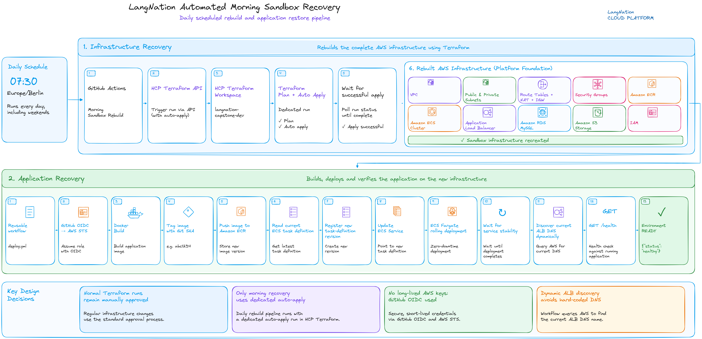
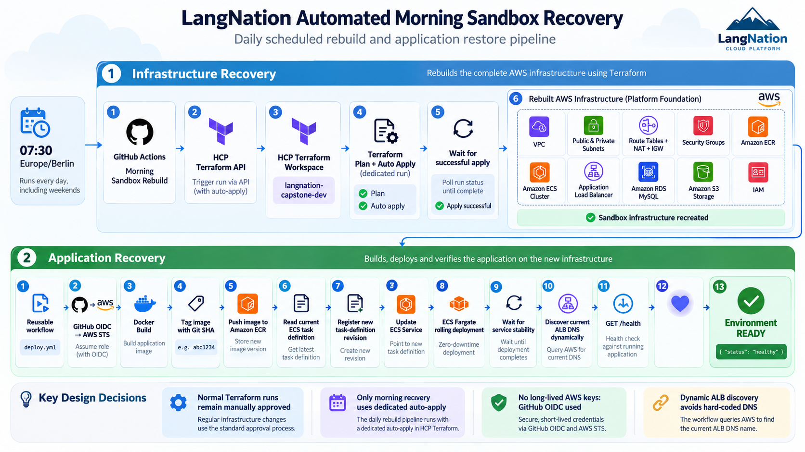

# LangNation Cloud Platform
## OP01 — Automated Morning Sandbox Recovery

**Project:** LangNation Cloud Platform — Secure, Highly Available, Containerized Learning Platform with AI/RAG on AWS
**Course:** AWS Cloud Computing with AI Bootcamp
**Document Type:** Operations Automation
**Scope:** Automated recovery of the disposable development environment
**Environment:** Development (`dev`)
**Primary Schedule:** 07:37 Europe/Berlin
**Fallback Schedule:** 08:17 Europe/Berlin
**Status:** ✅ Implemented and manually validated end to end

---

## 1. Problem

The AWS training sandbox regularly removes the project infrastructure overnight.

That creates two separate recovery problems:

```text
Infrastructure disappears
        +
application artifacts disappear
        +
CloudFront endpoint can change
```

Terraform can recreate AWS resources, but Terraform does not restore the Docker image into a newly recreated ECR repository.

The public DNS record also needs to follow the newly recreated CloudFront distribution.

The goal of OP01 is therefore to recover the complete working environment automatically before the development day starts.

---

## 2. Recovery Design

### My Recovery Design Sketch



### Final Recovery Flow



The complete recovery path is:

```text
07:37 primary schedule
        ↓
GitHub Actions
        ↓
HCP Terraform API
        ↓
Terraform rebuild
        ↓
AWS infrastructure recreated
        ↓
Reusable application deployment workflow
        ↓
Docker image rebuilt
        ↓
Amazon ECR
        ↓
ECS task-definition revision
        ↓
ECS deployment + validation
        ↓
Read recreated CloudFront domain
        ↓
Assume personal-AWS Route 53 OIDC role
        ↓
Update cloud.namienterprises.in
        ↓
Wait for DNS INSYNC
        ↓
Verify public HTTPS /health
```

A second schedule at **08:17 Europe/Berlin** acts as a fallback.

---

## 3. Why Two Scheduled Runs?

Scheduled GitHub workflows are useful but should not be treated like a guaranteed real-time scheduler.

The recovery design therefore uses:

```text
07:37 Europe/Berlin
→ primary recovery run

08:17 Europe/Berlin
→ fallback check
```

The primary run performs the recovery workflow.

The fallback first checks:

```text
https://cloud.namienterprises.in/health
```

If the endpoint is already healthy:

```text
fallback
→ skip duplicate rebuild
```

If it is not healthy:

```text
fallback
→ run the complete recovery
```

This provides a second opportunity for automatic recovery without rebuilding an already healthy environment.

---

## 4. Workflow Entry Points

The workflow supports:

```text
scheduled primary run
scheduled fallback run
manual workflow_dispatch
```

`workflow_dispatch` is important because the complete recovery process can be tested without waiting for the next scheduled morning.

---

## 5. Recovery Ownership

The automation deliberately separates responsibilities.

```text
HCP Terraform
→ infrastructure

GitHub Actions deploy workflow
→ Docker image
→ ECR push
→ ECS application revision

Application Auto Scaling
→ live ECS desired task count

Route 53 synchronization step
→ public DNS destination
```

This avoids one automation system trying to control state owned by another.

---

## 6. HCP Terraform Recovery

The morning workflow calls the HCP Terraform API and creates a dedicated run.

For this recovery run:

```text
auto-apply = true
```

This is intentionally different from normal infrastructure development.

Normal HCP Terraform behavior remains:

```text
global auto-apply = OFF
```

So routine infrastructure changes still require review, while the known morning rebuild path can proceed automatically.

The workflow polls the HCP Terraform run until it reaches a final state.

A successful infrastructure phase means the disposable sandbox resources have been recreated before application deployment begins.

---

## 7. Why the Workflow Is Chained

The recovery is dependency-driven rather than timer-driven.

Correct design:

```text
Terraform starts
    ↓
Terraform finishes successfully
    ↓
application deployment starts
```

A weaker design would use unrelated timers:

```text
Timer A → Terraform
Timer B → application deployment
```

That would introduce a race condition because services such as RDS, ECS, the ALB or CloudFront may take different amounts of time to become ready on different rebuilds.

The chained workflow starts the next stage only after the required previous stage succeeds.

---

## 8. Application Recovery

After Terraform recreates the infrastructure, ECR exists again but is empty.

The reusable deployment workflow restores the application by:

1. checking out the repository;
2. authenticating to AWS through GitHub OIDC;
3. logging in to ECR;
4. building the Docker image;
5. tagging the image with the Git commit SHA;
6. pushing the image to ECR;
7. registering a new ECS task-definition revision;
8. updating the ECS service;
9. waiting independently for ECS stability;
10. verifying the deployed image matches the triggering Git SHA;
11. verifying the service task counts;
12. verifying the application through the protected public edge.

This demonstrates the difference between:

```text
Infrastructure recovery
and
application artifact recovery
```

---

## 9. Deployment Validation

The current deployment workflow does not rely only on one ECS deployment action result.

The final checks include:

```text
aws ecs wait services-stable
        ↓
active task image = current Git SHA
        ↓
desired == running
        ↓
pending == 0
        ↓
public /health succeeds
```

After Milestone 6, the public health check is performed through:

```text
Route 53
→ CloudFront
→ WAF
→ ALB
→ ECS
```

rather than by calling the ALB directly.

---

## 10. Persistent DNS

The public hostname is:

```text
cloud.namienterprises.in
```

The Route 53 hosted zone is intentionally kept in a persistent personal AWS account, while the application infrastructure lives in the disposable training sandbox.

The architecture principle is:

> **Persistent DNS + disposable infrastructure**

When Terraform recreates CloudFront, the CloudFront domain name can change.

The workflow therefore reads the current:

```text
cloudfront_domain_name
```

from HCP Terraform outputs and updates Route 53 automatically.

---

## 11. Cross-Account Route 53 Authentication

GitHub Actions uses a separate OIDC role in the personal AWS account.

The role is limited to the DNS operations required for the hosted zone, including:

```text
route53:ChangeResourceRecordSets
route53:ListResourceRecordSets
route53:GetChange
```

No long-lived personal AWS access key or secret key is stored in GitHub.

The DNS phase performs:

```text
GitHub OIDC
    ↓
personal AWS Route 53 role
    ↓
UPSERT cloud.namienterprises.in
    ↓
wait for INSYNC
```

The CNAME uses a short TTL so the hostname can follow rebuilt CloudFront infrastructure quickly.

---

## 12. End-to-End Recovery Flow

```text
Nightly sandbox cleanup
        ↓
AWS workload resources disappear

07:37 Europe/Berlin
        ↓
Primary GitHub recovery run
        ↓
HCP Terraform rebuild
        ↓
ECR / ECS / ALB / CloudFront / RDS / other resources recreated
        ↓
Application deployment workflow
        ↓
Git-SHA Docker image pushed
        ↓
ECS service becomes stable
        ↓
CloudFront domain read from HCP Terraform outputs
        ↓
Route 53 CNAME updated
        ↓
Route 53 reports INSYNC
        ↓
https://cloud.namienterprises.in/health
        ↓
HTTP 200
```

Fallback:

```text
08:17 Europe/Berlin
        ↓
check public /health
        ↓
healthy?
 ┌──────┴──────┐
 yes           no
 ↓              ↓
skip       full recovery
```

---

## 13. Manual End-to-End Validation

The complete recovery workflow was tested manually with `workflow_dispatch`.

Validated stages:

```text
Check Whether Recovery Is Needed      PASS
Rebuild AWS Infrastructure            PASS
Restore LangNation Application        PASS
Sync Persistent Route 53 DNS          PASS
```

The final public health check also succeeded.

This confirms that the full chain can recover the environment without manually rebuilding resources in the AWS Console.

Additional real scheduled runs can still be recorded as operational evidence, but they are not required to prove that the implemented workflow works end to end.

---

## 14. Security Decisions

### GitHub OIDC instead of static credentials

Both AWS trust paths use temporary credentials:

```text
GitHub
→ training AWS account

GitHub
→ personal AWS account
```

No long-lived AWS deployment credentials are stored in the repository.

### Auto-apply isolated to recovery

The normal HCP Terraform workspace keeps global auto-apply disabled.

Only the known API-created morning recovery run requests automatic apply.

### Least-privilege DNS role

The personal-account role is limited to the Route 53 operations needed for DNS synchronization.

### Public validation through CloudFront

The automation validates the application through the same protected edge path used by real clients.

It does not bypass WAF by health-checking the ALB directly.

---

## 15. Reliability Decisions

The recovery workflow includes several reliability controls:

- primary and fallback schedules
- fallback health check to avoid duplicate work
- chained stages instead of independent timers
- HCP Terraform status polling
- reusable application deployment workflow
- independent ECS stability validation
- exact Git-SHA deployment verification
- desired/running/pending count checks
- Route 53 `INSYNC` wait
- final HTTPS health retries

A workflow is considered successful only when the public application is actually reachable and healthy.

---

## 16. Troubleshooting and Improvements

### Scheduled run did not execute as expected

An earlier single scheduled run was not observed at the expected time.

**Improvement:** use a primary schedule plus a later fallback rather than depending on a single scheduled execution.

### Terraform recreated ECR but not the image

Terraform correctly recreated the registry, but the Docker image was missing.

**Improvement:** automatically invoke the application deployment workflow after infrastructure recovery.

### CloudFront domain changes after rebuild

A static DNS target would become stale after the sandbox recreates CloudFront.

**Improvement:** read the current CloudFront domain from Terraform outputs and synchronize Route 53 automatically.

### Direct ALB health validation no longer worked after security hardening

Milestone 6 restricted ALB ingress to CloudFront origin-facing addresses.

**Improvement:** validate `/health` through `cloud.namienterprises.in`, which exercises the actual protected request path.

### ECS deployment action could report a transient failure

A deployment action once reported failure even though ECS later converged successfully.

**Improvement:** independently wait for service stability and validate the actual deployed image, task counts and public health.

---

## 17. What I Learned

OP01 gave me practical experience with:

- recovery automation
- HCP Terraform API runs
- controlled auto-apply
- GitHub Actions reusable workflows
- dependency-driven orchestration
- OIDC across multiple AWS accounts
- dynamic Terraform output retrieval
- Route 53 automation
- DNS convergence checks
- deployment final-state validation
- designing for ephemeral infrastructure

The biggest lesson was that reproducibility must cover more than Terraform resources.

A complete recovery design also needs to restore:

```text
application artifacts
+
runtime deployment state
+
external DNS dependencies
```

---

## 18. Result

Before OP01:

```text
Morning
  ↓
manually rebuild infrastructure
  ↓
manually restore Docker image
  ↓
manually redeploy application
  ↓
manually repair public DNS
```

After OP01:

```text
07:37 primary
        ↓
automatic infrastructure recovery
        ↓
automatic application recovery
        ↓
automatic CloudFront discovery
        ↓
automatic Route 53 synchronization
        ↓
automatic public HTTPS validation

08:17 fallback
        ↓
health check
        ↓
recover only if needed
```

The disposable training environment can now be recovered as one coordinated operational workflow.

---

## Interview / Presentation Summary

> My AWS training sandbox removes resources overnight, so I automated the complete recovery process. A primary GitHub Actions workflow runs at 07:37 Europe/Berlin, with a fallback at 08:17 that first checks whether the application is already healthy. The workflow calls the HCP Terraform API to rebuild the infrastructure using an isolated auto-apply run, then invokes the reusable deployment workflow to rebuild the Docker image, push the Git-SHA-tagged image to ECR and restore the ECS service. After the edge infrastructure is recreated, the workflow reads the current CloudFront domain from Terraform outputs, assumes a least-privilege cross-account Route 53 role through OIDC, updates `cloud.namienterprises.in`, waits for DNS to become `INSYNC` and finally verifies the public HTTPS `/health` endpoint. Normal Terraform development still keeps global auto-apply disabled, so automatic apply is limited to this recovery workflow.
